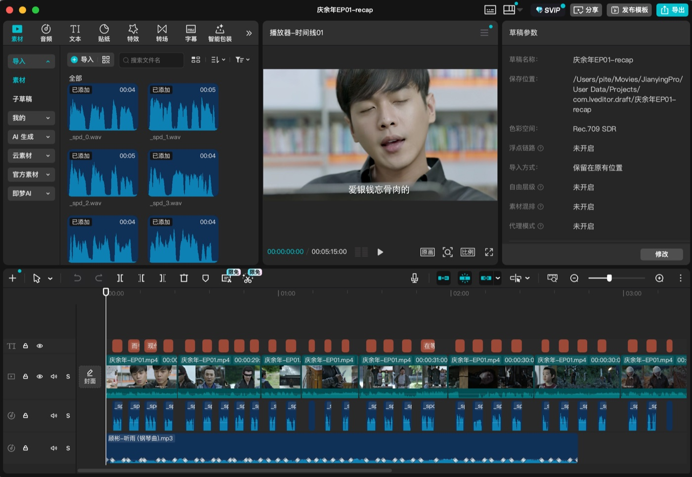
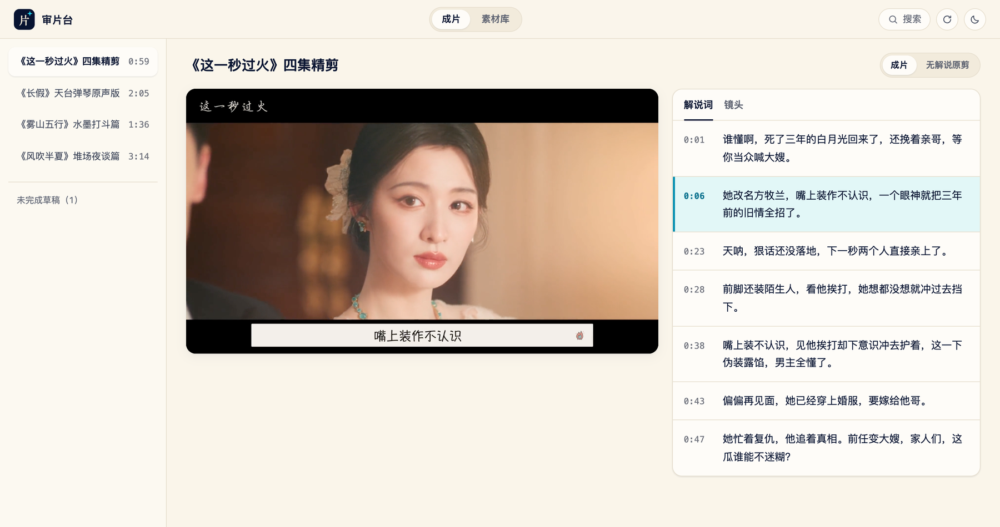
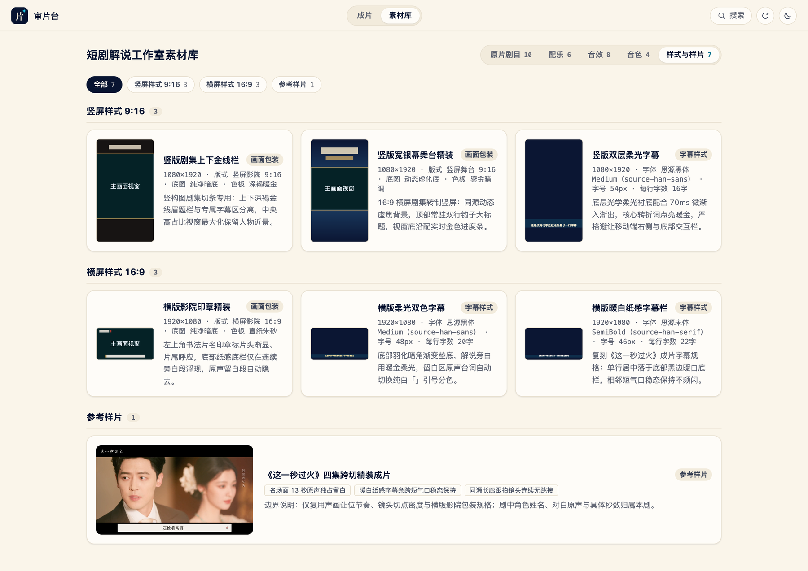

<!-- Last synced with README.md: 2026-11-11 -->
<p align="center">
  
</p>

<h1 align="center">Video Recap Skills</h1>

<p align="center">
  <b>An AI video-editing workflow for drama recap creators, short-drama editors, and video producers: install two self-contained skills into the coding agent you already use to turn one or multiple episodes into a finished Chinese-narration recap, studio visual packaging, and an editable JianYing/CapCut draft.</b>
</p>

<p align="center">
  <a href="https://zenstory.ai/video-recap"><b>Project page</b></a>
  &nbsp;·&nbsp;
  <a href="#install"><b>Install</b></a>
  &nbsp;·&nbsp;
  <a href="#quick-start"><b>Quick start</b></a>
  &nbsp;·&nbsp;
  <a href="#see-what-it-produces"><b>See what it produces</b></a>
  &nbsp;·&nbsp;
  <a href="README.md"><b>中文</b></a>
</p>

<p align="center">
  <a href="https://github.com/zenstory-ai/video-recap-skills/stargazers"></a>
  <a href="https://github.com/zenstory-ai/video-recap-skills/releases/latest"></a>
  
  <a href="https://www.python.org/"></a>
  <a href="https://github.com/zenstory-ai/video-recap-skills/actions/workflows/skill-validate.yml"></a>
  <a href="https://platform.xiaomimimo.com"></a>
  <a href="./LICENSE"></a>
</p>

<p align="center">
  <a href="https://github.com/zenstory-ai/video-recap-skills/issues"></a>
</p>

https://github.com/user-attachments/assets/f3c2df0c-6869-4f5b-8f4c-cce70b58b667

The 59-second landscape recap above, *Guohuo (这一秒过火)*, was selected across four drama episodes, cut, scripted, voiced, mixed, packaged, and refined through viewing revisions. Every structured creative artifact behind it (story plan, sound-picture board, narration script, multi-track timeline, revision ledger, and QC reports) is published in [examples/guohuo-60s/](examples/guohuo-60s/).

## What it is

`video-recap-skills` packages an end-to-end Chinese video recap pipeline into two self-contained skills (`video-recap` for unified production plus `video-reference` for on-demand reference breakdown) inside Claude Code, Codex CLI, OpenCode, or OpenClaw. Give local video paths (`.mp4 / .mov / .mkv / .webm`) and creative direction in plain language, and the agent runs the full chain: **scene & dialogue understanding → editorial POV & sound ownership → sentence-safe cutting → narration scripting with floor gates → TTS voiceover → studio packaging, multi-track mixing, and JianYing draft export**.

- **One API key remotely, zero third-party Python packages locally** — Speech recognition (ASR), visual understanding (VLM), and default voiceover (TTS) all run through [Xiaomi MiMo](https://platform.xiaomimimo.com). Locally you need only Python's standard library and `ffmpeg`—no GPU, no `pip install`, and no model weights. Voiceover can optionally switch to Fish Audio or self-hosted IndexTTS.
- **Editorial POV and sound handoff before scripting** — Before writing narration, the agent locks the viewer promise, point of view, and beat-by-beat state turns in `recap_story_plan.json`, then assigns an audio owner per beat in `visual_audio_board.json`: peak acting stays at `1.0x` in original dialogue, physical conflict belongs to action sound, and narration steps in only for context and subtext.
- **Cut first, narrate second, guarded by five deterministic floor gates** — Cut mode (`cut`) renders a constant-frame-rate shortened master aligned to sentence pauses and hard shot cuts first, then scripts against the real output timeline while blocking `<= 0.20s` flash slivers, mid-sentence cuts, unmotivated dead air, generic appearance labels, and syllable budget overflows.
- **Declarative studio packaging and broadcast-grade audio mixing** — Built-in studio packaging (`packaging_plan.json`) renders `9:16` `4:3` portrait stage / cinema frames and `16:9` warm editorial caption bands, `@2x` supersampled headers, callouts, character name tags, data cards, heavy CJK typography, and automatic `cover.jpg` export; the audio chain applies vocal presence EQ & compression, a `2.2kHz` BGM vocal-pocket dip, transient-aligned SFX, and closed-loop `-1.0 dBTP` true-peak limiting.
- **One-step JianYing draft export, five-domain asset library, and minimal review studio** — Multi-track `timeline.json` exports directly to a self-contained JianYing/CapCut draft bundle; the read-only local review studio (`审片台`) provides finished-film playback alongside a five-domain library (**Source Series / BGM / SFX / Voices / Styles & Samples**).

## Install

### 1. Prerequisites

Requires **Python 3.10+**, **`ffmpeg` / `ffprobe`** on `PATH`, and one [Xiaomi MiMo](https://platform.xiaomimimo.com) API key (pay-as-you-go with no subscription; one full recap measured around CNY 1.3):

```bash
brew install ffmpeg                        # macOS; apt on Debian/Ubuntu, winget / scoop / choco on Windows
export MIMO_API_KEY=your-mimo-key          # Windows PowerShell: $env:MIMO_API_KEY="your-mimo-key"
export MIMO_TOKEN_PLAN_CLUSTER=cn          # tp-* Token Plan keys only: cn | sgp | ams
```

> **macOS burned-in subtitles**: Burning subtitles requires `ffmpeg` compiled with `libass`. Stock Homebrew `ffmpeg` omits `libass`, so default runs gracefully fall back to a sidecar `.srt` and log a note in `final_qc.json`. To burn subtitles directly on macOS, run `brew install ffmpeg-full` and prepend its `bin` directory to `PATH`.

### 2. Add to your coding agent

In **Claude Code**:

```text
/plugin marketplace add zenstory-ai/video-recap-skills
/plugin install video-recap-skills@video-recap
```

Or ask any agent that imports GitHub repositories directly:

```text
Install this plugin: https://github.com/zenstory-ai/video-recap-skills
```

<details>
<summary><strong>Codex CLI · OpenCode · OpenClaw installation</strong></summary>

**Codex CLI**

```bash
codex plugin marketplace add zenstory-ai/video-recap-skills
codex plugin add video-recap-skills@video-recap
```

**OpenCode**: per the [official Agent Skills documentation](https://opencode.ai/docs/skills/), project skills live under `.opencode/skills/<name>/SKILL.md`:

```bash
git clone https://github.com/zenstory-ai/video-recap-skills.git
cd video-recap-skills
mkdir -p .opencode
ln -s ../skills .opencode/skills             # on Windows, copy skills\* into .opencode\skills\
opencode debug skill                         # should list both skills
```

**OpenClaw**: clone the repository and import the plugin bundle:

```bash
openclaw plugins install ./video-recap-skills
openclaw skills list
```

Register the checkout through one discovery path only to avoid duplicate skill triggers.

</details>

<details>
<summary><strong>Optional: switch voiceover to Fish Audio or self-hosted IndexTTS</strong></summary>

ASR and VLM continue to run on MiMo (local reference-audio cloning via `--voice-ref` is supported on the MiMo TTS path only):

```bash
# Option A: Fish Audio (default model s2.1-pro-free, built-in "娱乐扒妹" voice; billed per Fish Audio terms)
export TTS_PROVIDER=fish-audio
export FISH_API_KEY=your-fish-key
export FISH_TTS_REFERENCE_ID=5653cea4ac83480aaf2bf45406556185   # optional custom voice ID

# Option B: Self-hosted IndexTTS (activated when --tts-provider index-tts is passed)
export INDEX_TTS_ENDPOINT=http://127.0.0.1:8000
export INDEX_TTS_VOICE=narrator_default
```

</details>

### 3. Verify your setup

Ask your agent to run a preflight check:

```text
Check the video-recap environment and tell me whether Python, ffmpeg/libass, and MiMo are ready.
```

ClawHub packages and digests are governed by the [explicit publish inventory](.clawhub/publish.json) (`video-recap` and `video-reference` are both self-contained bundles). Release history lives in [CHANGELOG.md](CHANGELOG.md) and [Releases](https://github.com/zenstory-ai/video-recap-skills/releases) (migrated from `worldwonderer/video-recap-skills` to `zenstory-ai/video-recap-skills`).

## Quick start

Copy any prompt below and replace the file paths—you never need to invoke internal Python scripts by hand:

```text
# 1. Single-episode or full-video Chinese recap
Make a Chinese-narration recap of /path/to/video.mp4. It is episode 1 of 庆余年, the lead is 范闲, and subtitles should be burned in.

# 2. Condense multiple episodes into one unified story spine (cut first, narrate against the cut)
Use /path/to/ep1.mp4 and /path/to/ep2.mp4 to make one ten-minute recap with a shared story spine, keeping key original dialogue and character reactions, not two separate summaries.

# 3. 9:16 portrait 4:3 golden-stage studio packaging + JianYing draft export
Cut /path/to/ep1.mp4 into a 90-second vertical short-drama recap using the 4:3 golden-stage packaging with a two-line highlighted header, character name tags, and transition SFX, and export an editable JianYing draft.

# 4. Produce a series episode bound to a shared asset library and adopted templates
Render episode 3 from /path/to/ep3.mp4 using the narrator voice, instrumental BGM, and portrait packaging template bound in /path/to/series/recap_project.json.

# 5. Open the read-only local screening dashboard and five-domain studio library
Open the local dashboard for /path/to/projects so I can review finished videos, script/shot sync and the studio library.
```

If you want to align on the **story spine and beat-level sound handoff** before voicing or rendering:

> Based on `/path/to/video.mp4`, propose the POV and beat-by-beat sound handoff first: which complete original dialogue lines or action pauses stay untouched, where narration enters, and which visual/ASR evidence supports each beat. Wait for my confirmation before calling TTS or rendering.

## Workflow and architecture

```mermaid
flowchart LR
    video(["Source Video"]) --> understand["① Understand<br/>scenes · ASR · VLM"]
    research["Story research · optional"] -.-> understand
    understand --> plan["② Direct & Script<br/>POV · sound handoff · floor lint"]
    understand -. "cut mode · cut first" .-> cut["Sentence-safe Cut<br/>edited_source.mp4"] -.-> plan
    plan --> voiceover["③ Voiceover<br/>MiMo / Fish / IndexTTS"]
    voiceover --> assemble["④ Mix & Studio Package<br/>plates · captions · true-peak lock"]
    assemble --> output(["recap_*.mp4 + JianYing Draft"])
    classDef io fill:#0f172a,stroke:#0f172a,color:#fff;
    classDef stage fill:#eff6ff,stroke:#3b82f6,color:#1e293b;
    classDef opt fill:#f8fafc,stroke:#94a3b8,color:#475569;
    class video,output io;
    class understand,plan,voiceover,assemble stage;
    class research,cut opt;
```



The two self-contained skills communicate strictly through structured files inside `work_dir/`:

| Skill | Role & Scope | Input → Core Deliverables |
|---|---|---|
| [`video-recap`](skills/video-recap/) | **Unified production skill**: scene/ASR/VLM understanding (`understand.py`) · story & audiovisual planning · sentence-safe cutting & sliver review (`cut.py` / `shot_review.py`) · deterministic floor validation (`validate.py`) · TTS synthesis (`voiceover.py`) · multi-track mixing, studio packaging & captions (`assemble.py`) · JianYing export · five-domain library & review studio | `source video` → `recap_<name>.mp4` + `cover.jpg` + `subtitles.srt/.ass` + `timeline.json` + `final_qc.json` |
| [`video-reference`](skills/video-reference/) | **On-demand reference breakdown** (off the daily production path): measures pacing, loudness, and sound-picture handoffs from a finished reference film, stripping source plot facts into reusable craft rules | `reference film + understanding artifacts` → `production_reference.json` |

Field contracts and stage boundaries are documented in the [Data Schema](skills/video-recap/references/data-schema.md) and [Architecture Overview](docs/architecture.md).

## See what it produces

All excerpts below come directly from [examples/guohuo-60s/](examples/guohuo-60s/) (sanitized structured configs, QC ledgers, and overlay code only—no episode audio or video is stored in the repository).

### 1. Lock the viewer promise first, then yield peak moments to original dialogue

Before cutting, the agent writes [`recap_story_plan.json`](examples/guohuo-60s/recap_story_plan.json) to establish the viewer promise and POV, then assigns an `audio_owner` per beat in [`visual_audio_board.json`](examples/guohuo-60s/visual_audio_board.json). In beat `b03` (the washstand confrontation), `original_dialogue` owns all 13 seconds at `1.0x` speed with `narration_job: "none"`:

```json
{
  "beat_id": "b03",
  "source_id": "episode-03",
  "output_start": 9.206666,
  "output_end": 22.446666,
  "picture_job": "performance",
  "audio_owner": "original_dialogue",
  "original_audio_anchor": "我好想你，日日夜夜地想你，想把你抽筋扒皮，挫骨扬灰",
  "narration_job": "none",
  "handoff": "整整13秒完全交给男主原声，不插半个字旁白，让那句又恨又疯的“日日夜夜地想你……挫骨扬灰”自己砸进观众耳朵。",
  "playback_speed": 1.0
}
```

Accordingly, [`narration.json`](examples/guohuo-60s/narration.json) exits cleanly at `10.2s`, leaves the 13-second confrontation entirely to the actor's voice and proofread `「」` captions in [`original_subtitles.json`](examples/guohuo-60s/original_subtitles.json), and re-enters at `23.047s` right on the emotional turn:

```json
[
  {
    "start": 5.773,
    "end": 10.2,
    "narration": "她改名方牧兰，嘴上装作不认识，一个眼神就把三年前的旧情全招了。",
    "overlaps_speech": true
  },
  {
    "start": 23.047,
    "end": 26.5,
    "narration": "天呐，狠话还没落地，下一秒两个人直接亲上了。",
    "overlaps_speech": true
  }
]
```

### 2. Scoped revision ledgers and machine-verified delivery QC

Viewing revisions separate `change_set` from `frozen_set` in [`revision-log.json`](examples/guohuo-60s/revision-log.json) so fixing a join never disturbs approved audio or captions, while [`assembly_qc.json`](examples/guohuo-60s/assembly_qc.json), [`delivery-qc.json`](examples/guohuo-60s/delivery-qc.json), and [`content-qc.md`](examples/guohuo-60s/content-qc.md) verify decode integrity, loudness/true peak, and per-line factual grounding:

[`revision-log.json`](examples/guohuo-60s/revision-log.json) (round 4 unfreezes picture joins only):

```json
{
  "baseline": "final_picture_conform",
  "scope": "picture_conform",
  "change_set": [
    "remove the visible tail-frame pause near 42.08 seconds",
    "restore continuous source movement around 46.24 seconds"
  ],
  "frozen_set": ["story and narration", "all audio", "caption timing and typography", "title and accent graphics"]
}
```

[`delivery-qc.json`](examples/guohuo-60s/delivery-qc.json) (pre-delivery mechanical verification):

```json
{
  "verdict": "PASS",
  "checks": { "full_decode": true, "audio_stream_matches_master": true, "vmaf_mean": 93.844938, "ssim_all": 0.989302 }
}
```

### 3. Keep editing in JianYing / CapCut

Ask the agent to "export a JianYing draft" and `timeline.json` becomes a self-contained multi-track draft folder—source clips, per-segment narration, BGM, SFX, captions, and overlay plates on separate tracks, with media bundled into `Resources/local` so the project opens cleanly across machines:



### 4. Minimal local screening dashboard and five-domain studio library

Strictly read-only on `127.0.0.1` (`GET` and `HEAD` only), the local screening dashboard (`审片台`) focuses on two clean views: switch between finished recaps and pure cuts with click-to-seek narration and shot lists in **Finished Films (`成片`)**, and browse **Source Series, BGM, SFX, Voices, and Styles & Samples** (including portrait/landscape packaging, subtitle styles, and reference sample playback) in **Studio Library (`素材库`)**:





## Advanced capabilities

| Scenario | What to tell your agent | Mechanism & guardrails |
|---|---|---|
| **Reuse cross-episode analysis** | `Analyze /path/to/ep1.mp4 and save reusable artifacts under /path/to/.video-materials` | Stores lightweight JSON/MD and an index only—never duplicates raw video files and needs no database or vector store |
| **Bind series library & studio packaging** | `Bind narrator voice, instrumental BGM, and portrait-stage-4x3@v1 in recap_project.json` | Supports `portrait_stage` / `portrait_cinema` / `landscape_cinema`; blocks vocal BGM in narration mode and writes `resource_lock.json` ([Resource Library](skills/video-recap/references/resource-library.md) · [Packaging Spec](skills/video-recap/references/packaging.md)) |
| **Mask burned-in source subtitle bands** | `Detect the source subtitle band in /path/to/video.mp4 and let me confirm the preview first` | Saves preview frames under `.subtitle_measure/`; supports bottom-aligned hard subtitles on square/near-square pixels (SAR within `2%`) |
| **Authorized reference-voice cloning** | `Use /path/to/voice-ref.wav for /path/to/video.mp4; I have the voice owner's authorization` | Supported on the MiMo TTS path; reference audio is uploaded for synthesis—always obtain explicit consent first |
| **Pure original-audio highlight cut** | `Cut /path/to/ep1.mp4 and ep2.mp4 into an original-dialogue highlight reel with no voiceover` | Routes through `source-mix`, preserving clean dialogue, optional instrumental BGM, and smooth tail fade-out |

## FAQ

### My source video has no narration—or no dialogue at all. Can it still get a recap?

Yes. Scene understanding reads visual frames directly via VLM. When a file has no speech or even no audio stream (such as silent B-roll or documentary footage), ASR degrades cleanly to an empty transcript, or you can ask the agent to pass `--skip-asr` and script purely from visual evidence (see [issue #79](https://github.com/zenstory-ai/video-recap-skills/issues/79)).

### A long video hit a 429 rate limit or stopped halfway. Do I start over?

No. VLM scene analysis checkpoints completed scenes to disk and automatically retries rate limits at lower concurrency. Repeating the original command reuses completed scene caches—and the same applies when resuming after writing `clip_plan.json` or `narration.json`, verified against the source fingerprint and run parameters.

### Why does the VLM refer to characters as "a man in black" instead of their names?

Whenever the drama or film title is known, have the agent follow the [Research Guide](skills/video-recap/references/research-guide.md) to write main character names and relationships into `work_dir/background_research.json` before understanding. Both VLM prompts and scripting briefs incorporate those names directly, and the `generic_character_label` floor check rejects drafts that fall back to generic appearance labels.

## Documentation

| Category | Links |
|---|---|
| **Editorial & Craft Guides** | [Video-to-narration workflow](https://zenstory.ai/video-recap/video-to-narration) · [Original sound & narration handoff](https://zenstory.ai/video-recap/original-audio-and-narration) · [Recap script writing guide (ZH)](docs/video-recap-script-writing.md) · [Grounding analysis without invented plot (ZH)](docs/ai-video-analysis-without-invented-plot.md) · [Creative editing & anti-cliché playbook (ZH)](skills/video-recap/references/creative-editing-playbook.md) |
| **JianYing Export & Comparisons** | [JianYing / CapCut draft guide](https://zenstory.ai/video-recap/capcut-draft) · [Draft export contents & cost breakdown (ZH)](docs/capcut-jianying-draft-export.md) · [Multi-track timeline & JianYing protocol (ZH)](docs/timeline-and-jianying.md) · [Open-source AI video recap comparison (ZH)](docs/open-source-ai-video-recap-tools.md) |
| **Architecture, Packaging & Config** | [Architecture overview (ZH)](docs/architecture.md) · [Production boundaries & acceptance (ZH)](docs/production-boundaries.md) · [Data schema (ZH)](skills/video-recap/references/data-schema.md) · [Studio packaging spec (ZH)](skills/video-recap/references/packaging.md) · [Resource library spec (ZH)](skills/video-recap/references/resource-library.md) · [Full config playbook (ZH)](skills/video-recap/references/config-playbook.md) |
| **Public Case Study** | [*Guohuo* artifact directory](examples/guohuo-60s/) · [Case reproduction runbook (ZH)](examples/guohuo-60s/skill-runbook.md) · [Four-round iteration notes (ZH)](examples/guohuo-60s/iteration-notes.md) |

## Acknowledgements

- [LINUX DO - The New Ideal Community](https://linux.do) — community discussion and feedback
- JianYing draft protocol references [pyJianYingDraft](https://github.com/GuanYixuan/pyJianYingDraft), [capcut-mate](https://github.com/Hommy-master/capcut-mate), and [duo-video](https://github.com/duoec/duo-video)
- Source subtitle-band detection adapted from [ops120/video-recap-skills-plus](https://github.com/ops120/video-recap-skills-plus)

## License

MIT License — see [LICENSE](LICENSE).

## Part of ZenStory AI

Maintained by [ZenStory AI](https://zenstory.ai) — open-source, agent-native tools for creating, adapting, and producing stories (GitHub org: [zenstory-ai](https://github.com/zenstory-ai)):

| Project | What it does |
| --- | --- |
| [oh-story-claudecode](https://github.com/zenstory-ai/oh-story-claudecode) | Web-fiction writing skill pack: chart scanning, deconstruction, drafting, de-AI-flavor polish, and cover design |
| [drama-skills](https://github.com/zenstory-ai/drama-skills) | AI short-drama / motion-comic suite: scripts, character assets, storyboards, image/video prompts, and independent review |
| [novel-to-game](https://github.com/zenstory-ai/novel-to-game) | Agent skills for source-grounded novel adaptation, runtime builds, and interactive QA |
| [video-recap-skills](https://github.com/zenstory-ai/video-recap-skills) | Turn long videos or multi-episode series into packaged Chinese-narration recaps with editable JianYing/CapCut drafts (this repo) |
| [oh-story-dsh](https://github.com/zenstory-ai/oh-story-dsh) | Community DeepSeek Harness plugin integrating novel, short-drama, game, and video-recap workbenches |
| [zenstory](https://github.com/zenstory-ai/zenstory) | Chat-to-create AI novel-writing workbench ([app.zenstory.ai](https://app.zenstory.ai)) |
