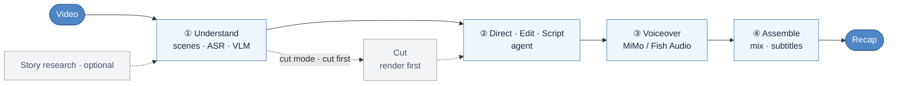

<p align="center">
  
</p>

<h1 align="center">Video Recap Skills</h1>

<p align="center">
  <b>Turn one or several videos into a Chinese-narration recap: two self-contained skills (one unified production skill plus one on-demand reference skill) inside the coding agent you already use, ffmpeg locally, one Xiaomi MiMo key remotely, and an optional JianYing/CapCut draft to keep editing by hand.</b>
</p>

<p align="center">
  <a href="https://zenstory.ai/video-recap"><b>Project page</b></a>
  &nbsp;·&nbsp;
  <a href="#install"><b>Install</b></a>
  &nbsp;·&nbsp;
  <a href="#see-what-it-produces"><b>See what it produces</b></a>
  &nbsp;·&nbsp;
  <a href="README.md"><b>中文</b></a>
</p>

<p align="center">
  <a href="https://github.com/zenstory-ai/video-recap-skills/stargazers"></a>
  <a href="https://github.com/zenstory-ai/video-recap-skills/releases/latest"></a>
  
  <a href="https://www.python.org/"></a>
  <a href="https://github.com/zenstory-ai/video-recap-skills/actions/workflows/skill-validate.yml"></a>
  <a href="https://platform.xiaomimimo.com"></a>
  <a href="./LICENSE"></a>
</p>

<p align="center">
  <a href="https://github.com/zenstory-ai/video-recap-skills/issues"></a>
</p>

<video src="https://github.com/user-attachments/assets/f3c2df0c-6869-4f5b-8f4c-cce70b58b667" controls muted playsinline width="100%"></video>

The 59-second landscape recap above, *Guohuo (这一秒过火)*, is the final delivery after selecting from four episodes of a short drama, cutting, scripting, voicing, mixing, packaging, and several rounds of viewing feedback. Every creative artifact behind it (story plan, sound ownership, narration, timeline, QC reports, revision log, Remotion overlay source) lives in [examples/guohuo-60s/](examples/guohuo-60s/), and every excerpt below is copied from those files.

## What it is

Two self-contained skills (`video-recap` for production plus `video-reference` on demand) install into Claude Code, Codex CLI, OpenCode, or OpenClaw. You give the video paths and the recap you want in plain language; the agent understands picture and dialogue, decides the story and audiovisual plan, cuts, writes, voices, mixes, and subtitles in one unified workflow. Supported inputs: `.mp4 / .mov / .mkv / .webm`.

- **One key, ffmpeg locally.** ASR, VLM, and TTS all go through [Xiaomi MiMo](https://platform.xiaomimimo.com); the local runtime is Python's standard library plus `ffmpeg`, with no GPU, no `pip install`, and no model downloads. Voiceover can switch to Fish Audio, which replaces only that stage.
- **The editorial decision comes before the sound allocation.** For a new concept, the agent compares viable edit directions; for a directed task or viewing feedback, it follows the current decisions. It records the viewer promise, POV, dramatic question, and change-based beats in `recap_story_plan.json`, then assigns each beat a picture job and an audio owner: narration is voiced as a block only when it has a defined job, and strong dialogue, action sound, or silence may own an entire beat.
- **Cut first, narrate second, so the timeline is aligned by construction.** Cut mode renders the shortened video first and writes narration against that output timeline; feed several videos at once and pick ranges by `source_id` to cut one story spine; analysis can be saved to a filesystem material library and reused when the source and settings match.
- **Keep editing after the render.** The multi-track `timeline.json` exports to a JianYing draft with editable source clips, narration, BGM, subtitles, and image overlays; drop in an accurate subtitle file and it becomes the preferred source for original-dialogue captions.
- **Every step leaves a record you can check.** Narration lint, assembly QC, and final QC produce machine-readable reports. Viewing revisions can separately record changes, frozen items, and verification.

## Install

### ClawHub

ClawHub entries and dependencies are governed by the [explicit publish inventory](.clawhub/publish.json) (`video-recap` and `video-reference` are both self-contained packages). For the complete plugin or source workflow, install as shown below.


Prerequisites: Python 3.10 or newer, `ffmpeg` on `PATH`, and one [Xiaomi MiMo](https://platform.xiaomimimo.com) API key. Subtitles are burned in by default, which needs an ffmpeg with libass. Homebrew's stock `ffmpeg` has no libass: the default run then skips the burn, ships a same-name `.srt` sidecar next to the recap, and records a warning in `final_qc.json` (an explicit `--burn-subtitles` stops before the run starts instead). To burn subtitles on macOS, use `brew install ffmpeg-full` (keg-only: put its `bin` first on `PATH`).

```bash
brew install ffmpeg                        # macOS; apt on Debian/Ubuntu, choco / scoop / winget on Windows
export MIMO_API_KEY=your-mimo-key          # Windows PowerShell: $env:MIMO_API_KEY="your-mimo-key"
export MIMO_TOKEN_PLAN_CLUSTER=cn          # tp-* Token Plan keys only: cn | sgp | ams
```

MiMo needs no subscription; `sk-*` keys bill pay-as-you-go. One complete video measured for this project cost about CNY 1.3, varying with length and request volume.

Inside Claude Code:

```text
/plugin marketplace add zenstory-ai/video-recap-skills
/plugin install video-recap-skills@video-recap
```

Or just ask (any agent that can import a GitHub repository):

```text
Install this plugin: https://github.com/zenstory-ai/video-recap-skills
```

<details>
<summary><strong>Codex CLI, OpenCode, OpenClaw</strong></summary>

**Codex CLI**

```bash
codex plugin marketplace add zenstory-ai/video-recap-skills
codex plugin add video-recap-skills@video-recap
```

**OpenCode**: the [official Agent Skills documentation](https://opencode.ai/docs/skills/) puts project skills under `.opencode/skills/<name>/SKILL.md`. Clone the repository and start OpenCode from that directory:

```bash
git clone https://github.com/zenstory-ai/video-recap-skills.git
cd video-recap-skills
mkdir -p .opencode
ln -s ../skills .opencode/skills             # on Windows, copy skills\* into .opencode\skills\
opencode debug skill                         # should list both skills
```

**OpenClaw**: after cloning, import the Claude plugin bundle:

```bash
openclaw plugins install ./video-recap-skills
openclaw skills list
```

Register the checkout through one discovery path only; duplicates cause name collisions or repeated triggers.

</details>

<details>
<summary><strong>Optional: voice with Fish Audio</strong></summary>

```bash
export TTS_PROVIDER=fish-audio
export FISH_API_KEY=your-fish-key
export FISH_TTS_REFERENCE_ID=your-voice-model-id  # optional; the built-in "娱乐扒妹" narration voice is the default
```

The default model is `s2.1-pro-free` with the built-in "娱乐扒妹" voice (reference ID `5653cea4ac83480aaf2bf45406556185`); billing follows Fish Audio's own terms. ASR and VLM still use MiMo, and local reference-voice cloning (`--voice-ref`) is available on the MiMo path only.

</details>

Once installed, ask the agent to check the environment:

```text
Check the video-recap environment and tell me whether Python, ffmpeg/libass, and MiMo are ready.
```

> Changes are in [CHANGELOG.md](CHANGELOG.md) and [Releases](https://github.com/zenstory-ai/video-recap-skills/releases). The repository moved from `worldwonderer/video-recap-skills` to `zenstory-ai/video-recap-skills`; if you installed from the old address, point at the new one.

## See what it produces

Every excerpt below is copied from a file in [examples/guohuo-60s/](examples/guohuo-60s/); cuts are marked with "…". The inputs were episodes 2, 3, 6, and 21 of *Guohuo*; the repository holds the structured artifacts only, never the episode audio or video. The files are in Chinese and are quoted as-is, with a translation after each.

### The story plan states the viewer promise first, then what changes in each beat

Before a single cut, the agent writes [`recap_story_plan.json`](examples/guohuo-60s/recap_story_plan.json). The director's intent answers four questions: what is promised, whose point of view, what question the audience watches with, and what is withheld until the end:

```json
"director_intent": {
  "viewer_promise": "60秒看懂死而复生的白月光为什么挽着亲哥逼男主当众叫大嫂，又在洗手台狠话强吻、替他挡击和婚服送嫁三场戏里彻底露馅。",
  "pov": "全程紧贴二少慕容清峄的眼睛：从家宴认出她的荒唐震怒，到洗手台狠话逼问，再到她飞身替自己挡下重击时彻底确认她的真心。",
  "dramatic_question": "她嘴上死不认账、非要嫁给大哥，为什么眼神闪躲、被强吻不推开、见他挨打还本能冲上去替他挡下重击？",
  "emotional_start": "前任挽着亲哥现身的抓马暴击",
  "emotional_end": "明明彼此死死挂念却要亲手送嫁的虐心拉扯",
  "ending_aftertaste": "两人都知道对方还爱着自己，她却依然穿戴皇冠婚服走向大哥的婚礼",
  "withhold_reveal": "前8秒先把“死去白月光变成准大嫂”的错位身份砸出来；中段用洗手台强吻和替身挡伤一点点扒下她的冷漠伪装；最后才亮出皇冠婚服把悬念拉满。"
},
```

Translated: the promise is "in 60 seconds, understand why the lover who came back from the dead takes his brother's arm and forces him to call her sister-in-law in public, then gives herself away across the washstand kiss, shielding him from a strike, and the wedding-dress send-off"; the POV stays with second brother Murong Qingyi; the dramatic question is "if she refuses to admit who she is and insists on marrying his brother, why do her eyes, the kiss, and throwing herself in front of him all betray her?"; the reveal order puts the sister-in-law shock in the first 8 seconds, strips her cold mask in the middle, and reveals the crown bridal gown last.

Each beat records not a scene summary but what changes, which question the audience carries in and out, the exact moment that must be kept, and where the evidence comes from (1 of 10 beats):

```json
{
  "beat_id": "b03",
  "source_id": "episode-03",
  "source_start": 1292.0,
  "source_end": 1305.5,
  "function": "escalation",
  "event": "慕容清峄把她堵在洗手台前，红着眼逼问并咬牙切齿放狠话",
  "change": "家宴上的隐忍试探 → 洗手台前撕破脸皮贴脸逼问",
  "audience_question_in": "男主私下能忍住不找她算账吗？",
  "audience_question_out": "嘴上喊着抽筋扒皮挫骨扬灰，字字句句全是想念",
  "character_focus": "慕容清峄",
  "must_keep_moment": "完整原声“我好想你，日日夜夜地想你，想把你抽筋扒皮，挫骨扬灰”",
  "evidence": ["asr", "vlm", "hard_subtitle"]
},
```

Translated: the event is "he corners her at the washstand, red-eyed, demanding answers and spitting threats"; the change is "restrained probing at the banquet → tearing off the mask face-to-face"; the audience goes in asking "can he hold back in private?" and comes out with "every threat of skinning her alive and grinding her bones to dust is pure longing"; the moment that must be kept is the complete original line, evidenced by ASR, VLM, and the burned-in subtitle.

In [`clip_plan.json`](examples/guohuo-60s/clip_plan.json) this beat becomes one range with a 7-part reason; cut mode renders the cut from it first and writes narration afterwards.

### Narration yields to original dialogue, and the owner of each beat is written down

[`visual_audio_board.json`](examples/guohuo-60s/visual_audio_board.json) assigns an `audio_owner` to every beat. The beat above is owned by the original dialogue, its narration job is `none`, and its playback speed is locked at 1.0 (1 of 10 beats):

```json
{
  "beat_id": "b03",
  "source_id": "episode-03",
  "source_start": 1292.0,
  "source_end": 1305.24,
  "output_start": 9.206666,
  "output_end": 22.446666,
  "picture_job": "performance",
  "preferred_moment": "完整原声“我好想你，日日夜夜地想你，想把你抽筋扒皮，挫骨扬灰”",
  "entry_reason": "慕容清峄把她困在洗手台前、欺身逼近时切入",
  "exit_reason": "“挫骨扬灰”尾音与眼底红血丝完整落地后切出",
  "audio_owner": "original_dialogue",
  "original_audio_anchor": "我好想你，日日夜夜地想你，想把你抽筋扒皮，挫骨扬灰",
  "narration_job": "none",
  "handoff": "整整13秒完全交给男主原声，不插半个字旁白，让那句又恨又疯的“日日夜夜地想你……挫骨扬灰”自己砸进观众耳朵。",
  "playback_speed": 1.0
},
```

Translated: enter as he traps her at the washstand and leans in; exit once the final syllable and red-rimmed eyes land; handoff gives all 13 seconds to the actor's original voice without a single word of narration.

So [`narration.json`](examples/guohuo-60s/narration.json) has only 7 narration blocks in the whole piece. The second stops at 10.2 s and the third does not enter until 23.047 s; the 13 seconds between belong entirely to that line:

```json
{
  "start": 5.773,
  "end": 10.2,
  "narration": "她改名方牧兰，嘴上装作不认识，一个眼神就把三年前的旧情全招了。",
  "pause_after_ms": 80,
  "overlaps_speech": true,
  "emotion": "调侃"
},
{
  "start": 23.047,
  "end": 26.5,
  "narration": "天呐，狠话还没落地，下一秒两个人直接亲上了。",
  "pause_after_ms": 50,
  "overlaps_speech": true,
  "emotion": "吃瓜、上头"
},
```

Translated: "She renamed herself Fang Mulan and pretends not to know him, but one look confesses the whole affair from three years ago." / "Oh no, the threat hasn't even landed and the next second they're kissing."

The three protected lines, proofread by the agent, go into [`original_subtitles.json`](examples/guohuo-60s/original_subtitles.json) and are burned as 「」 captions in the gaps:

```json
[
  { "start": 4.133, "end": 5.053, "text": "大嫂。" },
  { "start": 11.127, "end": 21.027, "text": "我好想你，日日夜夜地想你，想把你抽筋扒皮，挫骨扬灰。" },
  { "start": 35.673, "end": 37.473, "text": "有我在，你别怕。" }
]
```

Translated: "Sister-in-law." / "I missed you so much, day and night, I wanted to skin you alive and grind your bones to dust." / "I'm here. Don't be afraid."

At assembly, the original-audio track in [`timeline.json`](examples/guohuo-60s/timeline.json) is ducked under each narration block and restored after it; this timeline is what the JianYing export reads.

### After viewing: what changed, what was frozen, and how it was verified

The case went through four revision rounds, each written into [`revision-log.json`](examples/guohuo-60s/revision-log.json) as three lists: what to change, what stays frozen, how to verify. The last round unfreezes picture only:

```json
{
  "baseline": "final_picture_conform",
  "scope": "picture_conform",
  "change_set": [
    "remove the visible tail-frame pause near 42.08 seconds",
    "restore continuous source movement around 46.24 seconds"
  ],
  "frozen_set": [
    "story and narration",
    "all audio",
    "caption timing and typography",
    "title and accent graphics"
  ],
  "verification": [
    "normal-speed full watch",
    "join playback around both change points",
    "freeze detection as supporting evidence",
    "audio stream-copy verification",
    "full decode"
  ]
}
```

[`edit-map.json`](examples/guohuo-60s/edit-map.json) records how the jump near 46 s was repaired: not with a dissolve or a flash frame, but by restoring the 2001–2004 s stretch of the same continuous movement that had been cut out:

```json
{
  "name": "wedding_corridor_continuous_motion",
  "beat_ids": ["b07", "b08"],
  "output_frames": [1052, 1288],
  "output_seconds": [42.08, 51.52],
  "asset_id": "episode-21",
  "source_seconds": [1996.0, 2010.32],
  "speed": 1.516949153,
  "repair": "Restored the omitted 2001-2004 source interval instead of hiding the jump with a transition."
},
```

The mechanical pre-delivery checks are in [`assembly_qc.json`](examples/guohuo-60s/assembly_qc.json) (loudness, per-segment narration integrity, `verdict` / `blocking_codes`) and [`delivery-qc.json`](examples/guohuo-60s/delivery-qc.json):

```json
"checks": {
  "full_decode": true,
  "audio_stream_matches_master": true,
  "vmaf_mean": 93.844938,
  "ssim_all": 0.989302,
  "psnr_average_db": 45.415972
}
```

And [`content-qc.md`](examples/guohuo-60s/content-qc.md) checks every narration claim against the footage and public sources, and states the interpretive boundary of each colloquial line (1 of 10 rows):

```markdown
| “嘴上装不认识，见他挨打却下意识冲去护着，这一下伪装露馅，男主全懂了” | 替身挡击与递蜜饯说“有我在，你别怕”两段戏首尾相接，男主眼眶泛红怔住 | [爱奇艺官方角色片花](https://www.iqiyi.com/v_r8e40v8g54.html)印证两人重逢后表面针锋相对、实则彼此挂念 | **解读立得住**。“全懂了”指男主彻底看穿她心里仍在乎自己，并非指此时才第一次认出她的脸 |
```

Translated: claim "she pretends not to know him, yet instinctively rushes to shield him when he's struck — the disguise slips and the hero understands everything"; footage evidence: the shielding action and handing over candied fruit while saying "I'm here, don't be afraid" sit back to back, leaving the hero stunned with reddening eyes; web evidence: iQIYI's official character trailer confirms their surface hostility and mutual care after the reunion; verdict: **the interpretation holds**: "understands everything" means he sees right through her pretence and knows she still cares, not that this is the first moment he recognises her face.

### Keep editing in JianYing

Add "export a JianYing draft" to the request and `timeline.json` is written as an editable multi-track draft: source clips, per-segment narration, BGM, subtitles, and image overlays each on their own track, with media bundled under `Resources/local` so the draft still opens on another machine. The `recap_<name>.mp4` that `ffmpeg` renders is the final piece; the draft is for you to keep working on.


Export contents and limits: [JianYing draft export and cost](docs/capcut-jianying-draft-export.md) (Chinese).

## Your first request

Copy one and adjust it. Give the video path, the recap you want, and any useful story context; you never run the repository's Python scripts by hand.

**Full-video recap:**

```text
Make a Chinese-narration recap of /path/to/video.mp4. It is episode 1 of 庆余年, the lead is 范闲, and subtitles should be burned in.
```

**Cut a long video or several episodes into one short recap:**

```text
Use /path/to/ep1.mp4 and /path/to/ep2.mp4 to make one ten-minute recap with a shared story spine, keeping key original dialogue and character reactions, not two separate summaries.
```

**Text-only handoff first, no voiceover and no render** (replace the 〈placeholders〉):

> I have permission to use 〈local video〉 and am supplying checked picture and dialogue records for it. Propose only the sound handoff for this material: which full dialogue line, action sound or pause to preserve, where narration is needed, and which record supports each choice. List missing evidence rather than inventing motives or unseen events. Return beat notes and necessary narration drafts without calling TTS or rendering.

For a complete production request, the agent handles understanding, story and audiovisual planning, cutting, scripting, voiceover, and assembly. A text-only handoff stops at the requested scope. In cut mode it first chooses the footage, renders the shortened video, and only then writes narration on the output timeline; the internal pauses and resumes are the agent's job too.

## Workflow and the two skills



The two self-contained skills (`video-recap` for production plus `video-reference` on demand) hand off through the JSON / MP4 artifacts in `work_dir`:

| Skill | Responsibility | In → Out |
|---|---|---|
| [`video-recap`](skills/video-recap/) | Unified production skill: scene/ASR/VLM understanding (`understand.py`), story/audiovisual direction, sentence-safe cutting (`cut.py`), baseline floor validation (`validate.py`), TTS voiceover (`voiceover.py`), multi-track mixing & subtitle burn (`assemble.py`), optional JianYing export, local dashboard & resource library | `video` → `recap_<name>.mp4 + subtitles.srt/.ass + timeline.json` |
| [`video-reference`](skills/video-reference/) | On demand, off the production path: break a finished video down into a reusable production reference (structure, pacing, shots, narration/subtitles, sound-picture handoff); source facts stay local, the export holds only methods and numbers | `finished video + understanding artifacts` → `production_reference.json` |

The recap is always written to `recap_<name>.mp4` alongside `subtitles.srt/.ass`; all intermediate artifacts live in `work_dir/`, with the field contracts in the [data schema](skills/video-recap/references/data-schema.md).

## Advanced requests

**Reuse previously analysed material:**

```text
Analyze /path/to/ep1.mp4 and save reusable understanding artifacts under /path/to/.video-materials. Prefer that material library in later projects.
```

The library holds JSON, Markdown, and an index only; it copies no media, builds no database, and uses no embeddings. The agent simply `grep`s the filesystem.

**Export a JianYing draft:**

```text
Make a recap of /path/to/video.mp4 and export an editable JianYing draft.
```

**Align recap subtitles with the source's burned-in subtitle band:**

```text
Detect the source subtitle band in /path/to/video.mp4 and let me confirm the preview before rendering recap subtitles in the same region.
```

The preview is stored under `.subtitle_measure/`; it currently requires square or near-square pixels (SAR within 2% of 1:1) and bottom-aligned source subtitles.

**Voice with an authorised reference voice:**

```text
Use the voice from /path/to/voice-ref.wav for the recap of /path/to/video.mp4. I have the voice owner's authorization.
```

The reference audio is sent to MiMo for synthesis; use it only with the voice owner's authorisation.

**Reuse subtitle style, voice, BGM and frame across a series:**

```text
Use /path/to/library as the resource library: register this BGM, this font and this frame image, draft a subtitle-style
template for 1080x1920 for me to adopt, then render this series with /path/to/series/recap_project.json binding them.
```

Resources, templates and sample films are JSON records in your own directory; licence and "adopted" status are only ever set by you. A binding that conflicts with an explicit setting, or a template whose canvas differs from the output, stops the run before voicing. Each run writes `work_dir/resource_lock.json`, listing what it actually used and whether the licences are clear. Format: [resource library, templates and samples](skills/video-recap/references/resource-library.md).

**Browse projects, runs and the library in a local page (read-only):**

```text
Open the local dashboard for /path/to/projects so I can see run progress, finished videos and the library.
```

The dashboard is read-only and listens on loopback only; wherever something needs doing it gives you one sentence to paste back into the conversation.


**Proofread original-dialogue captions (`「」`):** put verified output-timeline lines into `work_dir/original_subtitles.json` (`[{"start": s, "end": s, "text": "line"}]`) so clean original-audio moments carry accurate `「」` captions without coarse ASR guesswork.

## FAQ

### My video has no narration, or even no dialogue. Can it still get a new narration track?

Yes. Understanding relies on the VLM reading the picture and does not require existing narration; when there is no dialogue either, have the agent skip ASR (`--skip-asr`) and narrate from the picture. This was asked in [issue #79](https://github.com/zenstory-ai/video-recap-skills/issues/79).

### A long video hit a 429 or was interrupted halfway. Do I start over?

VLM analysis saves completed scenes and retries suspected rate limits once with lower concurrency. Persistent failures remain visible. After addressing the cause, repeat the same command to reuse matching scene caches and continue. Use the original command after writing `narration.json` too. In cut mode, `recap_phase.json` binds narration to its clip plan; a changed plan requires checking or rewriting the narration. Resuming requires the same source video and parameters.

### The VLM can't tell who is who and the narration is all "a man in black"?

When the title or plot is known, have the agent research first and write `background_research.json`; character names and relationships are folded into the VLM context. See the [research guide](skills/video-recap/references/research-guide.md) (Chinese).

## Further reading

- [Video-to-narration workflow](https://zenstory.ai/video-recap/video-to-narration) — establish picture, dialogue, and supplied background before treating a claim as a source-video fact
- [Original sound and narration](https://zenstory.ai/video-recap/original-audio-and-narration) — assign each beat's sound task first, then write the narration
- [JianYing / CapCut draft export](https://zenstory.ai/video-recap/capcut-draft) — export independently from a real `timeline.json`
- [JianYing draft export and cost](docs/capcut-jianying-draft-export.md) — in-repo document (Chinese): what is in the draft, and how self-hosting bills differ from SaaS
- [Production boundaries and acceptance](docs/production-boundaries.md) — in-repo document (Chinese): which delivery rules belong in the shared library and which belong to a single project; the three kinds of acceptance cannot stand in for one another
- [Guohuo case runbook](examples/guohuo-60s/skill-runbook.md) · [decision chain from content lock to final](examples/guohuo-60s/iteration-notes.md) (both in Chinese)
- Per-skill contracts in each `skills/<skill>/SKILL.md`; [data schema](skills/video-recap/references/data-schema.md) · [config playbook](skills/video-recap/references/config-playbook.md) · [multi-track timeline / JianYing export](docs/timeline-and-jianying.md) · [creative editing playbook](skills/video-recap/references/creative-editing-playbook.md)

## Acknowledgements

- [LINUX DO - The New Ideal Community](https://linux.do) — community support
- The JianYing draft protocol references [pyJianYingDraft](https://github.com/GuanYixuan/pyJianYingDraft), [capcut-mate](https://github.com/Hommy-master/capcut-mate), and [duo-video](https://github.com/duoec/duo-video)
- Subtitle-band detection adapted from [ops120/video-recap-skills-plus](https://github.com/ops120/video-recap-skills-plus)

## License

MIT, see [LICENSE](LICENSE).

## Part of ZenStory AI

This project is maintained by [ZenStory AI](https://zenstory.ai) — open-source, agent-native tools for creating, adapting and producing stories (GitHub org: [zenstory-ai](https://github.com/zenstory-ai)). Sibling projects:

| Project | What it does |
| --- | --- |
| [oh-story-claudecode](https://github.com/zenstory-ai/oh-story-claudecode) | Web-fiction writing skill pack: chart scanning, deconstruction, drafting, de-AI-flavor, covers |
| [drama-skills](https://github.com/zenstory-ai/drama-skills) | AI short-drama / motion-comic suite: scripts, assets, storyboards, image & video prompts, review |
| [novel-to-game](https://github.com/zenstory-ai/novel-to-game) | Agent skills for source-grounded novel adaptation, target-runtime builds, and evidence-based QA |
| [video-recap-skills](https://github.com/zenstory-ai/video-recap-skills) | Create Chinese-narration recaps from supported video files, with optional editable JianYing/CapCut draft export (this repo) |
| [oh-story-dsh](https://github.com/zenstory-ai/oh-story-dsh) | Community DeepSeek Harness plugin with novel, short-drama, game and video-recap workbenches |
| [zenstory](https://github.com/zenstory-ai/zenstory) | Chat-to-create AI novel-writing workbench ([app.zenstory.ai](https://app.zenstory.ai)) |
