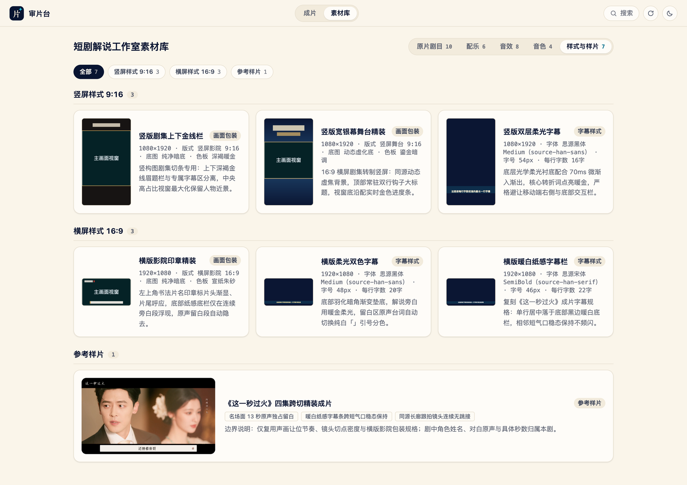

<p align="center">
  
</p>

<h1 align="center">Video Recap Skills</h1>

<p align="center">
  <b>给影视解说、短剧二创与视频编导用的 AI 剪辑技能：装进你常用的编程 Agent，把一段或多集长视频剪成带画框和字幕的中文解说成片，并导出可继续精修的剪映草稿。</b>
</p>

<p align="center">
  <a href="https://zenstory.ai/zh/video-recap"><b>项目主页</b></a>
  &nbsp;·&nbsp;
  <a href="#安装"><b>安装</b></a>
  &nbsp;·&nbsp;
  <a href="#快速开始"><b>快速开始</b></a>
  &nbsp;·&nbsp;
  <a href="#看看它的输出"><b>看看它的输出</b></a>
  &nbsp;·&nbsp;
  <a href="README_EN.md"><b>English</b></a>
</p>

<p align="center">
  <a href="https://github.com/zenstory-ai/video-recap-skills/stargazers"></a>
  <a href="https://github.com/zenstory-ai/video-recap-skills/releases/latest"></a>
  
  <a href="https://www.python.org/"></a>
  <a href="https://github.com/zenstory-ai/video-recap-skills/actions/workflows/skill-validate.yml"></a>
  <a href="https://platform.xiaomimimo.com"></a>
  <a href="./LICENSE"></a>
</p>

<p align="center">
  <a href="https://github.com/zenstory-ai/video-recap-skills/issues"></a>
</p>

https://github.com/user-attachments/assets/f3c2df0c-6869-4f5b-8f4c-cce70b58b667

上面这条 59 秒横屏解说《这一秒过火》，从四集长剧里跨集挑戏、剪辑、写词、配音、混音、加字幕框，经过几轮看片微调做成；背后的故事大纲、声音分工表、解说词、时间线、修改记录和质检结果都在 [examples/guohuo-60s/](examples/guohuo-60s/)。

## 这是什么

`video-recap-skills` 包含两个配套技能（做片用的 `video-recap` 和拆解参考片用的 `video-reference`），装进 Claude Code、Codex CLI、OpenCode 或 OpenClaw 就能用。直接用日常话说出视频路径（`.mp4 / .mov / .mkv / .webm`）和你想怎么讲，Agent 就会一路做完：**看懂画面与台词 → 定主线与留原声位置 → 按台词停顿切镜头 → 写解说词并检查闪帧与超速 → 配音 → 混音、加画框字幕并导出剪映草稿**。

- **一个 Key 跑通，本机不用 `pip install`** — 听写台词、看画面和默认配音都走[小米 MiMo](https://platform.xiaomimimo.com) API；本机只要 Python 标准库和 `ffmpeg`，不用显卡、不用 `pip install`、不用下模型。配音也可以换成 Fish Audio 或本地部署的 IndexTTS。
- **重头戏留给原声，旁白不抢台词** — 动笔前先在 `recap_story_plan.json` 定好核心看点和主视角，再在 `visual_audio_board.json` 标清每一段谁出声：高光对手戏原速留给演员原声，打斗冲突留给现场声，旁白只在前后交代处境和潜台词。
- **先剪画面再写词，自动拦住闪帧与超长句** — 剪辑模式（`cut`）先按台词停顿和镜头切换剪出定长画面，再对着真实成片时间轴写解说词，不怕词画错位；切点处不掐半句话，还会自动拦住 `<= 0.20s` 的碎闪帧、没说完的残句和塞不进时间窗的超长句，并对过长冷场或“黑衣男子”这类笼统称呼给出提醒。
- **自带横竖屏画框、字幕样式与防爆音混音** — 支持 `9:16` 竖屏（`4:3` 居中画框或上下分栏）和 `16:9` 横屏浅底圆角字幕条，能加双行标题、花字、人物名牌和数据卡，顺带生成 `cover.jpg` 封面；混音时自动提亮人声、压低配乐与人声冲突的频段、对齐转场音效，并把音量峰值控制在 `-1.0 dBTP` 以内防止爆音。
- **导出剪映草稿，自带本地审片与素材页** — 多轨时间线（`timeline.json`）能一键转成剪映 / CapCut 草稿目录，换台电脑也能直接打开细调；本地只读网页可以对照看成片与解说词，还能按**原片剧目、配乐、音效、音色、样式与样片**在线试听试看素材。

## 安装

### 1. 准备基础环境

需要 **Python 3.10+**、`PATH` 中有 **`ffmpeg` / `ffprobe`**，以及一个[小米 MiMo](https://platform.xiaomimimo.com) API Key（按量计费无需包月，实测跑完一条完整解说约 ¥1.3）：

```bash
brew install ffmpeg                        # macOS；Debian/Ubuntu 用 apt，Windows 用 winget / scoop / choco
export MIMO_API_KEY=your-mimo-key          # Windows PowerShell：$env:MIMO_API_KEY="your-mimo-key"
export MIMO_TOKEN_PLAN_CLUSTER=cn          # 仅 tp-* Token Plan 密钥需要：cn | sgp | ams
```

> **macOS 硬字幕说明**：烧录硬字幕需 `ffmpeg` 含 `libass` 滤镜。Homebrew 默认 `ffmpeg` 不带 `libass` 时，默认会改为输出同名 `.srt` 外挂字幕并在 `final_qc.json` 记录提醒；如需直接烧录硬字幕，可执行 `brew install ffmpeg-full` 并将其 `bin` 目录放到 `PATH` 首位。

### 2. 安装技能到编程 Agent

在 **Claude Code** 中执行：

```text
/plugin marketplace add zenstory-ai/video-recap-skills
/plugin install video-recap-skills@video-recap
```

或在支持直接导入 GitHub 仓库的 Agent 中说一句话：

```text
安装这个插件：https://github.com/zenstory-ai/video-recap-skills
```

<details>
<summary><strong>Codex CLI · OpenCode · OpenClaw 安装方式</strong></summary>

**Codex CLI**

```bash
codex plugin marketplace add zenstory-ai/video-recap-skills
codex plugin add video-recap-skills@video-recap
```

**OpenCode**：按[官方 Agent Skills 文档](https://opencode.ai/docs/skills/)，项目级技能位于 `.opencode/skills/<name>/SKILL.md`：

```bash
git clone https://github.com/zenstory-ai/video-recap-skills.git
cd video-recap-skills
mkdir -p .opencode
ln -s ../skills .opencode/skills             # Windows 将 skills\* 复制到 .opencode\skills\
opencode debug skill                         # 应列出全部 2 个技能
```

**OpenClaw**：克隆仓库后导入插件包：

```bash
openclaw plugins install ./video-recap-skills
openclaw skills list
```

用其中一种方式安装即可，不用同时注册多个目录。

</details>

<details>
<summary><strong>可选：切换 Fish Audio 或本地 IndexTTS 配音</strong></summary>

切换配音后，台词听写和画面分析仍走 MiMo（本地参考音频克隆 `--voice-ref` 仅在 MiMo 配音通道下可用）：

```bash
# 方案 A：Fish Audio（默认模型 s2.1-pro-free，内置音色“娱乐扒妹”，按官方计费）
export TTS_PROVIDER=fish-audio
export FISH_API_KEY=your-fish-key
export FISH_TTS_REFERENCE_ID=5653cea4ac83480aaf2bf45406556185   # 可选自定义音色 ID

# 方案 B：自托管 IndexTTS（通过 TTS_PROVIDER=index-tts 或 --tts-provider index-tts 启用）
export TTS_PROVIDER=index-tts
export INDEX_TTS_ENDPOINT=http://127.0.0.1:8000/tts
export INDEX_TTS_VOICE=narrator_default
```

</details>

### 3. 验证环境就绪

装好后可以直接让 Agent 自检一遍：

```text
检查 video-recap 的运行环境，告诉我 Python、ffmpeg/libass 和 MiMo 配置是否就绪。
```

版本更新见 [CHANGELOG.md](CHANGELOG.md) 与 [Releases](https://github.com/zenstory-ai/video-recap-skills/releases)（仓库原地址 `worldwonderer/video-recap-skills` 已迁至 `zenstory-ai/video-recap-skills`；ClawHub 包清单见 [publish.json](.clawhub/publish.json)）。

## 快速开始

复制下面任意一条指令，换成你的本地视频路径就能开跑，不用手写命令：

```text
# 1. 单集或整段视频解说成片
给 /path/to/video.mp4 做一个中文解说成片。这是《庆余年》第一集，主角是范闲，字幕烧进画面。

# 2. 多集长片剪成一条主线（先剪画面，再对成片时间轴写词）
用 /path/to/ep1.mp4 和 /path/to/ep2.mp4 做一个十分钟解说，围绕同一条主线剪辑，保留关键原声和人物反应，不要分成两个小总结。

# 3. 竖屏 9:16 画框字幕 + 导出剪映草稿
把 /path/to/ep1.mp4 剪成 90 秒竖屏短剧解说，用 4:3 居中画框加上顶部标题、人物名牌和转场音效，并导出剪映草稿。

# 4. 套用系列固定的音色、配乐和画框样式
按 /path/to/series/recap_project.json 里设好的音色、纯音乐配乐和竖屏画框样式，给 /path/to/ep3.mp4 做一集解说。

# 5. 在浏览器打开本地审片与素材页
打开本地审片页，看看 /path/to/projects 下面的成片、解说词镜头对照和素材库。
```

如果想先确认**故事主线和原声保留位置**，满意后再配音合成：

> 先看看 `/path/to/video.mp4` 怎么讲：定一下主视角，标出哪几句原声台词和动作停顿完整保留、哪里放旁白，等我确认方案后再配音和合成。

## 流程与架构


两个技能独立运行，通过工作目录 `work_dir/` 下的文件交接数据：

| 技能 | 用途 | 输入 → 输出 |
|---|---|---|
| [`video-recap`](skills/video-recap/) | **日常做片主技能**：切镜头与台词/画面识别 · 定故事主线与声音分工 · 按台词停顿剪辑与闪帧检查 · 解说词时长与断句检查 · 配音合成 · 多轨混音、横竖屏画框与字幕合成 · 剪映草稿导出 · 本地审片与素材页 | `源视频` → `recap_<名>.mp4` + `cover.jpg` + `subtitles.srt/.ass` + `timeline.json` + `final_qc.json` |
| [`video-reference`](skills/video-reference/) | **参考片拆解技能**（按需调用）：测量优秀成片的镜头长短、音量起伏与原声旁白衔接方式，去掉原片剧情细节，整理成可复用的剪辑参考 | `参考成片 + 理解文件` → `production_reference.json` |

各阶段文件格式与代码结构见[数据结构说明](skills/video-recap/references/data-schema.md)与[仓库架构说明](docs/architecture.md)。

## 看看它的输出

下面摘自公开案例 [examples/guohuo-60s/](examples/guohuo-60s/)（目录内只放脱敏后的配置文件、质检记录和画框代码，不含原剧音视频）。

### 1. 先定看点，再把重头戏完整留给演员原声

开剪前，Agent 先写 [`recap_story_plan.json`](examples/guohuo-60s/recap_story_plan.json) 定下全片看点和主视角，再在 [`visual_audio_board.json`](examples/guohuo-60s/visual_audio_board.json) 里给每一段分好声音归属。比如洗手台逼问这一段，直接标明归演员原声（`audio_owner: "original_dialogue"`、`narration_job: "none"`、保持 `1.0x` 原速）：

```json
{
  "beat_id": "b03",
  "source_id": "episode-03",
  "output_start": 9.206666,
  "output_end": 22.446666,
  "picture_job": "performance",
  "audio_owner": "original_dialogue",
  "original_audio_anchor": "我好想你，日日夜夜地想你，想把你抽筋扒皮，挫骨扬灰",
  "narration_job": "none",
  "handoff": "整整13秒完全交给男主原声，不插半个字旁白，让那句又恨又疯的“日日夜夜地想你……挫骨扬灰”自己砸进观众耳朵。",
  "playback_speed": 1.0
}
```

落到 [`narration.json`](examples/guohuo-60s/narration.json) 里，上一句旁白在 `10.2s` 收住，中间整整 13 秒完全留给演员原声和画面自带字幕，直到 `23.047s` 情绪反转时才接回下一句解说。校对后的原片台词时间轴另存在 [`original_subtitles.json`](examples/guohuo-60s/original_subtitles.json) 里，需要遮罩重排或导出外挂字幕时直接使用，这里不再叠第二层字幕：

```json
[
  {
    "start": 5.773,
    "end": 10.2,
    "narration": "她改名方牧兰，嘴上装作不认识，一个眼神就把三年前的旧情全招了。",
    "overlaps_speech": true
  },
  {
    "start": 23.047,
    "end": 26.5,
    "narration": "天呐，狠话还没落地，下一秒两个人直接亲上了。",
    "overlaps_speech": true
  }
]
```

### 2. 分轮改片不串改，出片前自动跑完质检

看片微调时，[`revision-log.json`](examples/guohuo-60s/revision-log.json) 会把本轮要改的地方（`change_set`）和锁住不动的部分（`frozen_set`）分开记清，修一个切点不会碰乱已经调好的配音和字幕；出片前还会生成 [`assembly_qc.json`](examples/guohuo-60s/assembly_qc.json)、[`delivery-qc.json`](examples/guohuo-60s/delivery-qc.json) 和 [`content-qc.md`](examples/guohuo-60s/content-qc.md)，核对视频解码、音量峰值和台词事实：

[`revision-log.json`](examples/guohuo-60s/revision-log.json)（第 4 轮只修画面衔接，其余全部锁定）：

```json
{
  "baseline": "final_picture_conform",
  "scope": "picture_conform",
  "change_set": [
    "remove the visible tail-frame pause near 42.08 seconds",
    "restore continuous source movement around 46.24 seconds"
  ],
  "frozen_set": ["story and narration", "all audio", "caption timing and typography", "title and accent graphics"]
}
```

[`delivery-qc.json`](examples/guohuo-60s/delivery-qc.json)（出片前画面与音频检查）：

```json
{
  "verdict": "PASS",
  "checks": { "full_decode": true, "audio_stream_matches_master": true, "vmaf_mean": 93.844938, "ssim_all": 0.989302 }
}
```

### 3. 导出剪映草稿继续细调

在对话里加一句“导出剪映草稿”，`timeline.json` 就会转成完整的多轨剪映草稿文件夹——原片片段、逐句配音、背景音乐、字幕和画框贴图各自独立成轨，所用素材一并打包进 `Resources/local`，换台电脑也能直接打开：


### 4. 本地审片与素材页

本地审片页只在 `127.0.0.1` 打开且纯只读，分成 **成片** 和 **素材库** 两栏：**成片**栏可以一键切换带解说成片与无解说原剪，点任意一句解说词或镜头就能跳到对应秒数；**素材库**栏按**原片剧目、配乐、音效、音色、样式与样片**分类，方便直接试听音色配乐、预览横竖屏画框和字幕样式：




## 进阶能力一览

| 场景 | 对 Agent 怎么说 | 说明 |
|---|---|---|
| **多集追更复用看片结果** | `分析 /path/to/ep1.mp4 并存到 /path/to/.video-materials，后面做同剧优先直接用` | 只保存轻量的台词与镜头分析文件，不重复拷贝大体积视频，也不用装数据库 |
| **整季统一音色、配乐与画框** | `把 /path/to/library 里的音色、纯音乐 BGM 和 portrait-stage-4x3@v1 画框绑进 recap_project.json 出片` | 内置 `portrait_stage` / `portrait_cinema` / `landscape_cinema` 三套横竖屏样式；解说模式会自动拦下带歌词的 BGM，并在 `resource_lock.json` 记下素材来源（见[素材库说明](skills/video-recap/references/resource-library.md)与[画框样式说明](skills/video-recap/references/packaging.md)） |
| **遮挡原片自带硬字幕** | `先测一下 /path/to/video.mp4 底部的原片字幕位置给我看预览图，再把新字幕贴在同一块区域` | 预览图存在 `.subtitle_measure/`，适合常规底部硬字幕 |
| **用授权录音克隆解说音色** | `用 /path/to/voice-ref.wav 的声音给 /path/to/video.mp4 配解说，我已拿到本人授权` | 仅支持 MiMo 配音通道；参考音频会上传用于合成，使用前请先取得声音本人同意 |
| **不加旁白的纯原声高光混剪** | `把 /path/to/ep1.mp4 和 ep2.mp4 按主线剪成纯原声高光短片，不配解说` | 保留干净原声对白，可叠加纯音乐配乐并在片尾自然淡出 |

## 常见问题

### 原视频没有旁白，甚至一句台词都没有，能做解说吗？

可以。看片阶段会直接抽帧识别画面内容；如果素材里没人说话，甚至压根没有音轨（比如空镜素材、无声纪录片），听写步骤会自动留空跳过，也可以让 Agent 加上 `--skip-asr` 纯看画面写词（见 [issue #79](https://github.com/zenstory-ai/video-recap-skills/issues/79)）。

### 长视频跑到一半遇到 429 限流或中途断了，要重头再来吗？

不用。画面分析每跑完一个镜头就会自动保存，遇到限流会自动放慢并发重试；中断后原样重跑，做完的镜头会直接跳过。写好 `clip_plan.json` 或 `narration.json` 后继续往下跑也一样，脚本核对视频和参数没变就会接着做。

### 为什么画面分析认不出角色名字，稿子里老出现“黑衣男子”？

只要知道片名或剧名，开跑前让 Agent 按[背景调研指南](skills/video-recap/references/research-guide.md)把主要角色名字和关系写进 `work_dir/background_research.json`。看画面和写稿时就会直接用上真名；如果稿子里还写出“黑衣男子”这类泛称，检查时也会给出提醒。

## 致谢

- <https://linux.do>
- <https://github.com/GuanYixuan/pyJianYingDraft> · <https://github.com/Hommy-master/capcut-mate> · <https://github.com/duoec/duo-video> · <https://github.com/ops120/video-recap-skills-plus>

## ZenStory AI 项目

由 [ZenStory AI](https://zenstory.ai/zh) 维护——面向故事创作、改编与视听制作的开源 Agent 工具集（GitHub：[@zenstory-ai](https://github.com/zenstory-ai)）：

| 项目 | 用途 |
| --- | --- |
| [oh-story-claudecode](https://github.com/zenstory-ai/oh-story-claudecode) | 网文写作技能包：扫榜、拆文、大纲细纲、长短篇写作、伏笔追踪、去 AI 味与封面生成 |
| [drama-skills](https://github.com/zenstory-ai/drama-skills) | AI 短剧与漫剧制作技能包：原著与对标拆解、剧本、视觉设定、分镜、生图/生视频提示词、确认后生产与剪辑成片 |
| [novel-to-game](https://github.com/zenstory-ai/novel-to-game) | 小说改游戏技能包：通读拆书、玩法与美术设计、代码构建与盲玩验收，支持网页、互动影游与微信/抖音/TapTap 小游戏 |
| [video-recap-skills](https://github.com/zenstory-ai/video-recap-skills) | AI 视频解说技能包：自动切镜、看画面写解说词、配音混音合成硬字幕成片，并可导出剪映 / CapCut 草稿（本仓库） |
| [oh-story-dsh](https://github.com/zenstory-ai/oh-story-dsh) | DeepSeek Harness 社区插件：集成网文写作、短剧漫剧、小说改游戏与视频解说四个可视化工作台 |
| [zenstory](https://github.com/zenstory-ai/zenstory) | 对话即创作的 AI 小说与短剧网页工作台（[app.zenstory.ai](https://app.zenstory.ai)） |
