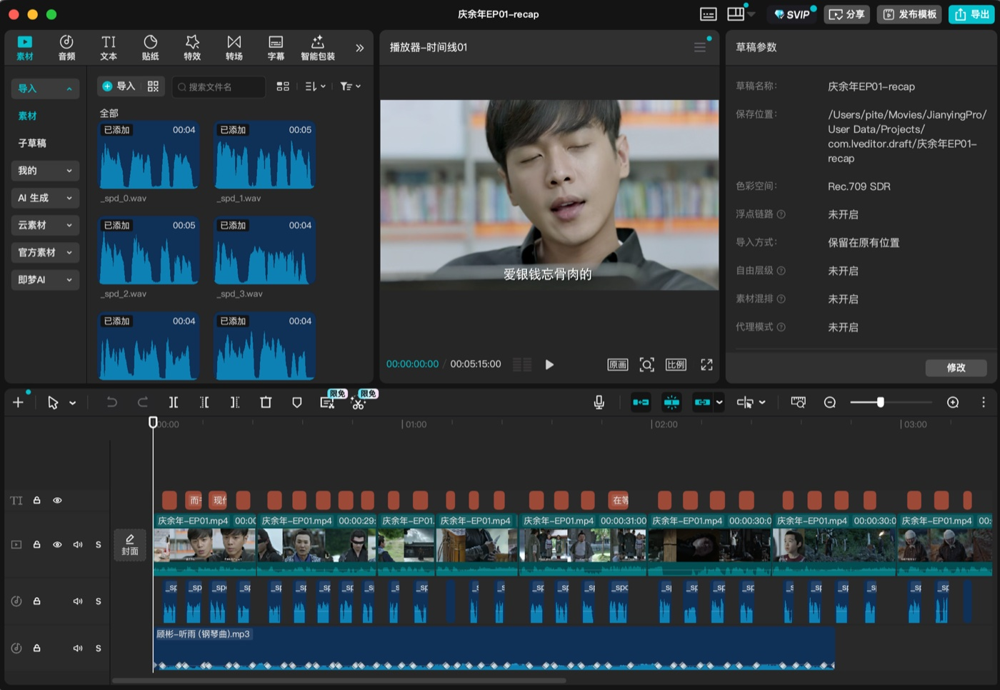
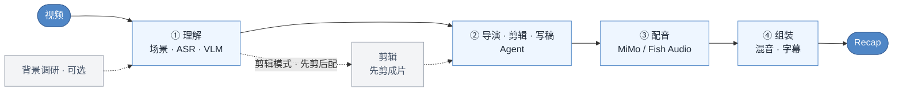
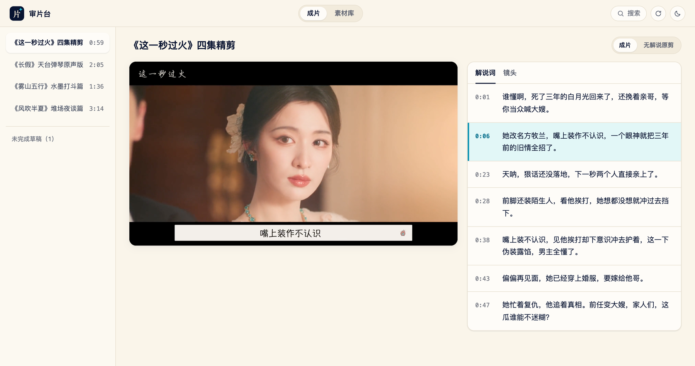
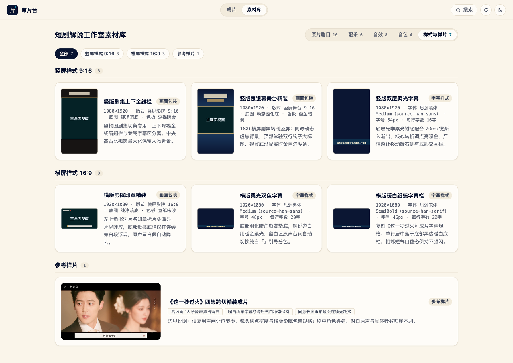

<p align="center">
  
</p>

<h1 align="center">Video Recap Skills</h1>

<p align="center">
  <b>把一段或几段长视频做成有解说质感的中文成片：两个自包含技能（一个统一生产技能 + 一个按需拆片参考技能）装进你正在用的编程 Agent，本机只要 ffmpeg，云端只要一个小米 MiMo Key，成片还能一键导出剪映草稿接着精修。</b>
</p>

<p align="center">
  <a href="https://zenstory.ai/zh/video-recap"><b>项目主页</b></a>
  &nbsp;·&nbsp;
  <a href="#安装"><b>安装</b></a>
  &nbsp;·&nbsp;
  <a href="#看看它的输出"><b>看看它的输出</b></a>
  &nbsp;·&nbsp;
  <a href="README.en.md"><b>English</b></a>
</p>

<p align="center">
  <a href="https://github.com/zenstory-ai/video-recap-skills/stargazers"></a>
  <a href="https://github.com/zenstory-ai/video-recap-skills/releases/latest"></a>
  
  <a href="https://www.python.org/"></a>
  <a href="https://github.com/zenstory-ai/video-recap-skills/actions/workflows/skill-validate.yml"></a>
  <a href="https://platform.xiaomimimo.com"></a>
  <a href="./LICENSE"></a>
</p>

<p align="center">
  <a href="https://github.com/zenstory-ai/video-recap-skills/issues"></a>
</p>

https://github.com/user-attachments/assets/f3c2df0c-6869-4f5b-8f4c-cce70b58b667

上面这条 59 秒横屏解说《这一秒过火》，是从四集长剧里跨集选段、剪辑、写稿、配音、混音、加包装并经多轮看片打磨后的最终交付；它的全套创作产物（故事方案、分镜声画板、解说词、多轨时间线、QC 报告、返修账本、Remotion 包装源码）全部公开在 [examples/guohuo-60s/](examples/guohuo-60s/)，下文展示的片段均摘自这些真实文件。

## 这是什么

把两个自包含技能（统一生产技能 `video-recap` + 按需拆片参考技能 `video-reference`）装进 Claude Code、Codex CLI、OpenCode 或 OpenClaw，直接用自然语言给出视频路径和想要的风格，Agent 就会一气呵成完成画面与对白理解、故事主线与声画分工设计、视频剪辑、解说词撰写、TTS 配音、多轨混音与字幕烧录。支持 `.mp4 / .mov / .mkv / .webm`。

- **一个 Key 跑通全链，本机只要 ffmpeg**：语音转写（ASR）、画面理解（VLM）和默认配音（TTS）全部走[小米 MiMo](https://platform.xiaomimimo.com)，本机只用 Python 标准库和 `ffmpeg`，不需要 GPU，不需要 `pip install`，也不用下载几十 GB 的模型权重。配音支持一键切换为 Fish Audio 或自托管 IndexTTS。
- **先立主线与声画让位，再按“垫半句、让半句、接半句”写词**：动笔写单句旁白前，Agent 先在 `recap_story_plan.json` 中定死观众看点、主视角（POV）、核心悬念与每一拍的局势翻转，并在 `visual_audio_board.json` 中为每一拍指定主导音源——演员飙戏的名场面原速原调让给原声，动作撞击让给现场声，旁白只负责把处境和潜台词垫到位。
- **先剪画面后写旁白，时间轴严丝合缝**：剪辑模式（`cut`）先把长视频或多集素材按句末安全边界剪成恒定帧率的 `edited_source.mp4`，再对照剪后真实时间轴编写解说词；理解产物还可按需存入本地文件素材库，跨集制作时免重复分析。
- **成片之外，还能一键导出剪映草稿**：多轨时间线 `timeline.json` 可直接导出为自包含的剪映草稿目录，原片区间、逐段配音、BGM、字幕和静态边框分轨排开，随时在剪映里拖拉微调。
- **每一步都有硬门禁与对账单**：句界防切词、必保画面核验、旁白抢话与字数底线校验、响度真峰值控制与终审 QC 全程生成机器可读报告；多轮看片返修（`REVISION`）严格区分“本轮修改项”与“锁定不动项”，防止越改越乱。

## 安装

### ClawHub

ClawHub 条目与依赖由[显式发布清单](.clawhub/publish.json)管理（`video-recap` 与 `video-reference` 均为自包含包）；使用完整插件或源码工作流请按下方方式安装。

**环境前提**：Python 3.10+、`PATH` 中有 `ffmpeg`，以及一个[小米 MiMo](https://platform.xiaomimimo.com) API Key。系统默认将解说字幕烧录进画面，这需要带 `libass` 滤镜的 `ffmpeg`；macOS 上 Homebrew 默认的 `ffmpeg` 不含 `libass`，此时默认运行会自动降级为在成片旁输出同名 `.srt` 外挂字幕并在 `final_qc.json` 中记一条警告（若显式传了 `--burn-subtitles` 则会在启动前直接报错）。在 macOS 上如需完整烧录硬字幕，可执行 `brew install ffmpeg-full` 并将其 `bin` 目录置于 `PATH` 最前面。

```bash
brew install ffmpeg                        # macOS；Debian/Ubuntu 用 apt，Windows 用 choco / scoop / winget
export MIMO_API_KEY=your-mimo-key          # Windows PowerShell：$env:MIMO_API_KEY="your-mimo-key"
export MIMO_TOKEN_PLAN_CLUSTER=cn          # 仅 tp-* Token Plan key 需要：cn | sgp | ams
```

MiMo 无需包月订阅，`sk-*` 密钥按实际调用量计费；实测跑完一条完整解说视频约 1.3 元人民币（随片长与抽帧密度浮动）。

在 **Claude Code** 中安装：

```text
/plugin marketplace add zenstory-ai/video-recap-skills
/plugin install video-recap-skills@video-recap
```

或者直接对支持导入 GitHub 仓库的 Agent 说一句话：

```text
安装这个插件：https://github.com/zenstory-ai/video-recap-skills
```

<details>
<summary><strong>Codex CLI、OpenCode、OpenClaw 安装方式</strong></summary>

**Codex CLI**

```bash
codex plugin marketplace add zenstory-ai/video-recap-skills
codex plugin add video-recap-skills@video-recap
```

**OpenCode**：按[官方 Agent Skills 文档](https://opencode.ai/docs/skills/)，项目级技能放在 `.opencode/skills/<name>/SKILL.md`。克隆仓库后从仓库目录启动：

```bash
git clone https://github.com/zenstory-ai/video-recap-skills.git
cd video-recap-skills
mkdir -p .opencode
ln -s ../skills .opencode/skills             # Windows 把 skills\* 复制到 .opencode\skills\
opencode debug skill                         # 应列出全部 2 个技能
```

**OpenClaw**：克隆后导入 Claude 插件包：

```bash
openclaw plugins install ./video-recap-skills
openclaw skills list
```

注意：同一套技能只注册到一个发现目录即可，避免重名或重复触发。

</details>

<details>
<summary><strong>可选：改用 Fish Audio 配音</strong></summary>

```bash
export TTS_PROVIDER=fish-audio
export FISH_API_KEY=your-fish-key
export FISH_TTS_REFERENCE_ID=your-voice-model-id  # 可选；默认内置“娱乐扒妹”解说音色
```

默认模型为 `s2.1-pro-free`，默认音色为“娱乐扒妹”（reference ID `5653cea4ac83480aaf2bf45406556185`），计费与限额以 Fish Audio 官方策略为准。切换后 ASR 和 VLM 仍走 MiMo；本地参考音频克隆（`--voice-ref`）仅在 MiMo 路径下可用。

</details>

安装完成后，可以让 Agent 先做一次离线自检：

```text
检查 video-recap 的运行环境，告诉我 Python、ffmpeg/libass 和 MiMo 配置是否就绪。
```

> 历次更新见 [CHANGELOG.md](CHANGELOG.md) 与 [Releases](https://github.com/zenstory-ai/video-recap-skills/releases)。仓库已由 `worldwonderer/video-recap-skills` 迁移至 `zenstory-ai/video-recap-skills`，早期按旧地址安装的用户请更新远程地址。

## 看看它的输出

下面每一段均摘自 [examples/guohuo-60s/](examples/guohuo-60s/) 中的真实公开产物（案例输入为《这一秒过火》第 2、3、6、21 集，仓库仅收录结构化 JSON 与包装代码，不含原剧音视频）。

### 1. 故事方案先立“观众看点与主视角”，再写每一拍的局势翻转

动刀剪辑前，Agent 先写出 [`recap_story_plan.json`](examples/guohuo-60s/recap_story_plan.json)，把观众看点、主视角（POV）、核心悬念与底牌揭晓顺序一次定死：

```json
"director_intent": {
  "viewer_promise": "60秒看懂死而复生的白月光为什么挽着亲哥逼男主当众叫大嫂，又在洗手台狠话强吻、替他挡击和婚服送嫁三场戏里彻底露馅。",
  "pov": "全程紧贴二少慕容清峄的眼睛：从家宴认出她的荒唐震怒，到洗手台狠话逼问，再到她飞身替自己挡下重击时彻底确认她的真心。",
  "dramatic_question": "她嘴上死不认账、非要嫁给大哥，为什么眼神闪躲、被强吻不推开、见他挨打还本能冲上去替他挡下重击？",
  "emotional_start": "前任挽着亲哥现身的抓马暴击",
  "emotional_end": "明明彼此死死挂念却要亲手送嫁的虐心拉扯",
  "ending_aftertaste": "两人都知道对方还爱着自己，她却依然穿戴皇冠婚服走向大哥的婚礼",
  "withhold_reveal": "前8秒先把“死去白月光变成准大嫂”的错位身份砸出来；中段用洗手台强吻和替身挡伤一点点扒下她的冷漠伪装；最后才亮出皇冠婚服把悬念拉满。"
},
```

每一拍（beat）都写明具体动作、局势怎样翻转、观众进场与离场时心里的疑问，以及决不能剪丢的原片时刻（10 拍中节选第 3 拍）：

```json
{
  "beat_id": "b03",
  "source_id": "episode-03",
  "source_start": 1292.0,
  "source_end": 1305.5,
  "function": "escalation",
  "event": "慕容清峄把她堵在洗手台前，红着眼逼问并咬牙切齿放狠话",
  "change": "家宴上的隐忍试探 → 洗手台前撕破脸皮贴脸逼问",
  "audience_question_in": "男主私下能忍住不找她算账吗？",
  "audience_question_out": "嘴上喊着抽筋扒皮挫骨扬灰，字字句句全是想念",
  "character_focus": "慕容清峄",
  "must_keep_moment": "完整原声“我好想你，日日夜夜地想你，想把你抽筋扒皮，挫骨扬灰”",
  "evidence": ["asr", "vlm", "hard_subtitle"]
},
```

这一拍随后在 [`clip_plan.json`](examples/guohuo-60s/clip_plan.json) 中转化为带 7 段剪辑理由的选段，由 `cut.py` 先剪出画面母版，再进入二阶段写词。

### 2. 旁白主动给原声名场面让路：谁主导声音白纸黑字写进分镜板

[`visual_audio_board.json`](examples/guohuo-60s/visual_audio_board.json) 为每一拍指定 `audio_owner` 与交接方式（`handoff`）。上面洗手台逼问这一拍由原声对白独占，旁白任务设为 `none`，播放倍速锁死 `1.0x`：

```json
{
  "beat_id": "b03",
  "source_id": "episode-03",
  "source_start": 1292.0,
  "source_end": 1305.24,
  "output_start": 9.206666,
  "output_end": 22.446666,
  "picture_job": "performance",
  "preferred_moment": "完整原声“我好想你，日日夜夜地想你，想把你抽筋扒皮，挫骨扬灰”",
  "entry_reason": "慕容清峄把她困在洗手台前、欺身逼近时切入",
  "exit_reason": "“挫骨扬灰”尾音与眼底红血丝完整落地后切出",
  "audio_owner": "original_dialogue",
  "original_audio_anchor": "我好想你，日日夜夜地想你，想把你抽筋扒皮，挫骨扬灰",
  "narration_job": "none",
  "handoff": "整整13秒完全交给男主原声，不插半个字旁白，让那句又恨又疯的“日日夜夜地想你……挫骨扬灰”自己砸进观众耳朵。",
  "playback_speed": 1.0
},
```

因此 [`narration.json`](examples/guohuo-60s/narration.json) 全片只写了 7 段旁白：第 2 段在 `10.2` 秒干净收声，把中间整整 13 秒完全让给男主原声，直到 `23.047` 秒两人亲上去的反差瞬间才切入第 3 段旁白：

```json
{
  "start": 5.773,
  "end": 10.2,
  "narration": "她改名方牧兰，嘴上装作不认识，一个眼神就把三年前的旧情全招了。",
  "pause_after_ms": 80,
  "overlaps_speech": true,
  "emotion": "调侃"
},
{
  "start": 23.047,
  "end": 26.5,
  "narration": "天呐，狠话还没落地，下一秒两个人直接亲上了。",
  "pause_after_ms": 50,
  "overlaps_speech": true,
  "emotion": "吃瓜、上头"
},
```

三处原声留白由 Agent 校对后写入 [`original_subtitles.json`](examples/guohuo-60s/original_subtitles.json)，在留白区间自动打上带 `「」` 引号的原声字幕：

```json
[
  { "start": 4.133, "end": 5.053, "text": "大嫂。" },
  { "start": 11.127, "end": 21.027, "text": "我好想你，日日夜夜地想你，想把你抽筋扒皮，挫骨扬灰。" },
  { "start": 35.673, "end": 37.473, "text": "有我在，你别怕。" }
]
```

合成时，[`timeline.json`](examples/guohuo-60s/timeline.json) 中的原声轨在每段旁白期间自动压低音量、在留白处平滑推回满音量，并可原样导出为剪映多轨草稿。

### 3. 看片返修账本：改哪几秒、锁死哪些层，笔笔可查

本案例历经四轮打磨，每一轮都在 [`revision-log.json`](examples/guohuo-60s/revision-log.json) 中明确列出修改项（`change_set`）、锁定项（`frozen_set`）与核验方式（`verification`）。最后一轮终审只解冻尾段画面：

```json
{
  "baseline": "final_picture_conform",
  "scope": "picture_conform",
  "change_set": [
    "remove the visible tail-frame pause near 42.08 seconds",
    "restore continuous source movement around 46.24 seconds"
  ],
  "frozen_set": [
    "story and narration",
    "all audio",
    "caption timing and typography",
    "title and accent graphics"
  ],
  "verification": [
    "normal-speed full watch",
    "join playback around both change points",
    "freeze detection as supporting evidence",
    "audio stream-copy verification",
    "full decode"
  ]
}
```

[`edit-map.json`](examples/guohuo-60s/edit-map.json) 如实记录了 46 秒附近那处跳接的修法——直接回原片补回被剪断的 `2001–2004` 秒同源长廊跟拍，绝不拿叠化转场遮丑：

```json
{
  "name": "wedding_corridor_continuous_motion",
  "beat_ids": ["b07", "b08"],
  "output_frames": [1052, 1288],
  "output_seconds": [42.08, 51.52],
  "asset_id": "episode-21",
  "source_seconds": [1996.0, 2010.32],
  "speed": 1.516949153,
  "repair": "Restored the omitted 2001-2004 source interval instead of hiding the jump with a transition."
},
```

交付前的机械质检结果写入 [`assembly_qc.json`](examples/guohuo-60s/assembly_qc.json) 与 [`delivery-qc.json`](examples/guohuo-60s/delivery-qc.json)：

```json
"checks": {
  "full_decode": true,
  "audio_stream_matches_master": true,
  "vmaf_mean": 93.844938,
  "ssim_all": 0.989302,
  "psnr_average_db": 45.415972
}
```

旁白与花字的每一句事实依据则在 [`content-qc.md`](examples/guohuo-60s/content-qc.md) 中逐条对照原片证据与官方资料：

```markdown
| “嘴上装不认识，见他挨打却下意识冲去护着，这一下伪装露馅，男主全懂了” | 替身挡击与递蜜饯说“有我在，你别怕”两段戏首尾相接，男主眼眶泛红怔住 | [爱奇艺官方角色片花](https://www.iqiyi.com/v_r8e40v8g54.html)印证两人重逢后表面针锋相对、实则彼此挂念 | **解读立得住**。“全懂了”指男主彻底看穿她心里仍在乎自己，并非指此时才第一次认出她的脸 |
```

### 4. 一键导出剪映草稿接着精修

只需在请求里加一句“导出剪映草稿”，`timeline.json` 就会直接转成可编辑的剪映多轨草稿：原片、逐段解说、BGM、字幕和静态图片各占一轨，媒体默认打包进草稿内部的 `Resources/local`，拷到别的机器上照样能打开。



轨道细节与成本账单对比见[《导出剪映草稿继续精修》](docs/capcut-jianying-draft-export.md)。

## 安装后的第一条请求

复制下面的话、换上你的视频路径就能直接开跑，无需自己动手调 Python 脚本：

**单集或整段视频解说：**

```text
给 /path/to/video.mp4 做一个中文解说成片。这是《庆余年》第一集，主角是范闲，字幕烧进画面。
```

**长视频或多集浓缩成一条主线解说：**

```text
用 /path/to/ep1.mp4 和 /path/to/ep2.mp4 做一个十分钟解说，围绕同一条主线剪辑，保留关键原声和人物反应，不要分成两个小总结。
```

**只出分镜与解说初稿，暂不配音渲染**（把〈占位内容〉换成你的实际信息）：

> 我有权使用〈本地视频〉，并提供了对应的已核对画面与对白记录。先只给这段素材的声音分工建议：哪句对白、哪个动作声或停顿应完整保留，哪里确需旁白，依据是哪条记录。缺证据就列待核对项，不补人物动机或没出现的事件。交付分拍说明和必要的旁白草案，不调用配音或渲染。

## 流程与两个技能分工



两个自包含技能（一个统一生产 + 一个按需参考）通过 `work_dir` 下的 JSON 与 MP4 文件交接：

| 技能 | 核心职责 | 输入 → 输出 |
|---|---|---|
| [`video-recap`](skills/video-recap/) | 统一解说成片生产技能：视频理解（`understand.py`）· 导演主线与声画分工 · 句界安全剪辑（`cut.py`）· 底线门禁校验（`validate.py`）· TTS 配音（`voiceover.py`）· 多轨混音与字幕烧录（`assemble.py`）· 剪映草稿导出 · 本地只读看板与资源库 | `视频` → `recap_<名>.mp4 + subtitles.srt/.ass + timeline.json` |
| [`video-reference`](skills/video-reference/) | 按需把优秀成片拆解为制作参考（测镜头节奏与响度、分离原片事实与可迁移方法），不在日常生产链上 | `成片 + 理解产物` → `production_reference.json` |

最终成片统一命名为 `recap_<名>.mp4`，附带 `subtitles.srt/.ass`；全部中间产物保存在 `work_dir/` 下，字段定义见[数据结构规范](skills/video-recap/references/data-schema.md)。

## 进阶用法

**跨集复用已分析过的视频理解缓存：**

```text
分析 /path/to/ep1.mp4，并把可复用的理解产物保存到 /path/to/.video-materials；后续制作时优先复用这个素材库。
```

文件素材库只保存轻量 JSON / Markdown 与索引，不重复拷贝大体积原视频，也不依赖外部数据库或向量索引，直接用文件系统检索。

**导出剪映草稿：**

```text
给 /path/to/video.mp4 做解说，并导出可继续编辑的剪映草稿。
```

**测量原片硬字幕位置，让新解说字幕刚好盖住原字幕带：**

```text
先检测 /path/to/video.mp4 的原片字幕区域并让我确认预览，再把解说字幕贴到同一区域生成成片。
```

检测预览图保存在 `.subtitle_measure/` 下；目前支持方形或近方形像素视频（SAR 与 `1:1` 偏差不超过 2%）与底部对齐字幕。

**用已获授权的参考音频克隆解说音色：**

```text
用 /path/to/voice-ref.wav 的音色给 /path/to/video.mp4 做解说；我已获得音色所有者授权。
```

参考音频会发送至 MiMo 进行克隆合成，请务必在取得声音本人授权后使用。

**整个系列统一绑定字幕样式、音色、BGM 与静态包框：**

```text
把 /path/to/library 当作资源库：登记这首 BGM、这个字体和这张包框图，按竖屏 1080x1920 做一版字幕样式模板让我确认采用；
之后这个系列都用 /path/to/series/recap_project.json 绑定它们来出片。
```

资源、模板和参考样片全部以本地 JSON 管理，版权与采纳状态只能由你本人确认；每次合成后生成的 `work_dir/resource_lock.json` 会完整记录本轮实际使用的资源与授权状态（详见[资源库、模板与样片](skills/video-recap/references/resource-library.md)）。

**在浏览器打开本地只读审片台：**

```text
在本机打开审片台，看看 /path/to/projects 下面的成片、解说词镜头对照和素材库。
```

审片台仅监听 `127.0.0.1` 且严格只读（仅响应 `GET` 与 `HEAD`），支持成片与无解说原剪切换播放、解说词与镜头时间轴点击跳转，以及原片剧目、配乐、音效、音色、样式与样片五维素材库预览。





**精校原声留白字幕：** 当原片角色在旁白留白处开口对白时，由 Agent 核实后写入 `work_dir/original_subtitles.json`（`[{"start": s, "end": s, "text": "台词"}]`），即可在成片与剪映草稿中精准呈现带 `「」` 引号的原声台词。

## 常见问题

### 原视频本身没有旁白、甚至一句对白都没有，能直接给它配解说吗？

完全可以。视频理解阶段靠 VLM 直接看抽帧画面，不要求原视频有旁白；如果素材连人物对白都没有（比如纯画面纪录片或监控录像），让 Agent 加上 `--skip-asr` 跳过语音转写，直接基于画面写解说即可（见 [issue #79](https://github.com/zenstory-ai/video-recap-skills/issues/79)）。

### 长视频跑到一半遇上 429 限流或意外中断，需要从头重跑吗？

不需要。VLM 抽帧分析每跑完一个镜头都会实时落盘保存；遇到限流会自动降并发重试，若仍失败直接重跑同一条命令即可从断点继续。写好 `clip_plan.json` 或 `narration.json` 后同样用原命令续跑，脚本会自动核对源视频身份与参数配置。

### 为什么 VLM 认不出角色名字，解说里全是“黑衣男子”“年轻女子”？

只要提前知道片名或剧集名，开跑前先让 Agent 按[背景调研指南](skills/video-recap/references/research-guide.md)把主要角色全名与关系写入 `work_dir/background_research.json`，VLM 看图和写稿简报就会直接叫准角色姓名。

## 延伸阅读

- [视频到解说完整流程](https://zenstory.ai/zh/video-recap/video-to-narration) — 先核实画面、对白与前情背景，绝不把猜测当事实
- [原声与旁白分工](https://zenstory.ai/zh/video-recap/original-audio-and-narration) — 先定每一拍谁主导声音，再动笔写解说词
- [剪映 / CapCut 草稿导出](https://zenstory.ai/zh/video-recap/capcut-draft) — 基于 `timeline.json` 导出可搬迁的多轨草稿
- [影视解说文案怎么写](docs/video-recap-script-writing.md) — 先定主视角与悬念，再按“垫半句、让半句、接半句”交接声画
- [AI 分析视频总爱乱编剧情怎么办](docs/ai-video-analysis-without-invented-plot.md) — 把亲眼看见的事实与脑补推断彻底分开
- [导出剪映草稿继续精修](docs/capcut-jianying-draft-export.md) — 草稿包含哪些轨道、自建流程与按月订阅 SaaS 的账单对比
- [开源 AI 影视解说工具怎么选](docs/open-source-ai-video-recap-tools.md) — 8 个开源项目按交互形态、许可证、剪映导出与模型来源横向对比
- [仓库架构说明](docs/architecture.md) — 生产技能与参考技能分工、内部子包、编排路由与架构守卫
- [生产能力边界与验收原则](docs/production-boundaries.md) — 通用核心与单项目数据的边界，以及三层验收标准
- [《这一秒过火》案例复现手册](examples/guohuo-60s/skill-runbook.md) · [从初剪母版到终审交付的四轮复盘](examples/guohuo-60s/iteration-notes.md)
- 技能契约与参考手册：[数据结构规范](skills/video-recap/references/data-schema.md) · [全量配置手册](skills/video-recap/references/config-playbook.md) · [多轨时间线与剪映协议](docs/timeline-and-jianying.md) · [创作剪辑与去 AI 味手册](skills/video-recap/references/creative-editing-playbook.md)

## 致谢

- [LINUX DO - 新的理想型社区](https://linux.do) — 社区交流与反馈支持
- 剪映草稿协议参考了 [pyJianYingDraft](https://github.com/GuanYixuan/pyJianYingDraft)、[capcut-mate](https://github.com/Hommy-master/capcut-mate) 与 [duo-video](https://github.com/duoec/duo-video)
- 原片字幕带检测算法改编自 [ops120/video-recap-skills-plus](https://github.com/ops120/video-recap-skills-plus)

## 开源许可

MIT License，详见 [LICENSE](LICENSE)。

## ZenStory AI 开源矩阵

本项目由 [ZenStory AI](https://zenstory.ai/zh) 维护——致力于打造开源的 Agent 故事创作、改编与视听生产工具链（GitHub 组织：[zenstory-ai](https://github.com/zenstory-ai)）：

| 项目 | 定位与用途 |
| --- | --- |
| [oh-story-claudecode](https://github.com/zenstory-ai/oh-story-claudecode) | 网文写作 Skill 包：扫榜、拆书、正文创作、去 AI 味精修与封面生成 |
| [drama-skills](https://github.com/zenstory-ai/drama-skills) | AI 短剧 / 漫剧创作 Skill 合集：剧本、角色资产、分镜、生图/生视频提示词与独立审稿 |
| [novel-to-game](https://github.com/zenstory-ai/novel-to-game) | 小说改编互动游戏 Skill 合集：原著拆解、运行环境构建与实机交互验收 |
| [video-recap-skills](https://github.com/zenstory-ai/video-recap-skills) | 将长视频或多集剧集制作成中文解说成片，支持一键导出剪映/CapCut 草稿（本仓库） |
| [oh-story-dsh](https://github.com/zenstory-ai/oh-story-dsh) | DeepSeek Harness 社区插件，集成小说、短剧、游戏与视频解说工作台 |
| [zenstory](https://github.com/zenstory-ai/zenstory) | 对话即创作的 AI 小说写作工作台（[app.zenstory.ai](https://app.zenstory.ai)） |
