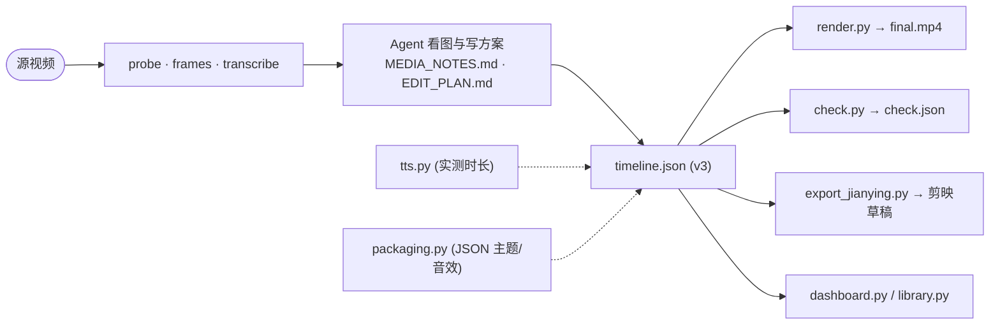

<p align="center">
  
</p>

<h1 align="center">Video Recap Skills</h1>

<p align="center">
  <b>面向通用视频剪辑与解说创作的 Agent 技能包：用极简无状态原子 CLI 与单一 <code>timeline.json</code> 总线，在 Claude Code、Codex CLI、OpenCode 或 OpenClaw 中完成多源剪辑、看图选镜、配音混音、竖横屏包装、物理质检与剪映草稿导出。</b>
</p>

<p align="center">
  <a href="https://zenstory.ai/zh/video-recap"><b>项目主页</b></a>
  &nbsp;·&nbsp;
  <a href="#安装"><b>安装</b></a>
  &nbsp;·&nbsp;
  <a href="#快速开始"><b>快速开始</b></a>
  &nbsp;·&nbsp;
  <a href="#架构与原子工具"><b>架构与原子工具</b></a>
  &nbsp;·&nbsp;
  <a href="README_EN.md"><b>English</b></a>
</p>

<p align="center">
  <a href="https://github.com/zenstory-ai/video-recap-skills/stargazers"></a>
  <a href="https://github.com/zenstory-ai/video-recap-skills/releases/latest"></a>
  
  <a href="https://www.python.org/"></a>
  <a href="https://github.com/zenstory-ai/video-recap-skills/actions/workflows/skill-validate.yml"></a>
  <a href="./LICENSE"></a>
</p>

https://github.com/user-attachments/assets/f3c2df0c-6869-4f5b-8f4c-cce70b58b667

> 上方 59 秒横屏解说示例《这一秒过火》的脱敏结构化产物与复盘保存在 [examples/guohuo-60s/](examples/guohuo-60s/)。

## 这是什么

`video-recap-skills` 包含两个自包含技能（通用剪辑与解说生产技能 `video-recap` + 按需成片拆解技能 `video-reference`）。我们坚持**“判断归 Agent，机械归原子 CLI”**：

- **通用多题材、本地优先、零第三方 Python 依赖** — 仅需 Python 3.10+ 标准库与 `ffmpeg` / `ffprobe`。开工前先确认目标画幅与构图（`3:4` 满屏 / `9:16` / `16:9`、`cover` vs `contain`）；优先使用外挂/内封字幕、本机 Whisper、本机离线 TTS 与宿主 Agent 原生多模态看图；按需接入 OpenAI 兼容 ASR 或 Fish Audio（默认免费可用模型 `s2.1-pro-free`，支持 `--whole-article` 整篇连贯合成与 `spoken_text` 读音分离）/ OpenAI / 自托管 IndexTTS（详见[远程调用披露](skills/video-recap/references/remote-services.md)）。
- **单一 `timeline.json` v3 总线，无清单锁、可随时局部重跑** — 创意与计划留在人类可读的 Markdown（`BRIEF.md`、`MEDIA_NOTES.md`、`EDIT_PLAN.md`、`PROMO.md`）；剪辑、配音、混音、包装、字幕、体检与剪映导出全部围绕同一份 `timeline.json` 协作，改一个镜头或一句台词只需重跑对应叶命令。
- **硬/软双层体检与内建机械正确性，绝不变速挤压旁白** — `tts.py` 实测真实时长并按内容哈希缓存；`render.py` 内建 CFR 帧精确裁切、`viewport.fit`、闪帧防护、同源闪避曲线、`-14 LUFS` / `-1.5 dBTP` 响度闭环与语义均衡双行字幕；`check.py` 严格区分**硬门禁**（仅 100% 确定性物理损坏判 `fail`）与**软门禁**（黑屏/定格/死寂/切边音频/重叠输出 `warn` + 顶层 `review_hints` 提醒 Agent 复核）。
- **四大配套工具按需即用** — 支持 **Remotion 现代杂志风无底框双层动效排版**（`drama-recap` `3:4` 满屏透明 `.mov`/`.webm` 叠加）与离线 PNG 主题/防撞音效（`packaging.py`）、跨机可开剪映/CapCut 多轨草稿导出（`export_jianying.py`）、静态 `review.html` 与只读 `127.0.0.1` 审片台（`dashboard.py`）、跨项目素材缓存与授权/音色同意审计（`library.py`）。

## 安装

### 1. 准备基础环境

只需 **Python 3.10+** 与 `PATH` 中的 **`ffmpeg` / `ffprobe`**（默认 100% 本地可跑，无需必填 API Key）：

```bash
brew install ffmpeg          # macOS（烧录硬字幕建议 brew install ffmpeg-full）
```

如需启用云端 ASR 或云端 TTS，按需设置对应环境变量（如 `ASR_API_URL` + `ASR_API_KEY`，或 `OPENAI_API_KEY` / `FISH_API_KEY` / `INDEX_TTS_ENDPOINT`），完整清单见[远程调用说明](skills/video-recap/references/remote-services.md)。

### 2. 安装技能到编程 Agent

在 **Claude Code** 中执行：

```text
/plugin marketplace add zenstory-ai/video-recap-skills
/plugin install video-recap-skills@video-recap
```

<details>
<summary><strong>Codex CLI · OpenCode · OpenClaw 安装方式</strong></summary>

**Codex CLI**

```bash
codex plugin marketplace add zenstory-ai/video-recap-skills
codex plugin add video-recap-skills@video-recap
```

**OpenCode**：按[官方 Agent Skills 文档](https://opencode.ai/docs/skills/)，项目级技能位于 `.opencode/skills/<name>/SKILL.md`：

```bash
git clone https://github.com/zenstory-ai/video-recap-skills.git
cd video-recap-skills
mkdir -p .opencode
ln -s ../skills .opencode/skills
opencode debug skill
```

**OpenClaw**：克隆仓库后导入插件包：

```bash
openclaw plugins install ./video-recap-skills
openclaw skills list
```

</details>

ClawHub 分发由[显式发布清单](.clawhub/publish.json)管理；历次变更见 [CHANGELOG.md](CHANGELOG.md)。

## 快速开始

直接用自然语言告诉 Agent 你的视频路径与创作目标即可：

```text
# 1. 多源视频剪辑与解说（先看拼图定主线，再实测配音并渲染成片）
用 /path/to/ep1.mp4 和 /path/to/ep2.mp4 做一个三分钟剧情解说，围绕同一条主线剪辑，保留关键原声对白与人物反应。

# 2. 纯原声高光剪辑 / 访谈播客切片（完全本地，不配旁白）
把 /path/to/interview.mp4 剪成 90 秒竖屏金句切片，配安全区双语字幕和模糊背景，不加旁白。

# 3. Remotion 现代杂志风动效包装（3:4 剧集满屏）+ 导出可编辑剪映草稿
用 drama-recap 主题和 Remotion 给 /path/to/clip.mp4 加上无底框双层动效花字与转场音效，渲染 3:4 满屏成片并导出剪映草稿。

# 4. 打开本地审片台或生成离线 review.html
为当前工作目录生成离线审片页，或启动本机只读审片台查看成片、字幕时间轴与素材库。

# 5. 按需拆解参考成片（video-reference）
帮我拆解 /path/to/reference.mp4 的镜头节奏、响度与版式，输出脱敏的 REFERENCE_NOTES.md。
```

## 架构与原子工具



| 技能 | 组成与核心职责 | 主要产出 |
|---|---|---|
| [`video-recap`](skills/video-recap/) | 6 支核心原子 CLI（`probe.py`、`frames.py`、`transcribe.py`、`tts.py`、`render.py`、`check.py`）+ 4 支单向叶工具（`packaging.py`、`export_jianying.py`、`dashboard.py`、`library.py`） | `out/final.mp4`、`timeline.json`、`check.json`、`out/review.html`、`out/jianying_draft/` |
| [`video-reference`](skills/video-reference/) | 1 支纯本地参考分析 CLI（`analyze_reference.py`）：实测镜头切点、时长分布、响度密度并抽帧拼图 | `reference_metrics.json`、`contact_sheet.jpg`、`REFERENCE_NOTES.md` |

## 审片台与剪映草稿预览


## 文档导航

| 类别 | 文档链接 |
|---|---|
| **技能规范与契约** | [timeline.json v3 契约](skills/video-recap/references/timeline-schema.md) · [通用剪辑与声画原则](skills/video-recap/references/editorial-craft.md) · [竖横屏包装与音效](skills/video-recap/references/packaging-and-sfx.md) · [剪映草稿导出](skills/video-recap/references/jianying-export.md) · [审片台与素材库](skills/video-recap/references/material-library.md) · [远程调用披露](skills/video-recap/references/remote-services.md) |
| **仓库架构与边界** | [仓库架构说明](docs/architecture.md) · [生产能力边界与验收原则](docs/production-boundaries.md) · [多轨时间线与剪映协议](docs/timeline-and-jianying.md) · [单测体系](tests/README.md) |
| **公开案例复盘** | [《这一秒过火》案例目录](examples/guohuo-60s/) · [影视解说文案指南](docs/video-recap-script-writing.md) · [AI 视频分析防编造指南](docs/ai-video-analysis-without-invented-plot.md) |

## 致谢与许可

- 感谢 [LINUX DO](https://linux.do) 社区讨论与反馈；剪映协议骨架参考 [pyJianYingDraft](https://github.com/GuanYixuan/pyJianYingDraft)、[capcut-mate](https://github.com/Hommy-master/capcut-mate) 与 [duo-video](https://github.com/duoec/duo-video)。
- MIT License，详见 [LICENSE](LICENSE)。

## ZenStory AI 开源矩阵

| 项目 | 定位与用途 |
| --- | --- |
| [oh-story-claudecode](https://github.com/zenstory-ai/oh-story-claudecode) | 网文写作 Skill 包：扫榜、拆书、正文创作、去 AI 味精修与封面生成 |
| [drama-skills](https://github.com/zenstory-ai/drama-skills) | AI 短剧 / 漫剧创作 Skill 合集：剧本、角色资产、分镜、提示词与独立审稿 |
| [novel-to-game](https://github.com/zenstory-ai/novel-to-game) | 小说改编互动游戏 Skill 合集：原著拆解、运行环境构建与实机盲玩验收 |
| [video-recap-skills](https://github.com/zenstory-ai/video-recap-skills) | 通用 AI 视频剪辑与解说技能包：极简原子 CLI、单一时间线、包装与剪映草稿导出（本仓库） |
| [oh-story-dsh](https://github.com/zenstory-ai/oh-story-dsh) | DeepSeek Harness 社区插件，集成小说、短剧、游戏与视频解说工作台 |
| [zenstory](https://github.com/zenstory-ai/zenstory) | 对话即创作的 AI 小说写作工作台（[app.zenstory.ai](https://app.zenstory.ai)） |
