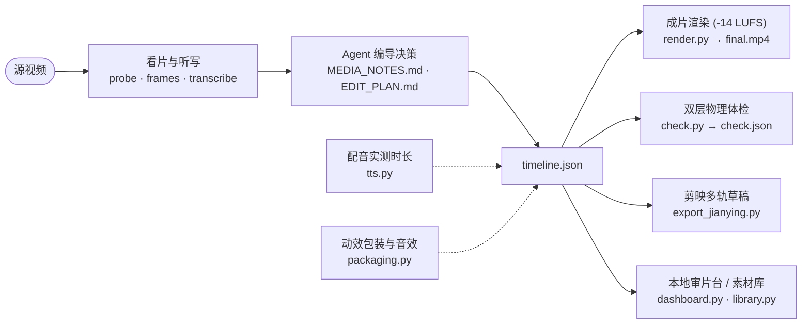
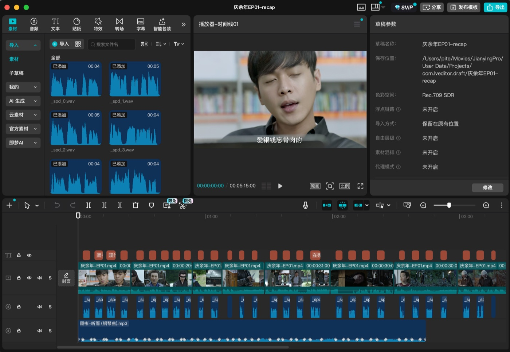
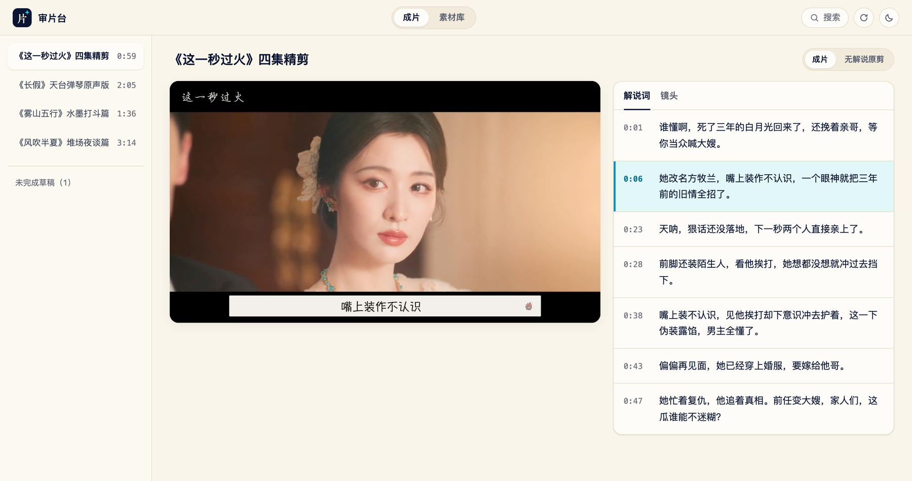

<p align="center">
  
</p>

<h1 align="center">Video Recap Skills</h1>

<p align="center">
  <b>让编程 Agent 像成熟视频编导一样剪片：把看片选镜、讲故事、配音混音、动效花字与剪映导出沉淀成一套开箱即用的技能包，支持 Claude Code、Codex CLI、OpenCode 与 OpenClaw。</b>
</p>

<p align="center">
  <a href="https://zenstory.ai/zh/video-recap"><b>项目主页</b></a>
  &nbsp;·&nbsp;
  <a href="#为什么它剪出来的片子更好看"><b>内容工艺</b></a>
  &nbsp;·&nbsp;
  <a href="#安装"><b>安装</b></a>
  &nbsp;·&nbsp;
  <a href="#快速开始"><b>快速开始</b></a>
  &nbsp;·&nbsp;
  <a href="#工作原理与配套工具"><b>架构</b></a>
  &nbsp;·&nbsp;
  <a href="README_EN.md"><b>English</b></a>
</p>

<p align="center">
  <a href="https://github.com/zenstory-ai/video-recap-skills/stargazers"></a>
  <a href="https://github.com/zenstory-ai/video-recap-skills/releases/latest"></a>
  
  <a href="https://www.python.org/"></a>
  <a href="https://github.com/zenstory-ai/video-recap-skills/actions/workflows/skill-validate.yml"></a>
  <a href="./LICENSE"></a>
</p>

https://github.com/user-attachments/assets/f3c2df0c-6869-4f5b-8f4c-cce70b58b667

> 上方 59 秒横屏解说示例《这一秒过火》的公开脱敏产物与创作复盘见 [examples/guohuo-60s/](examples/guohuo-60s/)。

## 为什么它剪出来的片子更好看

大多数 AI 剪辑工具难看，往往不是因为少调了一个大模型，而是不懂剪辑本身的分寸——瞎猜剧情、三秒一插嘴、原声切半句、配音狂加速、宽屏硬裁只剩半张桌子、套满丑陋黑框花字。

我们把大量真实成片踩坑总结出来的**编导工艺（Know-How）**，直接写进了技能和工具链里，坚持一件事：**创作判断交给多模态 Agent，机械活交给极简本地脚本。**

### 1. 先亲眼看片，再讲完整故事——不瞎编、不念说明书
Agent 不会对着纯文字摘要闭门造车，而是直接看带时间戳的抽帧拼图（必要时局部裁切放大），亲眼确认人物眼神、动作与台词对应关系后再定主线：
- **一条只讲透一个完整事件**：前 3 秒直接扔出最强冲突或悬念钩子，不寒暄、不报幕，全片只记 1–2 个核心人名。
- **像朋友讲故事，结果让画面自己“演出来”**：旁白只交代前情与人物动机，不复述画面、不复述台词、不替观众下结论；真正的高潮和反转留给角色的一句原声金句和一个微表情。

### 2. 块状聚拢、克制切换——治好 AI 解说的“乒乓插话病”
传统自动化解说最容易犯的毛病，是 3 秒旁白配 2 秒原声来回横跳，听得人支离破碎。我们沉淀了一套明确的声画节拍：
- **成块叙事，完整留声**：1 分钟成片里，旁白与原声只切换 **2–4 次**——把前情铺垫与快剪镜头聚拢成 **10–25 秒一气呵成的旁白块**，到了真正的情绪爆发或名场面，完整交还 **5–15 秒演员原声**，绝不在半句话中间硬截断。
- **杜绝“张嘴无声”与底镜漏音**：旁白说话时，画面切给听者反应、动作细节或空镜，不压在角色正脸开口说话的镜头上；纯铺画面的旁白底镜主动静音，防止闪避回弹漏出半句画外音；已有旁白和原声两路人声时，配乐只选纯音乐，避免三路人声打架。

### 3. 整篇连贯配音，绝不变速硬塞词
逐句零散合成很容易每句话语气断层，词写长了就靠 `atempo` 暴力加速更是满满“AI 味”：
- **语气连贯与细节可控**：使用 Fish Audio（默认免费可用模型 `s2.1-pro-free`）时支持整篇一次合成保持情绪连贯，自然保留 `[chuckle]`、`[sigh]` 等轻微语气；多音字、年份、英文缩写可把读音写进 `spoken_text`，画面字幕依然保持干净原文。
- **宁可改词，绝不加速**：先实测每句真实时长，超窗就改精简文案或延展镜头；换镜点自动吸附到句末停顿处，保留片头、段间与片尾的自然呼吸留白；双行字幕按语义停顿均衡折行，默认去掉刺眼的行尾标点。

### 4. 开工先定画幅、逐镜盯住主体——拒绝“空桌子”与硬黑边
- **先沟通比例再动工**：开工前先和你确认成片比例（`3:4` 满屏 / `9:16` 竖屏 / `16:9` 横屏）与构图方式（裁切满屏还是保留原画幅），避免做完才发现比例不对。
- **3:4 剧集满屏构图法**：横屏剧集改竖屏时，不再把画面孤零零架在上下大黑边里，而是看图给每个镜头指定主体焦点；遇到双人正反打，按原片切点拆段各自对准说话人，果断删掉转身虚焦或背影走场废镜，每一帧都稳稳锁住人物眼神。

### 5. 现代杂志风动效包装——有质感、不抢戏、拒绝千篇一律
- **可定制的 Remotion 透明动效画布**：内置现代电影杂志风起点（`drama-recap` 主题：无底框双层错落花字、柔和渐变暖金强调、上下柔光暗角），把组件当作随片气质微调的画布，而不是死套黑框大字模板。
- **花字只补潜台词，音效只用真素材**：每条花字控制在 4–8 字、不遮脸、不挡字幕，专门点破人物心理或反差；音效一律选用真实音频素材并自动避开旁白和原声对白，绝不手写廉价合成音。本机未装 Node 时，也能无痛回退到纯离线 PNG 包装。

### 6. 硬门禁守底线，软门禁做提醒——帮创作，不误杀好镜头
传统质检脚本常拿“每分钟必须多少字”或关键词正则把有余韵的好镜头直接拦死。我们将体检彻底拆成两层：
- **硬门禁（只拦 100% 确定性硬伤）**：文件损坏、无画面、无音轨、分辨率异常等物理问题直接阻断。
- **软门禁（给 Agent 的重点复核清单）**：黑屏转场、情绪定格、低响度、切边收音、疑似重叠等视语境而定的情况，不粗暴报错，而是汇总成 `review_hints` 提醒 Agent 抽帧复核，把审美决定权还给创作者。

## 工作原理与配套工具

整个技能包包含两套自包含技能：**`video-recap`**（日常剪辑与解说生产）和 **`video-reference`**（按需拆解优秀成片的镜头节奏、响度与版式，写出可复用的脱敏参考笔记）。

- **零第三方 Python 依赖、默认 100% 本地可跑**：核心链路只需 Python 3.10+ 标准库和 `ffmpeg` / `ffprobe`，无需 `pip install`，也无需必填任何 API Key；只有当你主动开启云端转写或云端配音时才会发起外部请求（详见[远程调用披露](skills/video-recap/references/remote-services.md)）。
- **人类读 Markdown，程序读 `timeline.json`**：需求（`BRIEF.md`）、看片笔记（`MEDIA_NOTES.md`）、剪辑方案（`EDIT_PLAN.md`）与宣发备忘（`PROMO.md`）都是清爽的 Markdown；剪辑、配音、混音、包装、字幕、体检与导出统一围绕单一规范的 `timeline.json` 协作，没有脆弱的清单锁——想换一个镜头或改一句词，只需局部重跑对应步骤。



| 技能 | 组成 | 产出物 |
|---|---|---|
| [`video-recap`](skills/video-recap/) | 6 支核心原子 CLI（`probe.py`、`frames.py`、`transcribe.py`、`tts.py`、`render.py`、`check.py`）+ 4 支按需配套工具（Remotion/PNG 包装 `packaging.py`、剪映/CapCut 导出 `export_jianying.py`、只读审片台 `dashboard.py`、跨项目素材库 `library.py`） | `out/final.mp4`、`timeline.json`、`check.json`、`out/review.html`、`out/jianying_draft/` |
| [`video-reference`](skills/video-reference/) | 1 支纯本地参考拆片 CLI（`analyze_reference.py`）：实测镜头切点、时长分布、响度密度并抽帧拼图 | `reference_metrics.json`、`contact_sheet.jpg`、`REFERENCE_NOTES.md` |

## 安装

### 1. 准备基础环境

只需 **Python 3.10+** 与 `PATH` 中的 **`ffmpeg` / `ffprobe`**（默认纯本地即可运行）：

```bash
brew install ffmpeg          # macOS（如需烧录硬字幕，建议 brew install ffmpeg-full）
```

如需接入云端 ASR 或云端配音，按需配置环境变量（如 `ASR_API_URL` + `ASR_API_KEY`，或 `FISH_API_KEY` / `OPENAI_API_KEY` / `INDEX_TTS_ENDPOINT`），完整说明见[远程调用披露](skills/video-recap/references/remote-services.md)。

### 2. 安装技能到你的编程 Agent

在 **Claude Code** 中执行：

```text
/plugin marketplace add zenstory-ai/video-recap-skills
/plugin install video-recap-skills@video-recap
```

<details>
<summary><strong>Codex CLI · OpenCode · OpenClaw 安装方式</strong></summary>

**Codex CLI**

```bash
codex plugin marketplace add zenstory-ai/video-recap-skills
codex plugin add video-recap-skills@video-recap
```

**OpenCode**：按[官方 Agent Skills 文档](https://opencode.ai/docs/skills/)，项目级技能位于 `.opencode/skills/<name>/SKILL.md`：

```bash
git clone https://github.com/zenstory-ai/video-recap-skills.git
cd video-recap-skills
mkdir -p .opencode
ln -s ../skills .opencode/skills
opencode debug skill
```

**OpenClaw**：克隆仓库后导入插件包：

```bash
openclaw plugins install ./video-recap-skills
openclaw skills list
```

</details>

ClawHub 分发由[显式发布清单](.clawhub/publish.json)管理；历次版本变更见 [CHANGELOG.md](CHANGELOG.md)。

## 快速开始

安装后无需记任何命令行参数，直接用自然语言告诉 Agent 视频路径和想做的风格即可：

```text
# 1. 多集剧情解说（先看拼图立主线，块状旁白 + 完整原声名场面）
用 /path/to/ep1.mp4 和 /path/to/ep2.mp4 做一个三分钟剧情解说，围绕同一条主线剪辑，保留关键原声对白与人物反应。

# 2. 访谈 / 播客高光切片（完全本地，纯原声不加旁白）
把 /path/to/interview.mp4 剪成 90 秒 9:16 竖屏金句切片，配安全区双语字幕和模糊背景，不加旁白。

# 3. 3:4 满屏剧集精装（Remotion 杂志风动效花字 + 导出剪映多轨草稿）
把 /path/to/clip.mp4 剪成 3:4 满屏解说，用 Remotion 加上无底框双层动效花字与真实转场音效，渲染成片并导出剪映草稿。

# 4. 本地审片与返修
帮我生成离线 review.html，或者启动本地审片台对照镜头、字幕和复核提示一起检查。

# 5. 拉片学习优秀成片（video-reference）
帮我拆解 /path/to/reference.mp4 的镜头节奏、原声配比与包装版式，整理成脱敏的 REFERENCE_NOTES.md。
```

## 审片台与剪映草稿预览

成片渲染之外，可直接导出分轨清晰的剪映/CapCut 草稿继续精修，也能在浏览器里零依赖打开本地审片台逐句核对：






## 文档导航

| 类别 | 文档链接 |
|---|---|
| **内容工艺与技能规范** | [通用剪辑与声画原则](skills/video-recap/references/editorial-craft.md) · [竖横屏包装与音效](skills/video-recap/references/packaging-and-sfx.md) · [timeline.json v3 契约](skills/video-recap/references/timeline-schema.md) · [剪映草稿导出](skills/video-recap/references/jianying-export.md) · [审片台与素材库](skills/video-recap/references/material-library.md) · [远程调用披露](skills/video-recap/references/remote-services.md) |
| **仓库架构与边界** | [仓库架构说明](docs/architecture.md) · [生产能力边界与验收原则](docs/production-boundaries.md) · [多轨时间线与剪映协议](docs/timeline-and-jianying.md) · [单测体系](tests/README.md) |
| **案例与写作复盘** | [《这一秒过火》案例目录](examples/guohuo-60s/) · [影视解说文案指南](docs/video-recap-script-writing.md) · [AI 视频分析防编造指南](docs/ai-video-analysis-without-invented-plot.md) |

## 致谢与许可

- 感谢 [LINUX DO](https://linux.do) 社区的讨论与反馈；剪映草稿协议参考了 [pyJianYingDraft](https://github.com/GuanYixuan/pyJianYingDraft)、[capcut-mate](https://github.com/Hommy-master/capcut-mate) 与 [duo-video](https://github.com/duoec/duo-video)。
- MIT License，详见 [LICENSE](LICENSE)。

## ZenStory AI 开源矩阵

| 项目 | 定位与用途 |
| --- | --- |
| [oh-story-claudecode](https://github.com/zenstory-ai/oh-story-claudecode) | 网文写作 Skill 包：扫榜、拆书、正文创作、去 AI 味精修与封面生成 |
| [drama-skills](https://github.com/zenstory-ai/drama-skills) | AI 短剧 / 漫剧创作 Skill 合集：剧本、角色资产、分镜、提示词与独立审稿 |
| [novel-to-game](https://github.com/zenstory-ai/novel-to-game) | 小说改编互动游戏 Skill 合集：原著拆解、运行环境构建与实机盲玩验收 |
| [video-recap-skills](https://github.com/zenstory-ai/video-recap-skills) | 通用 AI 视频剪辑与解说技能包：编导工艺沉淀、原子执行工具、动效包装与剪映导出（本仓库） |
| [oh-story-dsh](https://github.com/zenstory-ai/oh-story-dsh) | DeepSeek Harness 社区插件，集成小说、短剧、游戏与视频解说工作台 |
| [zenstory](https://github.com/zenstory-ai/zenstory) | 对话即创作的 AI 小说写作工作台（[app.zenstory.ai](https://app.zenstory.ai)） |
