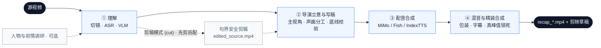

<p align="center">
  
</p>

<h1 align="center">Video Recap Skills</h1>

<p align="center">
  <b>面向影视解说创作者、短剧二创与视频编导的 AI 剪辑工作流：两个自包含技能装进你正在用的编程 Agent，从一段或多集长片一气呵成产出中文解说成片、精装包装与可编辑剪映草稿。</b>
</p>

<p align="center">
  <a href="https://zenstory.ai/zh/video-recap"><b>项目主页</b></a>
  &nbsp;·&nbsp;
  <a href="#安装"><b>安装</b></a>
  &nbsp;·&nbsp;
  <a href="#快速开始"><b>快速开始</b></a>
  &nbsp;·&nbsp;
  <a href="#看看它的输出"><b>看看它的输出</b></a>
  &nbsp;·&nbsp;
  <a href="README.en.md"><b>English</b></a>
</p>

<p align="center">
  <a href="https://github.com/zenstory-ai/video-recap-skills/stargazers"></a>
  <a href="https://github.com/zenstory-ai/video-recap-skills/releases/latest"></a>
  
  <a href="https://www.python.org/"></a>
  <a href="https://github.com/zenstory-ai/video-recap-skills/actions/workflows/skill-validate.yml"></a>
  <a href="https://platform.xiaomimimo.com"></a>
  <a href="./LICENSE"></a>
</p>

<p align="center">
  <a href="https://github.com/zenstory-ai/video-recap-skills/issues"></a>
</p>

https://github.com/user-attachments/assets/f3c2df0c-6869-4f5b-8f4c-cce70b58b667

上面这条 59 秒横屏解说《这一秒过火》，是从四集长剧跨集选段、剪辑、写稿、配音、混音、加包装并经多轮看片打磨后的最终交付；全套结构化产物（故事方案、声画分镜板、解说词、多轨时间线、返修账本与质检报告）均公开在 [examples/guohuo-60s/](examples/guohuo-60s/)。

## 这是什么

`video-recap-skills` 把整条中文视频解说产线收敛为两个自包含技能（生产主技能 `video-recap` + 按需拆片技能 `video-reference`），装进 Claude Code、Codex CLI、OpenCode 或 OpenClaw 即可使用。直接用自然语言给出视频路径（`.mp4 / .mov / .mkv / .webm`）与创作要求，Agent 就会连贯完成：**画面与对白理解 → 导演主线与声画分工 → 句界安全剪辑 → 解说撰稿与底线门禁 → TTS 配音 → 多轨混音、精装包装与剪映草稿导出**。

- **一个 Key 跑通全链，本机零第三方 Python 依赖** — 语音转写（ASR）、画面理解（VLM）与默认配音（TTS）统一走[小米 MiMo](https://platform.xiaomimimo.com)；本机仅需 Python 标准库与 `ffmpeg`，无需 GPU、无需 `pip install`、无需下载模型权重。配音可按需切换为 Fish Audio 或自托管 IndexTTS。
- **先立主视角与声画让位，再按“垫半句、让半句、接半句”写词** — 动笔前先在 `recap_story_plan.json` 定死观众看点、主视角（POV）与局势翻转，并在 `visual_audio_board.json` 指定每一拍的主导音源：高光飙戏原速让给演员原声，动作冲突让给现场声，旁白只垫处境与潜台词。
- **先剪画面后写旁白，五道确定性底线硬门禁兜底** — 剪辑模式（`cut`）先按句末停顿锚点与镜头硬切剪出恒定帧率母版，再对照真实成片时间轴撰稿；全程自动拦截 `<= 0.20s` 残帧闪帧、半句掐断或半句放回原声、超长死气空窗、笼统外貌代称与时间窗字数超载。
- **精装画幅包装与录音室级混音一次成型** — 内置声明式包装引擎（`packaging_plan.json`），支持 `9:16` 竖屏 `4:3` 黄金舞台/黑金画框与 `16:9` 横屏温润纸感字幕条、`@2x` 超采样标题/花字/人物名牌/数据卡、重字重中文字体排版与自动封面图导出；混音层内置人声 EQ 提亮压缩、配乐 `2.2kHz` 人声让位凹槽、瞬态峰值对齐音效与 `-1.0 dBTP` 编码器真峰值闭环。
- **一键导出剪映草稿，配套五维素材库与极简审片台** — 多轨 `timeline.json` 可直接导出为自包含的剪映/CapCut 草稿目录；本地只读工作台提供成片审看，以及按**原片剧目 / 配乐 / 音效 / 音色 / 样式与样片**五维归类的素材在线试听试看。

## 安装

### 1. 准备基础环境

需要 **Python 3.10+**、`PATH` 中有 **`ffmpeg` / `ffprobe`**，以及一个[小米 MiMo](https://platform.xiaomimimo.com) API Key（按量计费无需包月，实测跑完一条完整解说约 ¥1.3）：

```bash
brew install ffmpeg                        # macOS；Debian/Ubuntu 用 apt，Windows 用 winget / scoop / choco
export MIMO_API_KEY=your-mimo-key          # Windows PowerShell：$env:MIMO_API_KEY="your-mimo-key"
export MIMO_TOKEN_PLAN_CLUSTER=cn          # 仅 tp-* Token Plan 密钥需要：cn | sgp | ams
```

> **macOS 硬字幕说明**：烧录硬字幕需 `ffmpeg` 含 `libass` 滤镜。Homebrew 默认 `ffmpeg` 不带 `libass` 时，默认运行会自动降级输出同名 `.srt` 外挂字幕并在 `final_qc.json` 记录提醒；如需烧录硬字幕，可执行 `brew install ffmpeg-full` 并将其 `bin` 目录置于 `PATH` 首位。

### 2. 安装技能到编程 Agent

在 **Claude Code** 中执行：

```text
/plugin marketplace add zenstory-ai/video-recap-skills
/plugin install video-recap-skills@video-recap
```

或在任意支持直接导入 GitHub 仓库的 Agent 中说一句话：

```text
安装这个插件：https://github.com/zenstory-ai/video-recap-skills
```

<details>
<summary><strong>Codex CLI · OpenCode · OpenClaw 安装方式</strong></summary>

**Codex CLI**

```bash
codex plugin marketplace add zenstory-ai/video-recap-skills
codex plugin add video-recap-skills@video-recap
```

**OpenCode**：按[官方 Agent Skills 文档](https://opencode.ai/docs/skills/)，项目级技能位于 `.opencode/skills/<name>/SKILL.md`：

```bash
git clone https://github.com/zenstory-ai/video-recap-skills.git
cd video-recap-skills
mkdir -p .opencode
ln -s ../skills .opencode/skills             # Windows 将 skills\* 复制到 .opencode\skills\
opencode debug skill                         # 应列出全部 2 个技能
```

**OpenClaw**：克隆仓库后导入插件包：

```bash
openclaw plugins install ./video-recap-skills
openclaw skills list
```

同一套技能只注册到一个发现目录即可，避免重名或重复触发。

</details>

<details>
<summary><strong>可选：切换 Fish Audio 或自托管 IndexTTS 配音</strong></summary>

切换配音后端后，ASR 与 VLM 仍走 MiMo（本地参考音频克隆 `--voice-ref` 仅在 MiMo 路径下可用）：

```bash
# 方案 A：Fish Audio（默认模型 s2.1-pro-free，默认音色“娱乐扒妹”，计费以官方策略为准）
export TTS_PROVIDER=fish-audio
export FISH_API_KEY=your-fish-key
export FISH_TTS_REFERENCE_ID=5653cea4ac83480aaf2bf45406556185   # 可选自定义音色 ID

# 方案 B：自托管 IndexTTS（仅在显式指定 --tts-provider index-tts 时启用）
export INDEX_TTS_ENDPOINT=http://127.0.0.1:8000
export INDEX_TTS_VOICE=narrator_default
```

</details>

### 3. 验证环境就绪

安装后可直接让 Agent 做一次环境自检：

```text
检查 video-recap 的运行环境，告诉我 Python、ffmpeg/libass 和 MiMo 配置是否就绪。
```

ClawHub 分发条目与包指纹由[显式发布清单](.clawhub/publish.json)管理（`video-recap` 与 `video-reference` 均为独立自包含包）。历次版本变更见 [CHANGELOG.md](CHANGELOG.md) 与 [Releases](https://github.com/zenstory-ai/video-recap-skills/releases)（仓库已由 `worldwonderer/video-recap-skills` 迁移至 `zenstory-ai/video-recap-skills`）。

## 快速开始

复制下方任一指令、替换为你的本地视频路径即可开跑，无需手动拼装底层命令：

```text
# 1. 单集或整段视频解说成片
给 /path/to/video.mp4 做一个中文解说成片。这是《庆余年》第一集，主角是范闲，字幕烧进画面。

# 2. 多集长片浓缩为一条主线（先剪出母版，再对成片时间轴写词）
用 /path/to/ep1.mp4 和 /path/to/ep2.mp4 做一个十分钟解说，围绕同一条主线剪辑，保留关键原声和人物反应，不要分成两个小总结。

# 3. 竖屏 9:16 黄金舞台精装包装 + 同步导出剪映草稿
把 /path/to/ep1.mp4 剪成 90 秒竖屏短剧解说，采用 4:3 黄金舞台包装加上顶部主标题、人物名牌与转场音效，并导出剪映草稿。

# 4. 绑定五维素材库与系列模板统一出片
按 /path/to/series/recap_project.json 绑定的音色、纯器乐配乐和竖屏包装模板，给 /path/to/ep3.mp4 生成本集解说成片。

# 5. 在浏览器打开本地极简审片台与五维素材库
在本机打开审片台，看看 /path/to/projects 下面的成片、解说词镜头对照和素材库。
```

如果第一轮只想先对齐**分镜与声画让位方案**、暂不调用配音或渲染：

> 先基于 `/path/to/video.mp4` 给出故事主视角与分拍声音分工方案：哪句原声台词或动作停顿完整保留、哪里安排旁白及对应画面证据，确认方案后再进入配音和渲染。

## 流程与架构



两个自包含技能通过 `work_dir/` 下的结构化文件交接，互不耦合：

| 技能 | 定位与职责 | 输入 → 核心交付 |
|---|---|---|
| [`video-recap`](skills/video-recap/) | **统一生产主技能**：场景/ASR/VLM 理解（`understand.py`）· 导演立意与声画分镜 · 句界安全剪辑与残帧体检（`cut.py` / `shot_review.py`）· 解说底线门禁（`validate.py`）· TTS 配音（`voiceover.py`）· 多轨混音、声明式精装包装与字幕渲染（`assemble.py`）· 剪映草稿导出 · 五维素材库与本地工作台 | `源视频` → `recap_<名>.mp4` + `cover.jpg` + `subtitles.srt/.ass` + `timeline.json` + `final_qc.json` |
| [`video-reference`](skills/video-reference/) | **按需拆片参考技能**（不在日常生产链上）：实测优秀成片的镜头节奏、响度与声画交接，剥离原片剧情事实，导出可迁移的制作参考模板 | `参考成片 + 理解产物` → `production_reference.json` |

字段定义与跨阶段契约见[数据结构规范](skills/video-recap/references/data-schema.md)与[仓库架构说明](docs/architecture.md)。

## 看看它的输出

以下片段摘自仓库公开案例 [examples/guohuo-60s/](examples/guohuo-60s/)（仅收录脱敏结构化配置、质检记录与包装代码，不含原剧音视频）。

### 1. 先立观众看点，再把名场面完整让给演员原声

动刀前，Agent 先写出 [`recap_story_plan.json`](examples/guohuo-60s/recap_story_plan.json) 锁定全片观众承诺与主视角，并在 [`visual_audio_board.json`](examples/guohuo-60s/visual_audio_board.json) 中为每一拍指定主导音源。例如洗手台逼问这一拍明确由原声独占（`audio_owner: "original_dialogue"`、`narration_job: "none"`、锁死 `1.0x` 原速）：

```json
{
  "beat_id": "b03",
  "source_id": "episode-03",
  "output_start": 9.206666,
  "output_end": 22.446666,
  "picture_job": "performance",
  "audio_owner": "original_dialogue",
  "original_audio_anchor": "我好想你，日日夜夜地想你，想把你抽筋扒皮，挫骨扬灰",
  "narration_job": "none",
  "handoff": "整整13秒完全交给男主原声，不插半个字旁白，让那句又恨又疯的“日日夜夜地想你……挫骨扬灰”自己砸进观众耳朵。",
  "playback_speed": 1.0
}
```

对应到 [`narration.json`](examples/guohuo-60s/narration.json)，上一句旁白在 `10.2s` 干净收声，中间整整 13 秒完全留给演员原声与 [`original_subtitles.json`](examples/guohuo-60s/original_subtitles.json) 校对后的 `「」` 原声台词，直到 `23.047s` 情绪反转瞬间才接回下一句解说：

```json
[
  {
    "start": 5.773,
    "end": 10.2,
    "narration": "她改名方牧兰，嘴上装作不认识，一个眼神就把三年前的旧情全招了。",
    "overlaps_speech": true
  },
  {
    "start": 23.047,
    "end": 26.5,
    "narration": "天呐，狠话还没落地，下一秒两个人直接亲上了。",
    "overlaps_speech": true
  }
]
```

### 2. 看片返修锁定账本与终审机器质检

多轮看片返修在 [`revision-log.json`](examples/guohuo-60s/revision-log.json) 中严格拆分“本轮修改项（`change_set`）”与“冻结不动项（`frozen_set`）”，杜绝改坏已验收的声音和字幕；交付前经 [`assembly_qc.json`](examples/guohuo-60s/assembly_qc.json)、[`delivery-qc.json`](examples/guohuo-60s/delivery-qc.json) 与 [`content-qc.md`](examples/guohuo-60s/content-qc.md) 完成编码、响度真峰值与逐句事实核查：

[`revision-log.json`](examples/guohuo-60s/revision-log.json)（第 4 轮仅解冻画面拼接）：

```json
{
  "baseline": "final_picture_conform",
  "scope": "picture_conform",
  "change_set": [
    "remove the visible tail-frame pause near 42.08 seconds",
    "restore continuous source movement around 46.24 seconds"
  ],
  "frozen_set": ["story and narration", "all audio", "caption timing and typography", "title and accent graphics"]
}
```

[`delivery-qc.json`](examples/guohuo-60s/delivery-qc.json)（终审机器核验）：

```json
{
  "verdict": "PASS",
  "checks": { "full_decode": true, "audio_stream_matches_master": true, "vmaf_mean": 93.844938, "ssim_all": 0.989302 }
}
```

### 3. 一键导出剪映草稿继续精修

只需在对话中加一句“导出剪映草稿”，`timeline.json` 即转换为自包含的多轨剪映草稿目录（原片片段、逐段解说、BGM、音效、字幕与包装图层分轨排布，媒体自动打包进 `Resources/local` 跨机即开）：


### 4. 本地极简审片台与五维分类素材库

审片台仅监听本机 `127.0.0.1` 且严格只读（仅响应 `GET` 与 `HEAD`），收敛为清爽的 **成片** 与 **素材库** 双视图：支持成片与无解说原剪一键切换播放、解说词与镜头时间轴点击跳转，以及按**原片剧目、配乐、音效、音色、样式与样片**五维分类检索与样片预览：


## 进阶能力一览

| 场景 | 对 Agent 怎么说 / 怎么配 | 机制与边界说明 |
|---|---|---|
| **跨集复用理解缓存** | `分析 /path/to/ep1.mp4 并保存到 /path/to/.video-materials，后续优先复用` | 仅存轻量 JSON/MD 与索引，不重复拷贝大体积视频，无需外部数据库或向量库 |
| **系列绑定素材库与精装包装** | `用 /path/to/library 里的音色、纯器乐 BGM 和 portrait-stage-4x3@v1 模板绑定 recap_project.json 出片` | 支持 `portrait_stage` / `portrait_cinema` / `landscape_cinema` 精装模板；解说模式自动拦截带人声歌词的 BGM，落盘 `resource_lock.json` 记录授权状态（详见[资源库规范](skills/video-recap/references/resource-library.md)与[包装规范](skills/video-recap/references/packaging.md)） |
| **原片硬字幕带检测遮罩** | `先检测 /path/to/video.mp4 的原片字幕带并让我确认预览，再把解说字幕贴到同一区域` | 预览图输出至 `.subtitle_measure/`，支持近方形像素（SAR 偏差 `<= 2%`）的底部硬字幕 |
| **授权参考音频克隆音色** | `用 /path/to/voice-ref.wav 的音色给 /path/to/video.mp4 配解说；我已获声音所有者授权` | 仅在 MiMo TTS 路径下可用，参考音频将发往云端克隆接口，请务必先获本人授权 |
| **无解说纯原声剧情精剪** | `把 /path/to/ep1.mp4 和 ep2.mp4 按主线剪成纯原声高光短片，不加解说配音` | 走 `source-mix` 音频路由，保留原声对白、可选纯器乐配乐与片尾平滑淡出 |

## 常见问题

### 原视频本身没有旁白、甚至一句对白都没有，能直接配解说吗？

完全可以。理解阶段靠 VLM 直接阅读抽帧画面；若素材连人物对白或音轨都没有（如纯画面纪录片、无声 MOV 素材），脚本会自动降级为空转写，也可让 Agent 传入 `--skip-asr` 直接基于画面撰稿（见 [issue #79](https://github.com/zenstory-ai/video-recap-skills/issues/79)）。

### 长视频跑到一半遇上 429 限流或意外中断，需要从头重跑吗？

不需要。VLM 场景分析逐镜实时落盘，遇限流自动降并发重试；中断后重跑原命令即可复用已完成缓存继续推进。写完 `clip_plan.json` 或 `narration.json` 后续跑同理，脚本会自动校验源视频指纹与运行参数一致性。

### 为什么 VLM 认不出角色名字，解说里容易出现“黑衣男子”？

只要已知片名或剧集名，开跑前让 Agent 按[背景调研指南](skills/video-recap/references/research-guide.md)将主要角色全名与关系写入 `work_dir/background_research.json`：VLM 抽帧分析与写稿简报会直接对齐真实人名，且底线门禁 `generic_character_label` 会自动拦截退回笼统外貌代称的稿件。

## 文档导航

| 类别 | 文档链接 |
|---|---|
| **创作与实操指南** | [视频到解说完整流程](https://zenstory.ai/zh/video-recap/video-to-narration) · [原声与旁白分工](https://zenstory.ai/zh/video-recap/original-audio-and-narration) · [影视解说文案怎么写](docs/video-recap-script-writing.md) · [AI 视频分析防编造指南](docs/ai-video-analysis-without-invented-plot.md) · [创作剪辑与去 AI 味手册](skills/video-recap/references/creative-editing-playbook.md) |
| **剪映导出与选型对比** | [剪映 / CapCut 草稿导出指南](https://zenstory.ai/zh/video-recap/capcut-draft) · [导出剪映草稿与成本账单](docs/capcut-jianying-draft-export.md) · [多轨时间线与剪映协议](docs/timeline-and-jianying.md) · [开源 AI 影视解说工具横向对比](docs/open-source-ai-video-recap-tools.md) |
| **架构、包装与配置规范** | [仓库架构说明](docs/architecture.md) · [生产能力边界与验收原则](docs/production-boundaries.md) · [数据结构规范](skills/video-recap/references/data-schema.md) · [精装包装规范](skills/video-recap/references/packaging.md) · [素材与资源库规范](skills/video-recap/references/resource-library.md) · [全量配置手册](skills/video-recap/references/config-playbook.md) |
| **公开案例复盘** | [《这一秒过火》案例产物目录](examples/guohuo-60s/) · [案例复现手册](examples/guohuo-60s/skill-runbook.md) · [从初剪母版到终审交付的四轮复盘](examples/guohuo-60s/iteration-notes.md) |

## 致谢

- [LINUX DO - 新的理想型社区](https://linux.do) — 社区交流与反馈支持
- 剪映草稿协议参考了 [pyJianYingDraft](https://github.com/GuanYixuan/pyJianYingDraft)、[capcut-mate](https://github.com/Hommy-master/capcut-mate) 与 [duo-video](https://github.com/duoec/duo-video)
- 原片字幕带检测算法改编自 [ops120/video-recap-skills-plus](https://github.com/ops120/video-recap-skills-plus)

## 开源许可

MIT License，详见 [LICENSE](LICENSE)。

## ZenStory AI 开源矩阵

本项目由 [ZenStory AI](https://zenstory.ai/zh) 维护——致力于打造开源的 Agent 故事创作、改编与视听生产工具链（GitHub 组织：[zenstory-ai](https://github.com/zenstory-ai)）：

| 项目 | 定位与用途 |
| --- | --- |
| [oh-story-claudecode](https://github.com/zenstory-ai/oh-story-claudecode) | 网文写作 Skill 包：扫榜、拆书、正文创作、去 AI 味精修与封面生成 |
| [drama-skills](https://github.com/zenstory-ai/drama-skills) | AI 短剧 / 漫剧创作 Skill 合集：剧本、角色资产、分镜、生图/生视频提示词与独立审稿 |
| [novel-to-game](https://github.com/zenstory-ai/novel-to-game) | 小说改编互动游戏 Skill 合集：原著拆解、运行环境构建与实机交互验收 |
| [video-recap-skills](https://github.com/zenstory-ai/video-recap-skills) | 将长视频或多集剧集制作成中文解说成片，支持精装包装与导出剪映/CapCut 草稿（本仓库） |
| [oh-story-dsh](https://github.com/zenstory-ai/oh-story-dsh) | DeepSeek Harness 社区插件，集成小说、短剧、游戏与视频解说工作台 |
| [zenstory](https://github.com/zenstory-ai/zenstory) | 对话即创作的 AI 小说写作工作台（[app.zenstory.ai](https://app.zenstory.ai)） |
