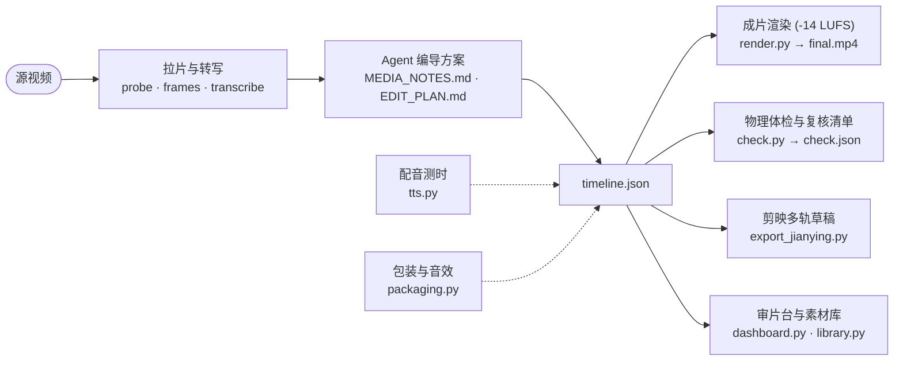

<p align="center">
  
</p>

<h1 align="center">Video Recap Skills</h1>

<p align="center">
  <b>面向编程 Agent 的视频剪辑与解说技能包：覆盖拉片看图、叙事剪辑、配音混音、字幕包装、成片质检与剪映草稿导出，支持 Claude Code、Google Antigravity (AGY)、Codex CLI、OpenCode 与 OpenClaw。</b>
</p>

<p align="center">
  <a href="https://zenstory.ai/zh/video-recap"><b>项目主页</b></a>
  &nbsp;·&nbsp;
  <a href="#核心剪辑与解说工艺"><b>剪辑工艺</b></a>
  &nbsp;·&nbsp;
  <a href="#安装"><b>安装</b></a>
  &nbsp;·&nbsp;
  <a href="#快速开始"><b>快速开始</b></a>
  &nbsp;·&nbsp;
  <a href="#工作原理与配套工具"><b>架构</b></a>
  &nbsp;·&nbsp;
  <a href="README_EN.md"><b>English</b></a>
</p>

<p align="center">
  <a href="https://github.com/zenstory-ai/video-recap-skills/stargazers"></a>
  <a href="https://github.com/zenstory-ai/video-recap-skills/releases/latest"></a>
  
  <a href="https://www.python.org/"></a>
  <a href="https://github.com/zenstory-ai/video-recap-skills/actions/workflows/skill-validate.yml"></a>
  <a href="./LICENSE"></a>
</p>

https://github.com/user-attachments/assets/f3c2df0c-6869-4f5b-8f4c-cce70b58b667

> 上方 59 秒横屏解说示例《这一秒过火》是 v0.7 时期的展示成片，归档说明见 [examples/guohuo-60s/](examples/guohuo-60s/)。

## 核心剪辑与解说工艺

大多数自动化剪辑的问题不在模型，而在缺少基本的编导与后期规范。我们将真实成片制作中的剪辑与解说经验沉淀到技能和工具链中——由多模态 Agent 负责拉片、叙事与画面判断，本地脚本负责精准裁切、配音测时、混音与质检：

### 1. 拉片看图与叙事结构
- **对照画面与字幕稿定主线**：Agent 直接看带时间戳的抽帧拼图（必要时做局部裁切放大），核对人物、表情、动作与台词对应关系后再写分镜方案，避免脱离画面的臆测。
- **单线叙事与声画分工**：开场前 3 秒抓核心冲突起手，全片围绕一条完整事件线推进；旁白只负责交代前情与人物动机，不复述画面和台词，把情绪落点留给原片表演与关键对白。

### 2. 旁白与原声的节奏配比
- **段落式推进，减少碎切**：常规解说以整段旁白（10–25 秒）连贯推进剧情，在冲突高潮或关键对手戏处完整保留原声片段（5–15 秒，一分钟成片约切换 2–4 次），不把原片台词切在半句。
- **画面匹配与声道隔离**：铺旁白时优先切听者反应、动作细节或空镜，避开正脸开口说话的镜头；纯旁白底镜静音处理，防止闪避回弹时漏出原片人声；配乐选用纯音乐，避免与旁白和原声互相干扰。

### 3. 配音连贯性与声画对齐
- **整篇连续合成与校音分离**：使用 Fish Audio（默认 `s2.1-pro-free`）时支持整篇连续合成，保持上下文语气一致，可保留 `[chuckle]`、`[sigh]` 等轻微语气；多音字、年份与缩写通过 `spoken_text` 单独标注读音，成片字幕仍保持干净原文。
- **按实测时长排镜头**：先测算每句真实配音时长，超长时优先精简文案或延展画面，不做音频变速挤压；切镜点落在旁白句末停顿处并保留自然气口；双行字幕按语义停顿折行，默认去掉行尾标点。

### 4. 画幅构图与逐镜选材
- **先确认画幅再动剪**：制作前先确认成片比例（`3:4`、`9:16` 或 `16:9`）以及构图方式（满画幅裁切或保留原画幅）。
- **竖屏满画幅逐镜对焦**：横屏剧集转 `3:4` 满画幅时，看图逐镜指定主体构图焦点；双人正反打按原片切点拆段分别对准说话人，剔除转身虚焦和无效过场，避免直接居中裁切导致主体偏出画面。

### 5. 动态包装与音效规范
- **可定制的 Remotion 透明包装**：内置现代简约排版起点（如 `drama-recap` 无底框双层花字与上下压暗渐变），支持按片子气质直接调整字体、配色与入场节奏；花字简短补充潜台词，避开人脸和字幕安全区。
- **真实音效素材与离线回退**：音效调用真实音频素材，自动避开旁白和原声对白区间；未安装 Node 环境时，可切换纯本地静态 PNG 包装。

### 6. 物理质检与人工复核
- **区分硬性错误与复核提示**：文件损坏、缺画面、缺音轨、分辨率异常等物理问题直接阻断；黑场过渡、长定格、响度偏低、切点音频或疑似叠字等依赖语境的情况仅作提示，汇总至复核清单（`review_hints`）交由 Agent 抽帧确认，不靠固定字速阈值或关键词规则误判。

## 工作原理与配套工具

整个技能包包含两个自包含技能：**`video-recap`**（通用视频剪辑与解说制作）和 **`video-reference`**（按需拆解参考成片的镜头节奏、响度与版式，整理出可复用的脱敏参考笔记）。

- **零第三方 Python 依赖、默认本地运行**：核心链路只需 Python 3.10+ 标准库与 `ffmpeg` / `ffprobe`，无需 `pip install`，也无需必填 API Key；仅在显式配置云端转写或云端配音时才会发起外部请求（详见[远程调用披露](skills/video-recap/references/remote-services.md)）。
- **Markdown 记方案，`timeline.json` 做交付**：需求（`BRIEF.md`）、看片笔记（`MEDIA_NOTES.md`）、剪辑方案（`EDIT_PLAN.md`）与宣发备忘（`PROMO.md`）均为人类可读的 Markdown；剪辑、配音、混音、包装、字幕、质检与剪映导出围绕同一份 `timeline.json` 协作，调整单个镜头或单句台词时只需局部重跑对应步骤。



| 技能 | 组成 | 产出物 |
|---|---|---|
| [`video-recap`](skills/video-recap/) | 6 支核心原子 CLI（`probe.py`、`frames.py`、`transcribe.py`、`tts.py`、`render.py`、`check.py`）+ 5 支按需配套工具（Remotion/PNG 包装 `packaging.py`、剪映/CapCut 导出 `export_jianying.py`、只读审片台 `dashboard.py`、跨项目素材库 `library.py`、旁白逐句配镜 `plan.py`） | `out/final.mp4`、`timeline.json`、`check.json`、`out/review.html`、`out/jianying_draft/` |
| [`video-reference`](skills/video-reference/) | 1 支纯本地参考拆片 CLI（`analyze_reference.py`）：实测镜头切点、时长分布、响度密度并抽帧拼图 | `reference_metrics.json`、`contact_sheet.jpg`、`REFERENCE_NOTES.md` |

## 安装

### 1. 准备基础环境

只需 **Python 3.10+** 与 `PATH` 中的 **`ffmpeg` / `ffprobe`**（默认纯本地即可运行）：

```bash
brew install ffmpeg          # macOS（如需烧录硬字幕，建议 brew install ffmpeg-full）
```

如需接入云端 ASR 或云端配音，按需配置环境变量（如 `ASR_API_URL` + `ASR_API_KEY`，或 `FISH_API_KEY` / `OPENAI_API_KEY` / `INDEX_TTS_ENDPOINT`），完整说明见[远程调用披露](skills/video-recap/references/remote-services.md)。

### 2. 安装技能到编程 Agent

在 **Claude Code** 中执行：

```text
/plugin marketplace add zenstory-ai/video-recap-skills
/plugin install video-recap-skills@video-recap
```

<details>
<summary><strong>Google Antigravity (AGY) · Codex CLI · OpenCode · OpenClaw 安装方式</strong></summary>

**Google Antigravity (AGY)**：通过 `agy` CLI 一键安装（会导入 `.claude-plugin/plugin.json` 至 `~/.gemini/config/plugins/`，在 Antigravity CLI 与 Antigravity App 中自动同步，可用 `/video-recap` 与 `/video-reference` 调用；详见[官方 Skills 文档](https://antigravity.google/docs/skills)）：

```bash
agy plugin install https://github.com/zenstory-ai/video-recap-skills
agy plugin list
```

也可按需将 `skills/video-recap` 与 `skills/video-reference` 放入工作区 `.agents/skills/`（项目级）或 `~/.gemini/config/skills/`（全局，App / CLI / IDE 通用）。

**Codex CLI**

```bash
codex plugin marketplace add zenstory-ai/video-recap-skills
codex plugin add video-recap-skills@video-recap
```

**OpenCode**：按[官方 Agent Skills 文档](https://opencode.ai/docs/skills/)，项目级技能位于 `.opencode/skills/<name>/SKILL.md`：

```bash
git clone https://github.com/zenstory-ai/video-recap-skills.git
cd video-recap-skills
mkdir -p .opencode
ln -s ../skills .opencode/skills
opencode debug skill
```

**OpenClaw**：克隆仓库后导入插件包：

```bash
openclaw plugins install ./video-recap-skills
openclaw skills list
```

</details>

ClawHub 分发由[显式发布清单](.clawhub/publish.json)管理；历次版本变更见 [CHANGELOG.md](CHANGELOG.md)。

## 快速开始

安装后直接用自然语言告诉 Agent 视频路径与剪辑需求即可：

```text
# 1. 多集剧情解说（先看拼图定主线，段落式旁白 + 完整原声对手戏）
用 /path/to/ep1.mp4 和 /path/to/ep2.mp4 做一个三分钟剧情解说，围绕同一条主线剪辑，保留关键原声对白与人物反应。

# 2. 访谈 / 播客高光切片（纯本地，原声不加旁白）
把 /path/to/interview.mp4 剪成 90 秒 9:16 竖屏金句切片，配安全区双语字幕和模糊背景，不加旁白。

# 3. 3:4 满画幅剧集包装（Remotion 动态花字 + 导出剪映草稿）
把 /path/to/clip.mp4 剪成 3:4 满画幅解说，用 Remotion 加上无底框双层动效花字与转场音效，渲染成片并导出剪映草稿。

# 4. 本地审片与返修
为当前工作目录生成离线 review.html，或启动本地只读审片台对照镜头、字幕与复核清单。

# 5. 参考成片拆解（video-reference）
帮我拆解 /path/to/reference.mp4 的镜头节奏、原声配比与包装版式，整理成脱敏的 REFERENCE_NOTES.md。
```

## 审片台与剪映草稿预览

成片渲染之外，支持导出分轨清晰的剪映/CapCut 草稿继续精修，也可在浏览器打开零服务端本地审片台逐句核对：


## 文档导航

| 类别 | 文档链接 |
|---|---|
| **剪辑工艺与技能规范** | [通用剪辑与声画原则](skills/video-recap/references/editorial-craft.md) · [长篇连续解说与 plan.py](skills/video-recap/references/long-form.md) · [长篇写稿与通读改稿](skills/video-recap/references/long-form-script.md) · [竖横屏包装与音效](skills/video-recap/references/packaging-and-sfx.md) · [timeline.json v3 契约](skills/video-recap/references/timeline-schema.md) · [剪映草稿导出](skills/video-recap/references/jianying-export.md) · [审片台与素材库](skills/video-recap/references/material-library.md) · [远程调用披露](skills/video-recap/references/remote-services.md) |
| **仓库架构与边界** | [仓库架构说明](docs/architecture.md) · [生产能力边界与验收原则](docs/production-boundaries.md) · [多轨时间线与剪映协议](docs/timeline-and-jianying.md) · [单测体系](tests/README.md) |
| **案例与写作参考** | [《这一秒过火》归档案例](examples/guohuo-60s/) · [影视解说文案指南](docs/video-recap-script-writing.md) · [AI 视频分析防编造指南](docs/ai-video-analysis-without-invented-plot.md) |

## 致谢与许可

- 感谢 [LINUX DO](https://linux.do) 社区的讨论与反馈；剪映草稿协议参考了 [pyJianYingDraft](https://github.com/GuanYixuan/pyJianYingDraft)、[capcut-mate](https://github.com/Hommy-master/capcut-mate) 与 [duo-video](https://github.com/duoec/duo-video)。
- MIT License，详见 [LICENSE](LICENSE)。

## ZenStory AI 开源矩阵

| 项目 | 定位与用途 |
| --- | --- |
| [oh-story-claudecode](https://github.com/zenstory-ai/oh-story-claudecode) | 网文写作 Skill 包：扫榜、拆书、正文创作、去 AI 味精修与封面生成 |
| [drama-skills](https://github.com/zenstory-ai/drama-skills) | AI 短剧 / 漫剧创作 Skill 合集：剧本、角色资产、分镜、提示词与独立审稿 |
| [novel-to-game](https://github.com/zenstory-ai/novel-to-game) | 小说改编互动游戏 Skill 合集：原著拆解、运行环境构建与实机盲玩验收 |
| [video-recap-skills](https://github.com/zenstory-ai/video-recap-skills) | 通用 AI 视频剪辑与解说技能包：剪辑与解说工艺、本地执行工具、动效包装与剪映导出（本仓库） |
| [oh-story-dsh](https://github.com/zenstory-ai/oh-story-dsh) | DeepSeek Harness 社区插件，集成小说、短剧、游戏与视频解说工作台 |
| [zenstory](https://github.com/zenstory-ai/zenstory) | 对话即创作的 AI 小说写作工作台（[app.zenstory.ai](https://app.zenstory.ai)） |
