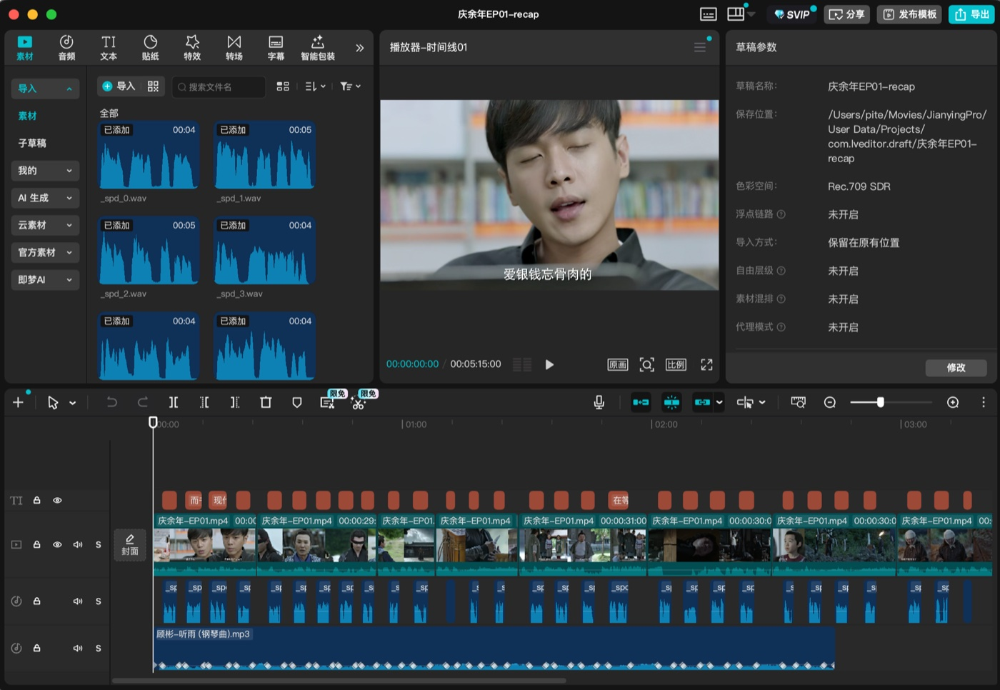
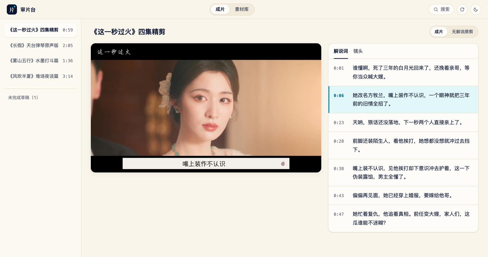
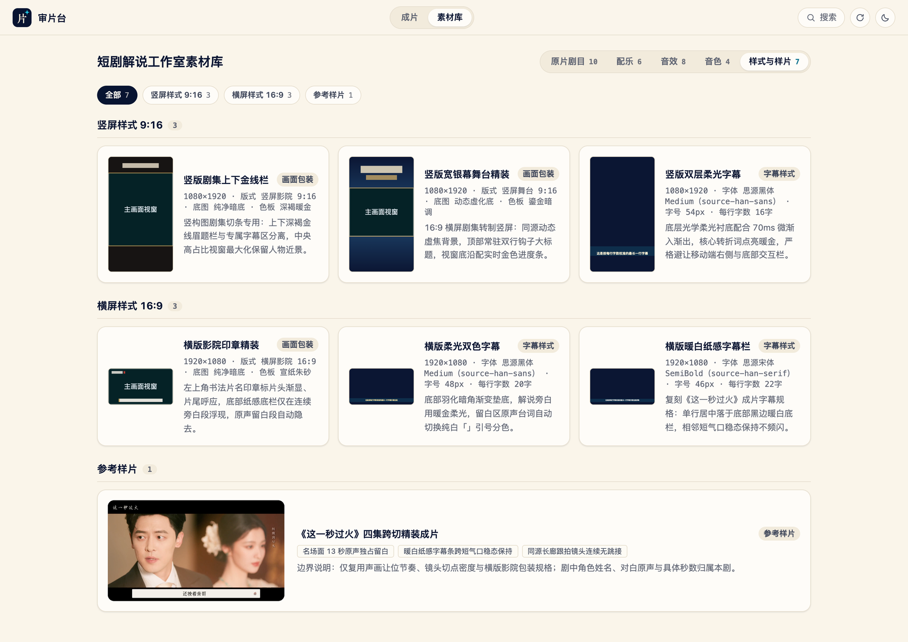

<!-- Last synced with README.md: 2026-11-19 -->
<p align="center">
  
</p>

<h1 align="center">Video Recap Skills</h1>

<p align="center">
  <b>AI video-editing skills for drama recap creators, short-drama editors, and video producers: plug into your coding agent to turn raw footage or multi-episode series into framed, subtitled Chinese-narration recaps—plus editable JianYing / CapCut drafts.</b>
</p>

<p align="center">
  <a href="https://zenstory.ai/video-recap"><b>Project page</b></a>
  &nbsp;·&nbsp;
  <a href="#install"><b>Install</b></a>
  &nbsp;·&nbsp;
  <a href="#quick-start"><b>Quick start</b></a>
  &nbsp;·&nbsp;
  <a href="#see-what-it-produces"><b>See what it produces</b></a>
  &nbsp;·&nbsp;
  <a href="README.md"><b>中文</b></a>
</p>

<p align="center">
  <a href="https://github.com/zenstory-ai/video-recap-skills/stargazers"></a>
  <a href="https://github.com/zenstory-ai/video-recap-skills/releases/latest"></a>
  
  <a href="https://www.python.org/"></a>
  <a href="https://github.com/zenstory-ai/video-recap-skills/actions/workflows/skill-validate.yml"></a>
  <a href="https://platform.xiaomimimo.com"></a>
  <a href="./LICENSE"></a>
</p>

<p align="center">
  <a href="https://github.com/zenstory-ai/video-recap-skills/issues"></a>
</p>

https://github.com/user-attachments/assets/f3c2df0c-6869-4f5b-8f4c-cce70b58b667

The 59-second landscape recap above, *Guohuo (这一秒过火)*, was pulled from four drama episodes—selected, cut, scripted, voiced, mixed, framed, and refined over viewing rounds. All working files behind it (story outline, sound plan, narration script, multi-track timeline, revision notes, and QC checks) are in [examples/guohuo-60s/](examples/guohuo-60s/).

## What it is

`video-recap-skills` gives your coding agent two companion skills—`video-recap` to make recaps and `video-reference` to study reference edits—inside Claude Code, Codex CLI, OpenCode, or OpenClaw. Point it at local video files (`.mp4 / .mov / .mkv / .webm`) and describe the angle you want in plain language; the agent runs the whole workflow: **read scenes & dialogue → pick the story angle & original-sound moments → cut cleanly on speech pauses → write narration & check flash frames / timing → generate voiceover → mix audio, add frames & captions, and export a JianYing / CapCut draft**.

- **One API key, no `pip install`** — Speech transcription, visual analysis, and default voiceover all run on the [Xiaomi MiMo](https://platform.xiaomimimo.com) API. Locally you only need Python's standard library and `ffmpeg`—no GPU, no `pip install`, and no model downloads. You can also switch voiceover to Fish Audio or self-hosted IndexTTS.
- **Keep original dialogue on key scenes** — Before writing a word, the agent maps out the hook and point of view in `recap_story_plan.json` and marks who owns the audio on every beat in `visual_audio_board.json`: big acting moments stay at `1.0x` in the actors' own voices, action scenes keep their live sound, and narration steps in around them for context and subtext.
- **Cut video before writing narration so timing matches** — Cut mode (`cut`) trims footage on speech pauses and shot changes first, then writes narration against the actual edited timeline instead of guessing durations. Cuts won't chop lines mid-sentence, and built-in checks block `<= 0.20s` flash frames, unfinished sentences, and lines too long for their time slots, while flagging long silences or vague labels like "man in black".
- **Built-in 9:16 / 16:9 frames, subtitle styling, and clean audio mix** — Supports `9:16` vertical layouts (`4:3` centered stage frame or top-and-bottom cinema bars) and `16:9` landscape rounded subtitle bands, complete with two-line titles, callouts, character name tags, data cards, and an automatic `cover.jpg` thumbnail. Audio mixing brightens vocals, carves room in the background music so speech stays clear, lines up transition SFX, and caps peaks at `-1.0 dBTP` to prevent clipping.
- **JianYing / CapCut draft export and local review page** — Turn `timeline.json` into a self-contained JianYing / CapCut draft folder that opens cleanly on another machine for fine-tuning. A local read-only web page lets you watch cuts alongside synced scripts and preview **Source Series, BGM, SFX, Voices, and Styles & Samples**.

## Install

### 1. Prerequisites

Requires **Python 3.10+**, **`ffmpeg` / `ffprobe`** on `PATH`, and one [Xiaomi MiMo](https://platform.xiaomimimo.com) API key (pay-as-you-go with no monthly plan; one full recap costs roughly CNY 1.3):

```bash
brew install ffmpeg                        # macOS; apt on Debian/Ubuntu, winget / scoop / choco on Windows
export MIMO_API_KEY=your-mimo-key          # Windows PowerShell: $env:MIMO_API_KEY="your-mimo-key"
export MIMO_TOKEN_PLAN_CLUSTER=cn          # tp-* Token Plan keys only: cn | sgp | ams
```

> **macOS burned-in subtitles**: Burning subtitles requires `ffmpeg` built with `libass`. Stock Homebrew `ffmpeg` omits `libass`, so default runs write a matching `.srt` sidecar file instead and note it in `final_qc.json`. To burn subtitles directly on macOS, run `brew install ffmpeg-full` and put its `bin` directory first on `PATH`.

### 2. Add to your coding agent

In **Claude Code**:

```text
/plugin marketplace add zenstory-ai/video-recap-skills
/plugin install video-recap-skills@video-recap
```

Or ask any agent that imports GitHub repositories directly:

```text
Install this plugin: https://github.com/zenstory-ai/video-recap-skills
```

<details>
<summary><strong>Codex CLI · OpenCode · OpenClaw installation</strong></summary>

**Codex CLI**

```bash
codex plugin marketplace add zenstory-ai/video-recap-skills
codex plugin add video-recap-skills@video-recap
```

**OpenCode**: per the [official Agent Skills documentation](https://opencode.ai/docs/skills/), project skills live under `.opencode/skills/<name>/SKILL.md`:

```bash
git clone https://github.com/zenstory-ai/video-recap-skills.git
cd video-recap-skills
mkdir -p .opencode
ln -s ../skills .opencode/skills             # on Windows, copy skills\* into .opencode\skills\
opencode debug skill                         # should list both skills
```

**OpenClaw**: clone the repository and import the plugin bundle:

```bash
openclaw plugins install ./video-recap-skills
openclaw skills list
```

Install through one method only so the skills aren't registered twice.

</details>

<details>
<summary><strong>Optional: switch voiceover to Fish Audio or self-hosted IndexTTS</strong></summary>

Speech transcription and visual analysis continue to use MiMo (reference-audio cloning via `--voice-ref` is available on the MiMo TTS path only):

```bash
# Option A: Fish Audio (default model s2.1-pro-free, built-in "娱乐扒妹" voice; billed by Fish Audio)
export TTS_PROVIDER=fish-audio
export FISH_API_KEY=your-fish-key
export FISH_TTS_REFERENCE_ID=5653cea4ac83480aaf2bf45406556185   # optional custom voice ID

# Option B: Self-hosted IndexTTS (enable via TTS_PROVIDER=index-tts or --tts-provider index-tts)
export TTS_PROVIDER=index-tts
export INDEX_TTS_ENDPOINT=http://127.0.0.1:8000/tts
export INDEX_TTS_VOICE=narrator_default
```

</details>

### 3. Verify your setup

Ask your agent to run a quick check:

```text
Check the video-recap environment and tell me whether Python, ffmpeg/libass, and MiMo are ready.
```

Release history is in [CHANGELOG.md](CHANGELOG.md) and [Releases](https://github.com/zenstory-ai/video-recap-skills/releases) (migrated from `worldwonderer/video-recap-skills` to `zenstory-ai/video-recap-skills`; ClawHub package manifest in [publish.json](.clawhub/publish.json)).

## Quick start

Copy any prompt below and swap in your local file paths—no need to run underlying scripts by hand:

```text
# 1. Single-episode or full-video Chinese recap
Make a Chinese-narration recap of /path/to/video.mp4. It is episode 1 of 庆余年, the lead is 范闲, and subtitles should be burned in.

# 2. Cut multiple episodes into one storyline (cut video first, then write narration to match)
Use /path/to/ep1.mp4 and /path/to/ep2.mp4 to make one ten-minute recap with a shared story spine, keeping key original dialogue and character reactions, not two separate summaries.

# 3. 9:16 vertical frame & captions + JianYing draft export
Cut /path/to/ep1.mp4 into a 90-second vertical short-drama recap with a centered 4:3 frame, top title, character name tags, and transition SFX, and export a JianYing draft.

# 4. Keep the same voice, music, and frame style across a series
Make a recap for /path/to/ep3.mp4 using the voice, instrumental BGM, and vertical frame style configured in /path/to/series/recap_project.json.

# 5. Open the local review and asset page in your browser
Open the local review page for /path/to/projects so I can check finished recaps, synced scripts/shots, and the asset library.
```

If you want to review the **story angle and original-dialogue plan** before voicing or rendering:

> Look through `/path/to/video.mp4` and propose the story angle and sound plan first: which original dialogue lines and action pauses stay untouched, and where narration comes in. Wait for my approval before generating voiceover or rendering.

## Workflow and architecture

```mermaid
flowchart LR
    video(["Source Video"]) --> understand["① Understand<br/>shot cuts · speech · visuals"]
    research["Character & plot notes · optional"] -.-> understand
    understand --> plan["② Story & Script<br/>keep dialogue · write lines · check timing"]
    understand -. "cut mode · cut first" .-> cut["Cut on Speech Pauses<br/>edited_source.mp4"] -.-> plan
    plan --> voiceover["③ Voiceover<br/>MiMo / Fish / IndexTTS"]
    voiceover --> assemble["④ Mix & Frame<br/>9:16 / 16:9 frames · captions · peak limit"]
    assemble --> output(["recap_*.mp4 + JianYing Draft"])
    classDef io fill:#0f172a,stroke:#0f172a,color:#fff;
    classDef stage fill:#eff6ff,stroke:#3b82f6,color:#1e293b;
    classDef opt fill:#f8fafc,stroke:#94a3b8,color:#475569;
    class video,output io;
    class understand,plan,voiceover,assemble stage;
    class research,cut opt;
```



Both skills run independently and hand off files inside `work_dir/`:

| Skill | What it does | Input → Output |
|---|---|---|
| [`video-recap`](skills/video-recap/) | **Main recap skill**: shot, speech, and visual analysis (`understand.py`) · story angle & sound plan · pause-aligned cutting & flash-frame check (`cut.py` / `shot_review.py`) · script timing & sentence check (`validate.py`) · voiceover synthesis (`voiceover.py`) · multi-track mixing, 9:16 / 16:9 framing & captions (`assemble.py`) · JianYing draft export · local review & asset page | `source video` → `recap_<name>.mp4` + `cover.jpg` + `subtitles.srt/.ass` + `timeline.json` + `final_qc.json` |
| [`video-reference`](skills/video-reference/) | **Reference breakdown skill** (on demand): measures shot pacing, loudness, and dialogue-to-narration handoffs from a finished edit, stripping out plot spoilers into a reusable editing reference | `reference video + analysis files` → `production_reference.json` |

File formats and stage boundaries are documented in the [Data Schema](skills/video-recap/references/data-schema.md) and [Architecture Overview](docs/architecture.md).

## See what it produces

The excerpts below come directly from [examples/guohuo-60s/](examples/guohuo-60s/) (sanitized config files, QC records, and overlay code only—no episode audio or video is stored in the repo).

### 1. Set the story hook first, then leave key scenes to original dialogue

Before cutting, the agent writes [`recap_story_plan.json`](examples/guohuo-60s/recap_story_plan.json) to set the hook and point of view, then marks who owns the sound on each beat in [`visual_audio_board.json`](examples/guohuo-60s/visual_audio_board.json). In beat `b03` (the washstand confrontation), `original_dialogue` owns all 13 seconds at `1.0x` speed with `narration_job: "none"`:

```json
{
  "beat_id": "b03",
  "source_id": "episode-03",
  "output_start": 9.206666,
  "output_end": 22.446666,
  "picture_job": "performance",
  "audio_owner": "original_dialogue",
  "original_audio_anchor": "我好想你，日日夜夜地想你，想把你抽筋扒皮，挫骨扬灰",
  "narration_job": "none",
  "handoff": "整整13秒完全交给男主原声，不插半个字旁白，让那句又恨又疯的“日日夜夜地想你……挫骨扬灰”自己砸进观众耳朵。",
  "playback_speed": 1.0
}
```

In [`narration.json`](examples/guohuo-60s/narration.json), the previous line finishes cleanly at `10.2s`, leaving the next 13 seconds untouched for the actor's voice and the episode's burned-in subtitles (verified transcript timing is saved in [`original_subtitles.json`](examples/guohuo-60s/original_subtitles.json) for subtitle masking or `.srt` export without stacking duplicate captions here), and comes back in at `23.047s` right on the emotional turn:

```json
[
  {
    "start": 5.773,
    "end": 10.2,
    "narration": "她改名方牧兰，嘴上装作不认识，一个眼神就把三年前的旧情全招了。",
    "overlaps_speech": true
  },
  {
    "start": 23.047,
    "end": 26.5,
    "narration": "天呐，狠话还没落地，下一秒两个人直接亲上了。",
    "overlaps_speech": true
  }
]
```

### 2. Targeted revisions without breaking approved tracks, plus automated QC

During viewing tweaks, [`revision-log.json`](examples/guohuo-60s/revision-log.json) separates what changes in this pass (`change_set`) from what stays locked (`frozen_set`), so fixing a cut never disturbs approved audio or captions. Before delivery, [`assembly_qc.json`](examples/guohuo-60s/assembly_qc.json), [`delivery-qc.json`](examples/guohuo-60s/delivery-qc.json), and [`content-qc.md`](examples/guohuo-60s/content-qc.md) check video decoding, audio peaks, and line-by-line facts:

[`revision-log.json`](examples/guohuo-60s/revision-log.json) (round 4 adjusts picture joins only and keeps everything else locked):

```json
{
  "baseline": "final_picture_conform",
  "scope": "picture_conform",
  "change_set": [
    "remove the visible tail-frame pause near 42.08 seconds",
    "restore continuous source movement around 46.24 seconds"
  ],
  "frozen_set": ["story and narration", "all audio", "caption timing and typography", "title and accent graphics"]
}
```

[`delivery-qc.json`](examples/guohuo-60s/delivery-qc.json) (pre-delivery video and audio check):

```json
{
  "verdict": "PASS",
  "checks": { "full_decode": true, "audio_stream_matches_master": true, "vmaf_mean": 93.844938, "ssim_all": 0.989302 }
}
```

### 3. Keep editing in JianYing / CapCut

Ask the agent to "export a JianYing draft" and `timeline.json` becomes a self-contained multi-track draft folder—source clips, per-line voiceover, BGM, captions, and frame graphics on separate tracks, with media packed into `Resources/local` so the draft opens cleanly on another computer:



### 4. Local review page and asset browser

Bound to `127.0.0.1` and strictly read-only, the local review page splits into two tabs: **Finished Films** lets you toggle between narrated recaps and raw cuts while clicking any line or shot to jump to that timestamp; **Asset Library** organizes **Source Series, BGM, SFX, Voices, and Styles & Samples** so you can audition voices and music or preview 9:16 / 16:9 frame and subtitle styles:





## Advanced capabilities

| Scenario | What to tell your agent | Notes |
|---|---|---|
| **Reuse analysis across episodes** | `Analyze /path/to/ep1.mp4 and save it under /path/to/.video-materials so later episodes can reuse it` | Saves lightweight transcript and shot files only—never copies heavy video files or needs a database |
| **Keep one voice, BGM & frame style all season** | `Bind the voice, instrumental BGM, and portrait-stage-4x3@v1 frame from /path/to/library in recap_project.json` | Includes `portrait_stage` / `portrait_cinema` / `landscape_cinema` layouts; blocks BGM with vocals in narration mode and records asset sources in `resource_lock.json` ([Resource Library](skills/video-recap/references/resource-library.md) · [Packaging Spec](skills/video-recap/references/packaging.md)) |
| **Cover burned-in source subtitles** | `Measure the bottom subtitle band in /path/to/video.mp4 and show me a preview before placing new captions over it` | Writes preview frames to `.subtitle_measure/` for bottom hard subtitles on standard pixel aspect ratios (SAR within `2%`) |
| **Clone a voice from authorized audio** | `Use the voice in /path/to/voice-ref.wav for /path/to/video.mp4; I have the speaker's permission` | Available on the MiMo TTS path; reference audio is uploaded for synthesis—obtain the speaker's consent first |
| **Cut an original-dialogue highlight reel** | `Cut /path/to/ep1.mp4 and ep2.mp4 into an original-dialogue highlight reel with no voiceover` | Keeps clean original dialogue with optional instrumental BGM and a smooth fade-out at the end |

## FAQ

### My video has no narration—or no dialogue at all. Can it still make a recap?

Yes. Scene analysis reads sampled frames directly. When a file has no speech or even no audio track (such as silent B-roll or nature footage), transcription leaves an empty transcript automatically, or you can ask the agent to pass `--skip-asr` and write strictly from the visuals (see [issue #79](https://github.com/zenstory-ai/video-recap-skills/issues/79)).

### A long video hit a 429 rate limit or stopped halfway. Do I have to start over?

No. Visual analysis saves each completed shot to disk and slows down concurrency automatically on rate limits. Running the same command again skips finished shots—and the same applies when continuing after `clip_plan.json` or `narration.json` as long as the source video and run flags match.

### Why does visual analysis call characters "man in black" instead of their names?

Whenever you know the show or film title, ask the agent to follow the [Research Guide](skills/video-recap/references/research-guide.md) and write main character names and relationships into `work_dir/background_research.json` before starting. Visual analysis and script briefs will use their real names, and validation will warn if a draft still slips back to generic appearance labels.

## Acknowledgments

- <https://linux.do>
- <https://github.com/GuanYixuan/pyJianYingDraft> · <https://github.com/Hommy-master/capcut-mate> · <https://github.com/duoec/duo-video> · <https://github.com/ops120/video-recap-skills-plus>

## Part of ZenStory AI

Maintained by [ZenStory AI](https://zenstory.ai) — open-source agent tools for writing, adapting, and producing stories (GitHub: [@zenstory-ai](https://github.com/zenstory-ai)):

| Project | What it does |
| --- | --- |
| [oh-story-claudecode](https://github.com/zenstory-ai/oh-story-claudecode) | Web-fiction writing skill pack: chart scanning, deconstruction, drafting, de-AI-flavor polish, and cover design |
| [drama-skills](https://github.com/zenstory-ai/drama-skills) | AI short-drama / motion-comic suite: scripts, character assets, storyboards, image/video prompts, and independent review |
| [novel-to-game](https://github.com/zenstory-ai/novel-to-game) | Agent skills for source-grounded novel adaptation, runtime builds, and interactive QA |
| [video-recap-skills](https://github.com/zenstory-ai/video-recap-skills) | Cut long videos or multi-episode series into framed, subtitled Chinese-narration recaps with editable JianYing / CapCut drafts (this repo) |
| [oh-story-dsh](https://github.com/zenstory-ai/oh-story-dsh) | Community DeepSeek Harness plugin integrating novel, short-drama, game, and video-recap workbenches |
| [zenstory](https://github.com/zenstory-ai/zenstory) | Chat-to-create AI novel-writing workbench ([app.zenstory.ai](https://app.zenstory.ai)) |
