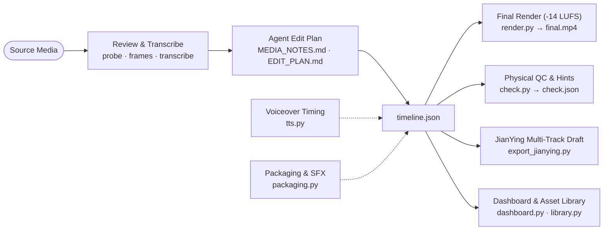

<!-- Last synced with README.md: 2026-11-21 -->
<p align="center">
  
</p>

<h1 align="center">Video Recap Skills</h1>

<p align="center">
  <b>Video editing and narration skill pack for coding agents: footage review, story cutting, voiceover mixing, subtitle & motion packaging, physical QC, and JianYing/CapCut draft export for Claude Code, Codex CLI, OpenCode, and OpenClaw.</b>
</p>

<p align="center">
  <a href="https://zenstory.ai/video-recap"><b>Project page</b></a>
  &nbsp;·&nbsp;
  <a href="#editorial--post-production-craft"><b>Editorial Craft</b></a>
  &nbsp;·&nbsp;
  <a href="#install"><b>Install</b></a>
  &nbsp;·&nbsp;
  <a href="#quick-start"><b>Quick start</b></a>
  &nbsp;·&nbsp;
  <a href="#how-it-works"><b>Architecture</b></a>
  &nbsp;·&nbsp;
  <a href="README.md"><b>中文</b></a>
</p>

<p align="center">
  <a href="https://github.com/zenstory-ai/video-recap-skills/stargazers"></a>
  <a href="https://github.com/zenstory-ai/video-recap-skills/releases/latest"></a>
  
  <a href="https://www.python.org/"></a>
  <a href="https://github.com/zenstory-ai/video-recap-skills/actions/workflows/skill-validate.yml"></a>
  <a href="./LICENSE"></a>
</p>

https://github.com/user-attachments/assets/f3c2df0c-6869-4f5b-8f4c-cce70b58b667

> Sanitized planning artifacts and post-mortem notes for the 59-second showcase above (*Guohuo*) are published in [examples/guohuo-60s/](examples/guohuo-60s/).

## Editorial & Post-Production Craft

Most issues in automated video editing stem from missing editorial and post-production discipline rather than model capability. We encode real-world editing and narration practices directly into the skills and tooling—the multimodal Agent handles footage review, story structure, and visual framing, while local scripts handle exact cutting, voiceover timing, mixing, and QC:

### 1. Footage Review & Story Structure
- **Frame-grounded planning**: The Agent inspects timestamped contact sheets (and zoomed crops when needed) alongside transcripts to verify characters, expressions, actions, and dialogue before outlining the cut.
- **Single-spine narrative & audio-visual division**: Open with the core conflict in the first 3 seconds and follow one complete storyline. Narration supplies context and character motivation without repeating what is already shown or spoken; emotional beats land on original performances and key lines.

### 2. Narration & Original Audio Pacing
- **Block-based progression, fewer abrupt switches**: Advance the story in coherent narration blocks (10–25s) and hand back intact original-audio scenes (5–15s) at key exchanges—roughly 2–4 switches per minute—without clipping dialogue mid-sentence.
- **Shot matching & track isolation**: Cover narration with reaction shots, gestures, or cutaways rather than talking faces; mute narration-bed clips so source speech never bleeds through ducking release; use instrumental BGM when narration and dialogue coexist.

### 3. Voiceover Continuity & Timing Alignment
- **Whole-article synthesis & pronunciation control**: With Fish Audio (default `s2.1-pro-free`), whole-article synthesis keeps vocal tone consistent across paragraphs and preserves subtle cues such as `[chuckle]` or `[sigh]`. `spoken_text` handles tricky pronunciations (years, acronyms, heteronyms) without altering clean on-screen captions.
- **Measured duration first**: Measure actual voiceover length before locking picture timing; shorten copy or extend shots when lines run long instead of speeding up audio. Align cuts to natural sentence pauses and wrap 2-line subtitles at semantic breaks without trailing punctuation.

### 4. Aspect Ratio Framing & Shot Selection
- **Confirm aspect ratio upfront**: Align on target aspect ratio (`3:4`, `9:16`, or `16:9`) and framing mode (`cover` vs. `contain`) before cutting.
- **Per-shot framing for vertical full-bleed**: When adapting widescreen footage to `3:4` full-bleed, set per-shot focal coordinates from visual review; split shot/reverse-shot dialogue at source cuts so each frame stays centered on the speaker, dropping out-of-focus turns and filler transitions.

### 5. Motion Packaging & Sound Effects
- **Customizable Remotion transparent overlays**: Includes clean editorial starting points (such as `drama-recap` frameless two-line callouts and subtle top/bottom scrims) whose typography, palette, and motion timing can be tailored to each video while staying clear of faces and subtitle safe zones.
- **Real SFX assets & offline fallback**: Sound effects use real audio assets placed clear of narration and dialogue windows. Without Node.js, packaging falls back cleanly to local static PNG overlays.

### 6. Physical QC & Editorial Review
- **Hard errors vs. review hints**: Deterministic physical breakage (corrupt streams, missing video/audio, invalid dimensions) fails outright. Context-dependent items—dark transitions, freeze holds, low loudness, edge audio, or possible overlaps—surface as non-blocking `review_hints` for visual inspection rather than failing on rigid word-rate or regex rules.

## How it works

The pack ships two self-contained skills: **`video-recap`** (general-purpose video editing and narration) and **`video-reference`** (on-demand local analysis of reference videos into reusable, sanitized `REFERENCE_NOTES.md`).

- **Zero third-party Python dependencies, local by default**: Core tools require only Python 3.10+ stdlib and `ffmpeg` / `ffprobe`—no `pip install`, no mandatory API keys. External requests occur only when you explicitly enable remote ASR or cloud TTS (see [Remote Services](skills/video-recap/references/remote-services.md)).
- **Markdown for planning, `timeline.json` for execution**: Briefs (`BRIEF.md`), footage notes (`MEDIA_NOTES.md`), edit plans (`EDIT_PLAN.md`), and promo copy (`PROMO.md`) live in readable Markdown. Cutting, voiceover, mixing, packaging, subtitles, QC, and JianYing export share one canonical `timeline.json`, allowing targeted re-runs after single-shot or single-line edits.



| Skill | Components | Core Deliverables |
|---|---|---|
| [`video-recap`](skills/video-recap/) | 6 core atomic CLIs (`probe.py`, `frames.py`, `transcribe.py`, `tts.py`, `render.py`, `check.py`) + 4 optional companion tools (`packaging.py`, `export_jianying.py`, `dashboard.py`, `library.py`) | `out/final.mp4`, `timeline.json`, `check.json`, `out/review.html`, `out/jianying_draft/` |
| [`video-reference`](skills/video-reference/) | 1 local-only analyzer CLI (`analyze_reference.py`): measures cuts, shot-length stats, loudness/audio density, and renders a contact sheet | `reference_metrics.json`, `contact_sheet.jpg`, `REFERENCE_NOTES.md` |

## Install

### 1. Prerequisites

Only **Python 3.10+** and **`ffmpeg` / `ffprobe`** on `PATH` are required (100% local by default):

```bash
brew install ffmpeg          # macOS (for burned-in libass subtitles, install ffmpeg-full)
```

For optional remote ASR or TTS backends, set the corresponding environment variables (`ASR_API_URL` + `ASR_API_KEY`, or `FISH_API_KEY` / `OPENAI_API_KEY` / `INDEX_TTS_ENDPOINT`); see [Remote Services](skills/video-recap/references/remote-services.md).

### 2. Add to your coding agent

In **Claude Code**:

```text
/plugin marketplace add zenstory-ai/video-recap-skills
/plugin install video-recap-skills@video-recap
```

<details>
<summary><strong>Codex CLI · OpenCode · OpenClaw installation</strong></summary>

**Codex CLI**

```bash
codex plugin marketplace add zenstory-ai/video-recap-skills
codex plugin add video-recap-skills@video-recap
```

**OpenCode**: per the [official Agent Skills documentation](https://opencode.ai/docs/skills/), project skills live under `.opencode/skills/<name>/SKILL.md`:

```bash
git clone https://github.com/zenstory-ai/video-recap-skills.git
cd video-recap-skills
mkdir -p .opencode
ln -s ../skills .opencode/skills
opencode debug skill
```

**OpenClaw**: clone the repository and import the plugin bundle:

```bash
openclaw plugins install ./video-recap-skills
openclaw skills list
```

</details>

ClawHub packages are tracked in [.clawhub/publish.json](.clawhub/publish.json); release history lives in [CHANGELOG.md](CHANGELOG.md).

## Quick start

Describe your footage paths and editing goals in plain language:

```text
# 1. Multi-source story recap (contact-sheet review, block narration + intact dialogue)
Use /path/to/ep1.mp4 and /path/to/ep2.mp4 to make a 3-minute narrated recap with a single story spine, preserving key original dialogue and reactions.

# 2. Original-audio highlight cut / podcast clip (local only, no voiceover)
Cut /path/to/interview.mp4 into a 90-second 9:16 vertical highlight with blurred backdrop and safe-zone captions, no narration.

# 3. 3:4 full-bleed drama packaging (Remotion motion callouts + JianYing/CapCut draft)
Edit /path/to/clip.mp4 as a 3:4 full-bleed recap with Remotion frameless stacked callouts and transition SFX, render the final video, and export a JianYing draft.

# 4. Local screening & review
Build an offline review.html or launch the read-only local dashboard to inspect the cut, synced subtitles, and review hints.

# 5. Reference video breakdown (video-reference)
Analyze /path/to/reference.mp4 for shot pacing, dialogue balance, and visual layout, and distill reusable notes into REFERENCE_NOTES.md.
```

## Screening dashboard & JianYing export preview

Beyond rendering the final MP4, export a multi-track JianYing/CapCut draft for fine-tuning or open the zero-server screening dashboard in your browser:


## Documentation

| Category | Links |
|---|---|
| **Editorial Craft & Skill Specs** | [Editorial Craft](skills/video-recap/references/editorial-craft.md) · [Packaging & SFX](skills/video-recap/references/packaging-and-sfx.md) · [timeline.json v3 Contract](skills/video-recap/references/timeline-schema.md) · [JianYing Export](skills/video-recap/references/jianying-export.md) · [Dashboard & Library](skills/video-recap/references/material-library.md) · [Remote Services](skills/video-recap/references/remote-services.md) |
| **Architecture & Boundaries** | [Architecture Overview (ZH)](docs/architecture.md) · [Production Boundaries (ZH)](docs/production-boundaries.md) · [Multi-track Timeline & JianYing Protocol](docs/timeline-and-jianying.md) · [Test Suite (ZH)](tests/README.md) |
| **Case Study & Guides** | [*Guohuo* Artifact Directory](examples/guohuo-60s/) · [Recap Script Writing (ZH)](docs/video-recap-script-writing.md) · [Grounding Analysis Without Invented Plot (ZH)](docs/ai-video-analysis-without-invented-plot.md) |

## Acknowledgements & License

- Thanks to the [LINUX DO](https://linux.do) community; JianYing protocol skeletons reference [pyJianYingDraft](https://github.com/GuanYixuan/pyJianYingDraft), [capcut-mate](https://github.com/Hommy-master/capcut-mate), and [duo-video](https://github.com/duoec/duo-video).
- MIT License — see [LICENSE](LICENSE).

## Part of ZenStory AI

| Project | What it does |
| --- | --- |
| [oh-story-claudecode](https://github.com/zenstory-ai/oh-story-claudecode) | Web-fiction writing skill pack: chart scanning, deconstruction, drafting, de-AI-flavor polish, and cover design |
| [drama-skills](https://github.com/zenstory-ai/drama-skills) | AI short-drama / motion-comic suite: scripts, character assets, storyboards, prompts, and independent review |
| [novel-to-game](https://github.com/zenstory-ai/novel-to-game) | Agent skills for source-grounded novel adaptation, runtime builds, and blind-playtest QA |
| [video-recap-skills](https://github.com/zenstory-ai/video-recap-skills) | General-purpose AI video editing & recap skill pack with editorial craft, local execution tools, motion packaging, and JianYing export (this repo) |
| [oh-story-dsh](https://github.com/zenstory-ai/oh-story-dsh) | Community DeepSeek Harness plugin integrating novel, short-drama, game, and video-recap workbenches |
| [zenstory](https://github.com/zenstory-ai/zenstory) | Chat-to-create AI novel-writing workbench ([app.zenstory.ai](https://app.zenstory.ai)) |
