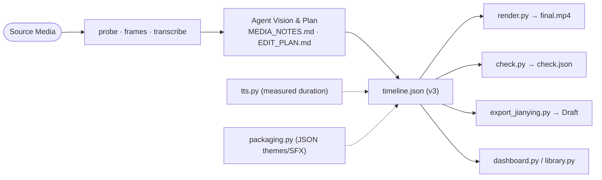

<!-- Last synced with README.md: 2026-11-21 -->
<p align="center">
  
</p>

<h1 align="center">Video Recap Skills</h1>

<p align="center">
  <b>General-purpose AI video editing and narration skill pack: minimal stateless atomic CLIs and a single canonical <code>timeline.json</code> bus for Claude Code, Codex CLI, OpenCode, and OpenClaw—covering multi-source cutting, multimodal frame viewing, voiceover mixing, vertical/landscape packaging, physical QA, and JianYing/CapCut draft export.</b>
</p>

<p align="center">
  <a href="https://zenstory.ai/video-recap"><b>Project page</b></a>
  &nbsp;·&nbsp;
  <a href="#install"><b>Install</b></a>
  &nbsp;·&nbsp;
  <a href="#quick-start"><b>Quick start</b></a>
  &nbsp;·&nbsp;
  <a href="#architecture--atomic-tools"><b>Architecture</b></a>
  &nbsp;·&nbsp;
  <a href="README.md"><b>中文</b></a>
</p>

<p align="center">
  <a href="https://github.com/zenstory-ai/video-recap-skills/stargazers"></a>
  <a href="https://github.com/zenstory-ai/video-recap-skills/releases/latest"></a>
  
  <a href="https://www.python.org/"></a>
  <a href="https://github.com/zenstory-ai/video-recap-skills/actions/workflows/skill-validate.yml"></a>
  <a href="./LICENSE"></a>
</p>

https://github.com/user-attachments/assets/f3c2df0c-6869-4f5b-8f4c-cce70b58b667

> Sanitized planning artifacts and post-mortem notes for the 59-second showcase above (*Guohuo*) are published in [examples/guohuo-60s/](examples/guohuo-60s/).

## What it is

`video-recap-skills` ships two self-contained skills: `video-recap` (general-purpose video editing & narration production) and `video-reference` (on-demand local reference-video analysis). Its core design principle is **"judgment belongs to the Agent; mechanics belong to atomic CLIs"**:

- **General-purpose, local-first, zero third-party Python dependencies** — Runs on Python 3.10+ stdlib and `ffmpeg` / `ffprobe`. Confirms target aspect ratio & framing upfront (`3:4` full-bleed / `9:16` / `16:9`, `cover` vs `contain`); prefers sidecar/embedded subtitles, local Whisper, offline local TTS, and the host Agent's native multimodal vision; optional HTTP ASR and Fish Audio (default free-tier `s2.1-pro-free` with `--whole-article` synthesis & `spoken_text` separation) / OpenAI / self-hosted IndexTTS are opt-in and disclosed in [Remote Services](skills/video-recap/references/remote-services.md).
- **Single canonical `timeline.json` v3 bus, zero manifest locks** — Creative briefs and scripts live in plain Markdown (`BRIEF.md`, `MEDIA_NOTES.md`, `EDIT_PLAN.md`, `PROMO.md`). Cutting, voiceover, mixing, packaging, subtitles, physical QC, and JianYing export all share one `timeline.json`, so tweaking a cut or caption re-runs only the affected command.
- **Hard vs. Soft Gate QC and built-in mechanical correctness** — `tts.py` hashes audio caches and reports real measured durations (`overflow_s`) without `atempo` squeezing; `render.py` applies frame-exact CFR cutting, `viewport.fit`, flash-frame guarding, canonical ducking, `-14 LUFS` / `-1.5 dBTP` loudness closing, and semantic balanced 2-line captions; `check.py` hard-fails **only** on 100% deterministic physical breakage and emits non-blocking `warn` + `review_hints` for Agent review on black/freeze/dead-air/edge-audio/overlap anomalies.
- **Four cleanly decoupled companion tools** — **Remotion modern editorial stacked typography** (`drama-recap` 3:4 full-bleed transparent `.mov`/`.webm` overlays) + offline PNG themes & speech-safe SFX (`packaging.py`), portable multi-track JianYing/CapCut draft export (`export_jianying.py`), zero-server `review.html` + read-only `127.0.0.1` screening dashboard (`dashboard.py`), and cross-project material cache + license/consent audit (`library.py`).

## Install

### 1. Prerequisites

Only **Python 3.10+** and **`ffmpeg` / `ffprobe`** on `PATH` are required (100% local by default, no mandatory API key):

```bash
brew install ffmpeg          # macOS (for burned-in libass subtitles, install ffmpeg-full)
```

For optional remote ASR or TTS backends, configure the corresponding environment variables (`ASR_API_URL` + `ASR_API_KEY`, or `OPENAI_API_KEY` / `FISH_API_KEY` / `INDEX_TTS_ENDPOINT`); see [Remote Services](skills/video-recap/references/remote-services.md).

### 2. Add to your coding agent

In **Claude Code**:

```text
/plugin marketplace add zenstory-ai/video-recap-skills
/plugin install video-recap-skills@video-recap
```

<details>
<summary><strong>Codex CLI · OpenCode · OpenClaw installation</strong></summary>

**Codex CLI**

```bash
codex plugin marketplace add zenstory-ai/video-recap-skills
codex plugin add video-recap-skills@video-recap
```

**OpenCode**: per the [official Agent Skills documentation](https://opencode.ai/docs/skills/), project skills live under `.opencode/skills/<name>/SKILL.md`:

```bash
git clone https://github.com/zenstory-ai/video-recap-skills.git
cd video-recap-skills
mkdir -p .opencode
ln -s ../skills .opencode/skills
opencode debug skill
```

**OpenClaw**: clone the repository and import the plugin bundle:

```bash
openclaw plugins install ./video-recap-skills
openclaw skills list
```

</details>

ClawHub packages are tracked in [.clawhub/publish.json](.clawhub/publish.json); release history lives in [CHANGELOG.md](CHANGELOG.md).

## Quick start

Give your coding agent local video paths and creative goals in plain language:

```text
# 1. Multi-source story edit with narration
Use /path/to/ep1.mp4 and /path/to/ep2.mp4 to make a 3-minute narrated recap with a single story spine, preserving key original dialogue and reactions.

# 2. Pure original-audio highlight cut / podcast clip (100% local, no voiceover)
Cut /path/to/interview.mp4 into a 90-second 9:16 vertical highlight with blurred backdrop and safe-zone captions, no narration.

# 3. Remotion editorial animated packaging (3:4 full-bleed drama) + JianYing/CapCut draft
Apply the drama-recap theme with Remotion stacked kinetic typography and transition SFX to /path/to/clip.mp4, render 3:4 full-bleed, and export a JianYing draft.

# 4. Build an offline review page or open the read-only local dashboard
Build review.html for this workspace, or launch the read-only local dashboard to inspect the film, synced subtitles, and asset catalog.

# 5. Analyze a reference video locally (video-reference)
Analyze /path/to/reference.mp4 for shot pacing, loudness, and visual layout, and distill reusable notes into REFERENCE_NOTES.md.
```

## Architecture & atomic tools



| Skill | Components & Role | Core Deliverables |
|---|---|---|
| [`video-recap`](skills/video-recap/) | 6 core atomic CLIs (`probe.py`, `frames.py`, `transcribe.py`, `tts.py`, `render.py`, `check.py`) + 4 unidirectional leaf tools (`packaging.py`, `export_jianying.py`, `dashboard.py`, `library.py`) | `out/final.mp4`, `timeline.json`, `check.json`, `out/review.html`, `out/jianying_draft/` |
| [`video-reference`](skills/video-reference/) | 1 local-only analyzer CLI (`analyze_reference.py`): measures cuts, shot-length stats, loudness/audio density, and renders a contact sheet | `reference_metrics.json`, `contact_sheet.jpg`, `REFERENCE_NOTES.md` |

## Screening dashboard & JianYing export preview


## Documentation

| Category | Links |
|---|---|
| **Skill Specs & Contracts** | [timeline.json v3 Contract](skills/video-recap/references/timeline-schema.md) · [Editorial Craft](skills/video-recap/references/editorial-craft.md) · [Packaging & SFX](skills/video-recap/references/packaging-and-sfx.md) · [JianYing Export](skills/video-recap/references/jianying-export.md) · [Dashboard & Library](skills/video-recap/references/material-library.md) · [Remote Services](skills/video-recap/references/remote-services.md) |
| **Architecture & Boundaries** | [Architecture Overview (ZH)](docs/architecture.md) · [Production Boundaries (ZH)](docs/production-boundaries.md) · [Multi-track Timeline & JianYing Protocol](docs/timeline-and-jianying.md) · [Test Suite (ZH)](tests/README.md) |
| **Case Study & Guides** | [*Guohuo* Artifact Directory](examples/guohuo-60s/) · [Recap Script Writing (ZH)](docs/video-recap-script-writing.md) · [Grounding Analysis Without Invented Plot (ZH)](docs/ai-video-analysis-without-invented-plot.md) |

## Acknowledgements & License

- Thanks to the [LINUX DO](https://linux.do) community; JianYing protocol skeletons reference [pyJianYingDraft](https://github.com/GuanYixuan/pyJianYingDraft), [capcut-mate](https://github.com/Hommy-master/capcut-mate), and [duo-video](https://github.com/duoec/duo-video).
- MIT License — see [LICENSE](LICENSE).

## Part of ZenStory AI

| Project | What it does |
| --- | --- |
| [oh-story-claudecode](https://github.com/zenstory-ai/oh-story-claudecode) | Web-fiction writing skill pack: chart scanning, deconstruction, drafting, de-AI-flavor polish, and cover design |
| [drama-skills](https://github.com/zenstory-ai/drama-skills) | AI short-drama / motion-comic suite: scripts, character assets, storyboards, prompts, and independent review |
| [novel-to-game](https://github.com/zenstory-ai/novel-to-game) | Agent skills for source-grounded novel adaptation, runtime builds, and blind-playtest QA |
| [video-recap-skills](https://github.com/zenstory-ai/video-recap-skills) | General-purpose AI video editing & recap skill pack with atomic CLIs, canonical timeline, packaging, and JianYing export (this repo) |
| [oh-story-dsh](https://github.com/zenstory-ai/oh-story-dsh) | Community DeepSeek Harness plugin integrating novel, short-drama, game, and video-recap workbenches |
| [zenstory](https://github.com/zenstory-ai/zenstory) | Chat-to-create AI novel-writing workbench ([app.zenstory.ai](https://app.zenstory.ai)) |
