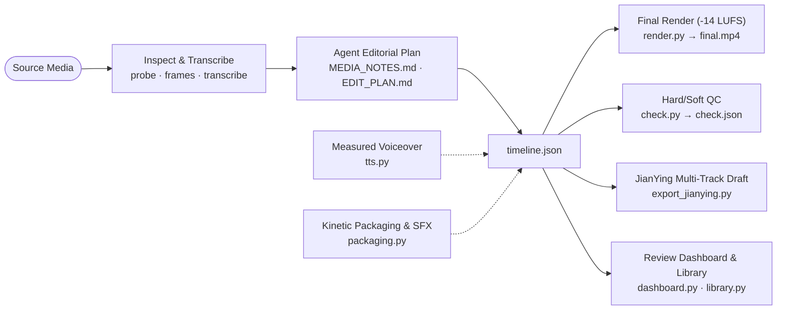

<!-- Last synced with README.md: 2026-11-21 -->
<p align="center">
  
</p>

<h1 align="center">Video Recap Skills</h1>

<p align="center">
  <b>Turn your coding agent into a seasoned video editor and storyteller: real editorial craft, frame-grounded cutting, coherent voiceover mixing, kinetic packaging, and JianYing/CapCut draft export for Claude Code, Codex CLI, OpenCode, and OpenClaw.</b>
</p>

<p align="center">
  <a href="https://zenstory.ai/video-recap"><b>Project page</b></a>
  &nbsp;·&nbsp;
  <a href="#why-the-edits-actually-hold-up"><b>Editorial Craft</b></a>
  &nbsp;·&nbsp;
  <a href="#install"><b>Install</b></a>
  &nbsp;·&nbsp;
  <a href="#quick-start"><b>Quick start</b></a>
  &nbsp;·&nbsp;
  <a href="#how-it-works"><b>Architecture</b></a>
  &nbsp;·&nbsp;
  <a href="README.md"><b>中文</b></a>
</p>

<p align="center">
  <a href="https://github.com/zenstory-ai/video-recap-skills/stargazers"></a>
  <a href="https://github.com/zenstory-ai/video-recap-skills/releases/latest"></a>
  
  <a href="https://www.python.org/"></a>
  <a href="https://github.com/zenstory-ai/video-recap-skills/actions/workflows/skill-validate.yml"></a>
  <a href="./LICENSE"></a>
</p>

https://github.com/user-attachments/assets/f3c2df0c-6869-4f5b-8f4c-cce70b58b667

> Sanitized planning artifacts and post-mortem notes for the 59-second showcase above (*Guohuo*) are published in [examples/guohuo-60s/](examples/guohuo-60s/).

## Why the edits actually hold up

Most AI-edited recap videos fail for editorial reasons, not model limitations—hallucinated plot details, ping-ponging between voiceover and original audio every three seconds, clipped mid-sentence dialogue, sped-up robotic TTS, widescreen shots awkwardly cropped onto empty tables, and boxy template callouts.

We distilled hard-won **video production know-how** directly into the skills and tooling around one principle: **editorial judgment belongs to the multimodal Agent; mechanical execution belongs to minimal local scripts.**

### 1. Look at the actual frames before telling the story
Instead of summarizing blind transcripts, the host Agent inspects timestamped contact sheets (and zoomed crops when needed) so character expressions, actions, and dialogue always line up:
- **One complete story spine per video**: Open in the first 3 seconds with the sharpest conflict or hook—no throat-clearing, no cast roll-call, at most 1–2 core character names.
- **Tell it like a friend, let the scene deliver the payoff**: Voiceover carries setup and motivation without narrating what the viewer already sees or hears; the emotional turn lands on an original line of dialogue and a reaction shot.

### 2. Block-cohesive pacing—curing AI's "ping-pong narration" habit
Alternating 3 seconds of narration with 2 seconds of source audio shatters immersion. Our editing craft enforces calm, cinematic rhythm:
- **Narrate in blocks, return full scenes**: Across a 60-second cut, switch between narration and original audio only **2–4 times**—group setup and fast cuts into coherent **10–25s narration blocks**, then hand back **5–15s of intact original performance** at the climax without ever chopping a sentence in half.
- **No "moving lips with no sound" or leaked dialogue**: Cover narration with listener reactions, gestures, or cutaways rather than talking faces; mute narration-bed clips cleanly so background dialogue never bleeds through ducking release; stick to instrumental BGM whenever narration and source dialogue share the mix.

### 3. Whole-article voiceover—never speed-crushed to fit
Synthesizing isolated lines breaks vocal continuity, and squeezing long lines with `atempo` instantly sounds synthetic:
- **Natural tone and pronunciation control**: With Fish Audio (default free-tier `s2.1-pro-free`), `--whole-article` keeps one consistent vocal arc across the script with inline cues like `[chuckle]` / `[sigh]`, while `spoken_text` separates tricky pronunciations (years, acronyms, heteronyms) from clean on-screen subtitles.
- **Rewrite or extend, never speed up**: Every line is measured for true duration before final assembly; cuts snap to natural sentence pauses with breathing room; 2-line captions wrap at semantic pauses without cluttered trailing punctuation.

### 4. Confirm aspect ratio upfront & frame every shot by eye
- **Framing agreed before editing starts**: Before cutting or rendering, the Agent confirms your target ratio (`3:4` full-bleed / `9:16` vertical / `16:9` landscape) and framing (`cover` vs. `contain`).
- **3:4 full-bleed drama framing**: Rather than marooning widescreen footage inside thick black bars, each shot gets an eye-checked `focus` point; shot/reverse-shot conversations split cleanly at source cuts so every frame locks onto faces and expressions—not empty desks or blurry turns.

### 5. Editorial kinetic packaging—tasteful, adaptive, never cookie-cutter
- **Remotion transparent overlay as a creative canvas**: Ships with a modern editorial magazine starting point (`drama-recap`: frameless stacked kinetic typography, warm ivory-gold accent, subtle top/bottom scrims) meant to be tuned to each film's mood rather than stamped from a rigid template.
- **Subtext-only callouts & real SFX**: Short 4–8 word callouts highlight subtext without covering faces or subtitles; sound effects use real audio assets placed safely away from narration and source dialogue. No Node.js installed? Fall back seamlessly to offline PNG themes.

### 6. Hard gates for physics, soft hints for taste
Rigid word-rate cutoffs and keyword regexes routinely reject great artistic moments. Quality control is split cleanly into two tiers:
- **Hard gate (`fail`)**: Only 100% deterministic physical breakage—corrupt streams, missing video/audio, invalid dimensions.
- **Soft gate (`warn` + `review_hints`)**: Context-dependent flags like dark transitions, freeze holds, low loudness, edge audio, or possible overlaps surface as a concise checklist for the Agent to inspect visually instead of blocking good shots.

## How it works

The pack ships two self-contained skills: **`video-recap`** (general-purpose editing and narration) and **`video-reference`** (on-demand local analysis of reference videos into reusable, sanitized `REFERENCE_NOTES.md`).

- **Zero third-party Python dependencies, 100% local by default**: Runs on Python 3.10+ stdlib and `ffmpeg` / `ffprobe`—no `pip install`, no mandatory API keys. Remote calls happen only when you explicitly opt into cloud ASR or cloud TTS (see [Remote Services](skills/video-recap/references/remote-services.md)).
- **Markdown for humans, `timeline.json` for machines**: Creative artifacts (`BRIEF.md`, `MEDIA_NOTES.md`, `EDIT_PLAN.md`, `PROMO.md`) stay readable Markdown. Cutting, voiceover, mixing, packaging, subtitles, QC, and export all share one canonical `timeline.json` with zero manifest locks—tweaking one shot or line re-runs only that step.



| Skill | Components | Core Deliverables |
|---|---|---|
| [`video-recap`](skills/video-recap/) | 6 core atomic CLIs (`probe.py`, `frames.py`, `transcribe.py`, `tts.py`, `render.py`, `check.py`) + 4 optional companion tools (`packaging.py`, `export_jianying.py`, `dashboard.py`, `library.py`) | `out/final.mp4`, `timeline.json`, `check.json`, `out/review.html`, `out/jianying_draft/` |
| [`video-reference`](skills/video-reference/) | 1 local-only analyzer CLI (`analyze_reference.py`): measures cuts, shot-length stats, loudness/audio density, and renders a contact sheet | `reference_metrics.json`, `contact_sheet.jpg`, `REFERENCE_NOTES.md` |

## Install

### 1. Prerequisites

Only **Python 3.10+** and **`ffmpeg` / `ffprobe`** on `PATH` are required (100% local by default):

```bash
brew install ffmpeg          # macOS (for burned-in libass subtitles, install ffmpeg-full)
```

For optional remote ASR or TTS backends, set the corresponding environment variables (`ASR_API_URL` + `ASR_API_KEY`, or `FISH_API_KEY` / `OPENAI_API_KEY` / `INDEX_TTS_ENDPOINT`); see [Remote Services](skills/video-recap/references/remote-services.md).

### 2. Add to your coding agent

In **Claude Code**:

```text
/plugin marketplace add zenstory-ai/video-recap-skills
/plugin install video-recap-skills@video-recap
```

<details>
<summary><strong>Codex CLI · OpenCode · OpenClaw installation</strong></summary>

**Codex CLI**

```bash
codex plugin marketplace add zenstory-ai/video-recap-skills
codex plugin add video-recap-skills@video-recap
```

**OpenCode**: per the [official Agent Skills documentation](https://opencode.ai/docs/skills/), project skills live under `.opencode/skills/<name>/SKILL.md`:

```bash
git clone https://github.com/zenstory-ai/video-recap-skills.git
cd video-recap-skills
mkdir -p .opencode
ln -s ../skills .opencode/skills
opencode debug skill
```

**OpenClaw**: clone the repository and import the plugin bundle:

```bash
openclaw plugins install ./video-recap-skills
openclaw skills list
```

</details>

ClawHub packages are tracked in [.clawhub/publish.json](.clawhub/publish.json); release history lives in [CHANGELOG.md](CHANGELOG.md).

## Quick start

No CLI flags to memorize—describe your footage and creative goal in plain language:

```text
# 1. Multi-source story recap (contact-sheet grounded, block narration + intact dialogue)
Use /path/to/ep1.mp4 and /path/to/ep2.mp4 to make a 3-minute narrated recap with a single story spine, preserving key original dialogue and reactions.

# 2. Pure original-audio highlight cut / podcast clip (100% local, no voiceover)
Cut /path/to/interview.mp4 into a 90-second 9:16 vertical highlight with blurred backdrop and safe-zone captions, no narration.

# 3. 3:4 full-bleed drama packaging (Remotion editorial callouts + JianYing/CapCut draft)
Edit /path/to/clip.mp4 as a 3:4 full-bleed recap with Remotion frameless stacked callouts and real transition SFX, render the final video, and export a JianYing draft.

# 4. Local screening & iteration
Build an offline review.html or launch the read-only local dashboard to review the cut, synced subtitles, and review hints.

# 5. Study a reference video locally (video-reference)
Analyze /path/to/reference.mp4 for shot pacing, dialogue balance, and visual layout, and distill reusable notes into REFERENCE_NOTES.md.
```

## Screening dashboard & JianYing export preview

Beyond rendering the final MP4, export a clean multi-track JianYing/CapCut draft for fine-tuning or open the zero-server screening dashboard in your browser:


## Documentation

| Category | Links |
|---|---|
| **Editorial Craft & Skill Specs** | [Editorial Craft](skills/video-recap/references/editorial-craft.md) · [Packaging & SFX](skills/video-recap/references/packaging-and-sfx.md) · [timeline.json v3 Contract](skills/video-recap/references/timeline-schema.md) · [JianYing Export](skills/video-recap/references/jianying-export.md) · [Dashboard & Library](skills/video-recap/references/material-library.md) · [Remote Services](skills/video-recap/references/remote-services.md) |
| **Architecture & Boundaries** | [Architecture Overview (ZH)](docs/architecture.md) · [Production Boundaries (ZH)](docs/production-boundaries.md) · [Multi-track Timeline & JianYing Protocol](docs/timeline-and-jianying.md) · [Test Suite (ZH)](tests/README.md) |
| **Case Study & Guides** | [*Guohuo* Artifact Directory](examples/guohuo-60s/) · [Recap Script Writing (ZH)](docs/video-recap-script-writing.md) · [Grounding Analysis Without Invented Plot (ZH)](docs/ai-video-analysis-without-invented-plot.md) |

## Acknowledgements & License

- Thanks to the [LINUX DO](https://linux.do) community; JianYing protocol skeletons reference [pyJianYingDraft](https://github.com/GuanYixuan/pyJianYingDraft), [capcut-mate](https://github.com/Hommy-master/capcut-mate), and [duo-video](https://github.com/duoec/duo-video).
- MIT License — see [LICENSE](LICENSE).

## Part of ZenStory AI

| Project | What it does |
| --- | --- |
| [oh-story-claudecode](https://github.com/zenstory-ai/oh-story-claudecode) | Web-fiction writing skill pack: chart scanning, deconstruction, drafting, de-AI-flavor polish, and cover design |
| [drama-skills](https://github.com/zenstory-ai/drama-skills) | AI short-drama / motion-comic suite: scripts, character assets, storyboards, prompts, and independent review |
| [novel-to-game](https://github.com/zenstory-ai/novel-to-game) | Agent skills for source-grounded novel adaptation, runtime builds, and blind-playtest QA |
| [video-recap-skills](https://github.com/zenstory-ai/video-recap-skills) | General-purpose AI video editing & recap skill pack with editorial craft, atomic CLIs, kinetic packaging, and JianYing export (this repo) |
| [oh-story-dsh](https://github.com/zenstory-ai/oh-story-dsh) | Community DeepSeek Harness plugin integrating novel, short-drama, game, and video-recap workbenches |
| [zenstory](https://github.com/zenstory-ai/zenstory) | Chat-to-create AI novel-writing workbench ([app.zenstory.ai](https://app.zenstory.ai)) |
